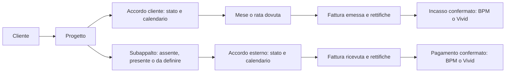
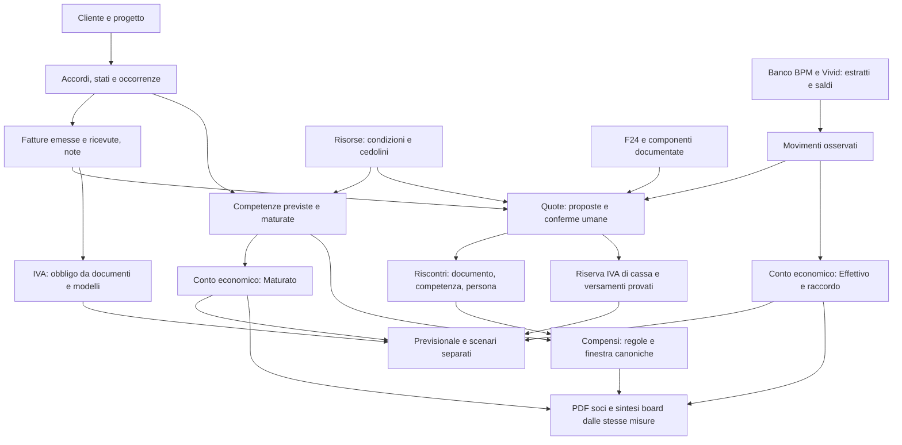
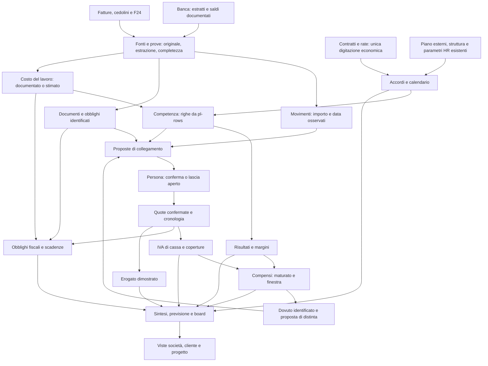
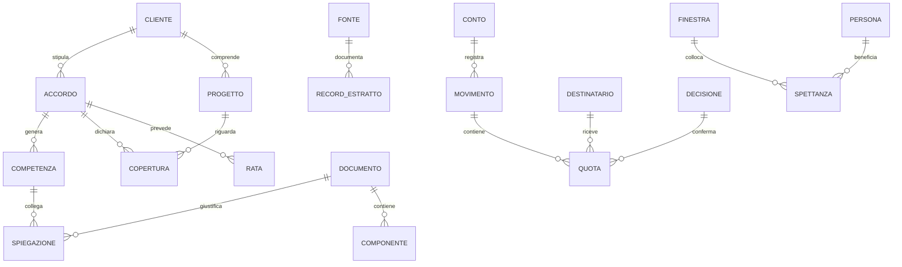

# Progetto dei moduli Economics

Progetto avviato il 12 novembre 2026, approvato il 14 novembre 2026. **Step 1–9 confermati; avviata l'esecuzione autorizzata nel Laboratorio.** Il disegno corrente parte dal cliente e dalla catena accordo → fattura → banca. La precedente architettura a sette moduli è archiviata e non è il piano da implementare. Accordi, Banca e Fatturazione in verifica, nessuna promozione, migration o scrittura sui dati di produzione. Pubblicazione del lavoro Lab su `main` autorizzata dall'utente dopo la verifica locale.

**Lettura rapida:** gli Step 1–5 descrivono l'esperienza richiesta; lo Step 6 definisce moduli e dati; gli Step 7–8 fissano promozione e controlli; lo Step 9 organizza l'esecuzione e raccoglie le decisioni residue. Il materiale dopo «Archivio non prescrittivo» conserva le evidenze iniziali e non sostituisce il piano corrente. L'approvazione del progetto non equivale all'autorizzazione a implementarlo.

## Avvio esecutivo autorizzato — 14 novembre 2026

**Nuovo mandato dell'utente:** progetto approvato; avviare i passi iniziali e rifare il Laboratorio, sostituendo gradualmente le sezioni esistenti quando pronte. Questo incarico autorizza le modifiche applicative necessarie al Lab e supera il precedente limite di scrivere soltanto questo documento. Restano DB in sola lettura, Lab senza scritture, gate, cronologia e criteri di promozione approvati. L'approvazione del progetto e l'incarico esecutivo sono due eventi distinti. Nessuna promozione viene dichiarata dal solo avvio del lavoro.

### Dossier iniziale: fatti letti e limiti

**Evidenza DB, non deduzione dal repository:** SELECT PostgREST con client di servizio locale, autorizzato, il 14 novembre 2026. Letture separate, non snapshot transazionale; nessun comando mutante. Le query non restituiscono definizioni dei trigger/grant: quella verifica resta aperta. Non si stampa né si conserva qui alcuna credenziale. I risultati economici sotto sono registrati per perimetro e istante; non vanno reinterpretati come saldi completi o aggiornati automaticamente.

| Verifica | Risultato osservato | Cosa non dimostra |
|---|---|---|
| Conti | Due conti principali attivi: Banco BPM e Vivid; tre sottoconti Vivid dei soci, con `parent_id` e proprietario. Tutti in EUR. | Non dimostra che sommare padre e figli rappresenti il saldo consolidato corretto. Nessun consolidato automatico nella nuova vista. |
| Movimenti banca ottobre 2026, lettura 14:10 UTC | BPM: 26 movimenti, entrato 13.206,50 €, uscito 18.907,66 €, ultimo 30 ottobre. Vivid principale: 29 movimenti, entrato 5.037,86 €, uscito 4.270,21 €, ultimo 27 ottobre. Giroconti inclusi nei flussi bancari. | Non sono ricavi/costi economici né prova di estratti completi; non si sommano i flussi dei due conti come fatturato. |
| Movimenti banca novembre fino al 14, stessa lettura | BPM: 8 movimenti, entrato 12.200,00 €, uscito 5.655,50 €. Vivid principale: 11 movimenti, entrato 2.237,00 €, uscito 1.360,28 €. Ultimo movimento di entrambi il 12 novembre. | Novembre è parziale; l'assenza di record del 13/14 non dimostra assenza di operazioni. |
| Tre sottoconti | Nessun movimento di origine banca nei due mesi interrogati. | Non prova saldo reale zero o chiusura dei conti; la nuova pagina parla di record registrati e copertura da verificare. |
| Chiusura dichiarata | Vivid: 381,43 € al 21 settembre; apertura + movimenti fino alla stessa data = 381,43 €, scarto 0,00 €. BPM senza chiusura dichiarata nel record. | La coincidenza di settembre non certifica ottobre/novembre; per BPM scarto n/d, non zero. |
| Registri letti, 14:30 UTC | 338 movimenti complessivi in archivio, 159 quote `payment_allocations`, 120 fatture, 62 righe ricavo, 128 righe costo, 8 mesi PL. Nessuna quota orfana rispetto ai movimenti letti nella precedente verifica. | Nessuna prova generale di capienza, concorrenza, trigger o equivalenza con i legami legacy. Il conteggio di quote orfane non è un audit completo delle quote. |
| Catena entrata campione | Movimento del 9 novembre, +7.930,00 €, collegato direttamente a fattura emessa dello stesso totale e riga di competenza ottobre con riferimenti a contratto/rata; nessuna quota nel registro per quel movimento. | È una catena diretta legacy, non prova della futura autorità unica né dell'attribuzione completa a progetto. |
| Catena uscita campione | Movimento del 9 ottobre, −483,12 €, collegato direttamente a fattura ricevuta di 483,12 €; nessuna riga costo diretta né quota per quel movimento. | Il pagamento del documento non identifica da solo accordo esterno o competenza. La differenza di rappresentazione deve essere gestita dal registro futuro. |
| Distinta risorse | `bank_tx_payslips`: 6 collegamenti complessivi. Movimento del 19 ottobre di −4.100,00 € spiegato da tre quote di 1.500,00 €, 1.600,00 € e 1.000,00 €, tutte a cedolini di settembre. | La somma quadra la distinta; non certifica costo completo individuale né compensi di ottobre. Il primo tentativo di lettura con ordinamento `id` era invalido: ripetuto sulle chiavi effettive `tx_id,payslip_id`. Nessuna assenza di dati dedotta dall'errore. |
| F24 e IVA | Tre modelli F24, 11 componenti; due quote con `f24_id`. Campione da 692,42 € collegato a movimento del 17 settembre e modello esistente. In `vat_settlements` compare soltanto il secondo trimestre 2026, `to_pay` 9.669,33 €, `paid_on` 20 agosto. | Non dimostra l'avvenuto versamento del terzo trimestre né la sua cifra dovuta; non basta per ricostruire riserva/riporti. La quota F24 campione non viene identificata come tutta IVA. |

**Esito dei tre passi iniziali:** perimetro e campioni letti; dossier della prima capacità predisposto; restano non verificabili da queste sole SELECT copertura degli estratti originali, definizioni effettive di grant/trigger, tutte le capienze e confronto vecchio/nuovo su snapshot coerente. La connessione in sandbox inizialmente falliva per DNS; la lettura autorizzata fuori sandbox è riuscita. Non si dichiara completata la fase 1 esecutiva per le parti ancora aperte.

### Prima capacità realizzata nel checkout

- Home `/lab` ricomposta secondo i sei moduli approvati; esperimenti precedenti mantenuti separatamente per il confronto. Gli altri nuovi moduli sono esplicitamente da costruire.
- `/lab/banca` in sola lettura: filtro mese e conto, entrate/uscite lorde di origine banca, saldo ricostruito dal motore `balance`, confronto del saldo dichiarato alla stessa data e provenienza visibile. Nascosti/giroconti conservati nella cassa; manuali e derivati esclusi. Nessuna conversione valutaria implicita.
- Loader server-only con gate esplicito prima del client di servizio, SELECT paginate con conteggio esatto e controllo delle duplicazioni di ID. Errori, valori mancanti o lettura incompleta non diventano totali zero. Nessuna garanzia di snapshot transazionale dichiarata.
- Residuo riconciliato n/d: riferimenti diretti, quote e distinte non sono fusi arbitrariamente in una certificazione. Consolidato n/d fino a verifica del perimetro padre/sottoconti.
- Gate nuovo `lib/lab-bank.check.ts`: fatti di cassa separati da dichiarazioni, nascosti/giroconti, data del saldo dichiarato, periodo futuro, apertura incoerente, mesi e fusi; regressione statica su gate e assenza di mutazioni/import di endpoint nei nuovi ingressi.

Questa capacità è **in verifica**, non «promossa». Nessuna sezione Economics in uso è sostituita e nessuna nuova conferma/import è attivata. La prova visiva autenticata e dei permessi dei diversi ruoli resta aperta: il browser integrato non ha sessioni disponibili; la richiesta HTTP anonima a `/lab/banca` restituisce redirect 307 a `/login`.

**Riferimenti implementativi verificati:** sei ingressi in `app/(dashboard)/lab/page.tsx:6`; nuova pagina in `app/(dashboard)/lab/banca/page.tsx:11`; gate del loader in `lib/lab-bank-load.ts:24`, gate prima del client di servizio in `lib/lab-read.ts:8` e paginazione in `lib/lab-read.ts:12`; calcoli e raccordo in `lib/lab-bank.ts:37`. Alla prima consegna Banca: **129/129 gate passati con TZ Europe/Rome**, incluso il nuovo controllo; gate Banca passato anche con UTC e America/Los_Angeles. TypeScript senza errori; manifest e lockfile invariati. Verifiche documentali/token superate. Questi esiti non certificano copertura degli estratti, permessi autenticati o resa visiva.

**Prossima verifica necessaria:** estratti originali e perimetro dei due conti, lettura autenticata della nuova pagina e confronto ripetibile con la lettura attuale; poi registro documentale/quote condiviso di Banca e Fatturazione. Nessun saldo o certificazione verrà forzato per anticipare questa sequenza.

### Seconda capacità: Fatturazione in sola lettura

**Avanzamento successivo autorizzato:** dopo il primo checkpoint applicativo l'utente conferma di procedere. La nuova `/lab/fatturazione` legge emesse e ricevute, mantiene ricerca e filtri su tutte le date e separa stato del registro e riscontro bancario. La precedente pagina, limitata alle emesse, è conservata in `/lab/fatturazione/precedente` per il confronto.

**Fatti verificati sul repository:** il nuovo loader riusa il mapper `toInvoices` e i motori `invoiceStatus`, `isOpen`, `txCandidates`, senza cambiare le regole delle pagine in uso (`lib/lab-invoices-load.ts:12`, `lib/lab-invoices.ts:13`). La lettura paginata e protetta è condivisa con Banca in `lib/lab-read.ts:7`. Fattura e movimento si aprono reciprocamente sul contesto preciso. Note di credito/debito conservano i riferimenti e vengono risolte prima dei filtri; una nota di debito non annulla l'originale.

**Scelta di provenienza:** «pagata nel registro» non è «pagamento provato». I bonifici di origine banca direttamente collegati sono esposti con data, conto, importo e valuta; manuali/derivati separati. Il loro totale non viene presentato come quota della fattura o come residuo: cumulativi, ritenute, acconti e storni parziali richiedono il registro unificato. Il residuo certificato resta n/d. Le proposte escludono movimenti impegnati nel registro quote o in altri legami, nascosti, giroconti, finanziamenti, stipendi, imposte, valute non confrontabili e fatti futuri; nessun aggancio viene salvato. Le contese sono calcolate su entrambe le direzioni prima dei filtri visivi. Niente proposta sul vecchio lordo di un documento stornato parzialmente.

**Nuova lettura DB del 14 novembre 2026, 14:54 UTC:** 120 fatture, di cui 56 emesse e 64 ricevute, tutte in EUR; nessun importo obbligatorio mancante nelle colonne interrogate. Quattro documenti hanno `paid_on` senza alcun movimento di origine banca direttamente collegato; esistono 84 movimenti banca con `invoice_id`. Questi conteggi non certificano pagamenti, coperture complete o errori dei quattro documenti: possono esistere altre spiegazioni legacy da riconciliare. Verificata la leggibilità delle colonne currency/withholding/paid_amount usate dalla nuova pagina; nessun dato modificato.

**Prove richieste per questa capacità:** gate `lib/lab-invoices.check.ts` su pagato senza banca, acconto, verso errato, derivato/manuale, valuta differente, candidato conteso/occupato e note di credito/debito; controllo statico delle dipendenze readonly e regressione Banca sul lettore condiviso. Il redirect anonimo locale è 307 verso `/login`. Esiti della raccolta completa e TypeScript riportati al checkpoint esecutivo sotto; prova visiva autenticata e promozione ancora aperte.

**Esito verifiche della seconda capacità:** TypeScript senza errori; **130/130 gate passati con TZ Europe/Rome**. Entrambi i gate Banca/Fatturazione passano anche con TZ UTC e America/Los_Angeles. Controllati diff e token; manifest e lockfile invariati. Nessuna scrittura DB o modifica alle pagine Economics in uso. Il lettore condiviso è stato introdotto senza cambiare la regola `balance`; la prova visiva autenticata resta da svolgere.

### Correzione caricamento e prosecuzione con Accordi

L'utente segnala un chunk non caricato e chiede di correggere main, ripristinare
l'accesso alle sezioni e proseguire. La lettura HTTP conferma la produzione su
`813dd42` e il chunk segnalato con risposta 200: cambio versione/cache o errore
transitorio restano ipotesi, non causa certificata. Corretto il recupero che
usava solo `reset()`: una ricarica completa massima per build/scheda, nessuna
automatica offline/storage negato, poi pulsante manuale. Errori economici e
permessi non provocano reload automatici. Build di produzione, TypeScript e
131 gate passati; otto chunk dei moduli Lab serviti con HTTP 200 dal build
locale. Push `d759615`, versione verificata anche in produzione. La prova nel
browser autenticato resta aperta e non viene sostituita dal controllo asset.

**Terza capacità:** `/lab/accordi`, con gate esplicito nel server e nel loader,
cliente/progetto e patto unici, rate e link alle fatture dalle righe collegate.
Importi mancanti n/d, importi noti a zero conservati; nessuna somma arbitraria
dei canoni con il venduto a corpo. Fonte della copertura `coveredProjects`,
accordi condivisi esposti una volta; relazione singola incoerente segnalata
senza aggirare il motore. Il margine del progetto condiviso resta n/d. I
progetti privi di accordo attribuibile sono visibili, senza valore inventato.

**Stati:** bozza = da avviare con patto ancora da confermare; attivo con avvio
futuro = da avviare con fonte esplicita; attivo/sospeso/concluso conservati.
Fine nel passato e stato attivo sono un'anomalia visibile, non una chiusura
automatica. Le rate dei conclusi restano consultabili; le spunte
fatturato/pagato sono dichiarazioni, non prova documentale/bancaria. I patti
esterni sono mostrati anche se non attivi, senza tradurre automaticamente un
booleano nei nuovi stati. I subappalti di un progetto non vengono duplicati
come nuovi costi per ogni accordo che lo copre.

**Dati reali letti per questa capacità:** 18 accordi (13 attivi, uno sospeso,
quattro conclusi), 20 rate, 21 relazioni accordo/progetto, 62 righe ricavo e
128 righe costo. Verificata la leggibilità delle colonne usate per i legami
stream/rata/fattura e costo/patto/fattura. Nessuna scrittura. Le quantità non
dimostrano completezza degli originali né riconciliazione dei saldi.

**Riferimenti:** `lib/lab-deals.ts:3` per stati, `lib/lab-deals.ts:15` per copertura e
`lib/lab-deals.ts:31` per selezione delle righe della singola rata;
`lib/lab-deals-load.ts:17` per il gate; `lib/lab-read.ts:7` per paginazione anche
su chiavi composte; `lib/lab-deals.check.ts:1` per stati,
null/zero, copertura ambigua e divieto di assegnare la fattura di una rata alle
altre. Nessuna sezione in uso sostituita. Esiti finali di questa capacità al
checkpoint esecutivo.

**Esito terza capacità:** TypeScript e 132 gate passati; build di produzione
completato. Tutti i sei chunk di Accordi presenti e serviti con HTTP 200 nel
server locale; richiesta anonima al modulo con redirect a login. Nessun
permesso allargato, nessuna scrittura o migration. La verifica autenticata dei
contenuti e il confronto formale restano necessari prima di promuovere.

## Proposta corrente — Step 1: cliente, progetto, accordi e riscontri

### Mandato e decisioni ricevute

**Requisiti dell'utente:** il percorso parte dal cliente; ogni nuovo progetto deve avere il proprio accordo economico, eventualmente un subappalto, e riscontri con Fatturazione e Banca. La stessa catena deve rimanere ricostruibile quando il lavoro è concluso. I conti indicati dall'utente sono **Banco BPM, principale**, e **Vivid, secondario**: è il perimetro operativo richiesto, non una nuova verifica del DB.

**Chiarimento ricevuto:** «pending» comprende due situazioni, da distinguere. I nomi raccomandati sono **Da avviare**, **Attivo**, **Sospeso**, **Concluso**. Non si usa la parola pending anche per dire che una fattura aspetta il pagamento.

**Priorità corrente:** definire e approvare questa catena base prima di riprogettare le altre sezioni. Non si prosegue con la vecchia Fase 4 di promozione. Le evidenze dell'inventario restano valide salvo successiva verifica, ma i confini della vecchia architettura non vincolano il nuovo disegno.

**Esito del checkpoint Step 1:** l'utente conferma il flusso cliente/progetto/accordo, il percorso speculare del subappalto, i quattro stati distinti e la separazione dai riscontri documentali/bancari. Si procede con il dettaglio di «Costi risorse & tasse».

**Input economici richiesti:** accordi cliente, accordi di subappalto e accordi con professionisti, con i relativi piani, sono le fonti contrattuali da rappresentare. Il netto fisso mensile manuale del dipendente è un'**eccezione esplicita richiesta dall'utente** al vincolo generale sulla digitazione: è il netto concordato, non il costo reale né la prova del pagamento. L'eccezione non autorizza modifiche manuali a importi bancari, fatture, cedolini, imposte o risultati. Il disegno precedente che impediva in assoluto quel netto è superato da questa istruzione. Il mapping degli accordi esterni sul modello corrente dovrà essere ridisegnato senza presumere che `cost_items` contenga già tutti gli stati necessari.

### Il flusso principale

**Raccomandazione:** dalla scheda cliente si apre o si crea il progetto e si definisce l'accordo con importo pattuito, growth/digital, validità, stato, commerciale e calendario delle rate o del canone. Quando il progetto parte, l'accordo deve essere identificato; se non è ancora definito si dichiara «accordo da definire», con valore n/d. Il progetto operativo non deve sparire né ricevere un importo zero fittizio per completare il form. La nuova validazione all'avvio economico è parte del progetto, non una garanzia già presente nel codice.

Il contratto si vede da cliente e progetto con **la stessa identità**. Ogni occorrenza mensile/rata dovuta porta ai documenti emessi e alle quote degli incassi confermati. Banca e Fatturazione permettono il percorso inverso fino all'accordo e al progetto. Nessuna pagina mantiene una propria casella «pagato» indipendente dalle prove.

L'assenza di una freccia nel dato reale è una cosa da completare, non una ragione per inventare il collegamento. Le proposte del sistema sono confermate da una persona e il comando registra l'attore; nessun match diventa certo per il solo importo uguale. Questo conserva la regola del Lab (`docs/lab.md:52`) e l'attribuzione richiesta (`docs/cronologia.md:15`).

**Fatti verificati nel codice:** gli accordi attuali distinguono bozza/attivo/sospeso/concluso (`lib/revenue.ts:21`) e gli importi per mese si costruiscono da canoni/rate (`lib/revenue.ts:139`). I nuovi nomi e le loro transizioni sono proposta corrente: non si associa automaticamente «Da avviare» a tutte le bozze storiche. Una bozza non venduta e un accordo già firmato ma con avvio futuro sono fatti diversi, da conservare nella validazione. Il loro dettaglio tecnico non cambia la lettura semplice per l'utente.

### Stato del lavoro e stato dei riscontri sono separati

| Stato dell'accordo | Significato raccomandato | Cosa rimane da collegare |
|---|---|---|
| **Da avviare** | Il servizio non è partito; distinguere se il patto è ancora da confermare o è già concordato con avvio futuro. | Eventuali anticipi e documenti già esistenti; nessun lavoro futuro è presentato come maturato solo perché è previsto. |
| **Attivo** | Il patto produce le occorrenze previste nel suo periodo di validità. | Per le occorrenze dovute: fatture e incassi, anche parziali; quelle future restano calendario. |
| **Sospeso** | L'attività è temporaneamente ferma, con data di decorrenza della sospensione e ripresa esplicita. | Le partite già maturate, emesse o pagate restano da riconciliare. La sospensione non cancella un credito o un debito. Il trattamento dei canoni nella sospensione deve essere dichiarato dal patto, senza presumere proroghe o sconti. |
| **Concluso** | Il lavoro/accordo è terminato, con data effettiva. | Restano visibili saldo, rate finali, fatture, incassi e rettifiche. Nessun rinnovo ricorrente implicito dopo la fine. |

**Regola di chiusura raccomandata:** «Concluso» descrive il lavoro; **«Riconciliato»** descrive i riscontri. Un accordo concluso può essere «da fatturare», «da incassare», «parzialmente incassato» o «da verificare». È riconciliato soltanto quando tutte le occorrenze dovute sono spiegate da documenti/pagamenti o da rettifiche documentate che ne giustificano la differenza. Nessun saldo nullo viene assunto per il solo stato concluso. Le rate dei conclusi sono già conservate dal motore attuale (`lib/revenue.ts:136`): il nuovo flusso non deve perderle.

Per evitare un'interfaccia piena di stati, la riga mostra **stato dell'accordo + prossima cosa da fare**. Il dettaglio conserva tre controlli autonomi: accordo/occorrenza, documento, pagamento. La sintesi non nasconde che possano mancare due riscontri insieme.

| Occorrenza dovuta | Documento | Banca | Lettura visibile |
|---|---|---|---|
| Presente | Mancante | Nessuna quota confermata | **Da fatturare e incassare** |
| Presente | Emesso | Nessuna quota confermata | **Da incassare**, con scadenza e motivo |
| Presente | Emesso | Quota parziale | **Incasso parziale**, con residuo |
| Presente | Emesso | Copertura integrale confermata | **Riconciliata**, se anche il documento è attribuito alla corretta occorrenza |
| Presente | Mancante | Anticipo ricevuto confermato | **Incasso ricevuto, documento da collegare/emettere**: l'incasso resta un fatto, senza creare una fattura fittizia |
| Presente | Rettificato | Pagamento precedente presente o assente | **Da verificare sul residuo rettificato**; un eventuale rimborso è un altro movimento, non sparisce |
| Mancante o non attribuibile | Presente o movimento presente | Qualsiasi | **Accordo/occorrenza da collegare**, con il valore del fatto noto e attribuzione n/d |

La tabella si applica specularmente agli esterni: «da fatturare/incassare» diventa «fattura da ricevere/pagamento da effettuare». Le scadenze future non diventano errori prima che siano dovute. I badge di ritardo dipendono dalla scadenza, non dallo stato attivo/concluso del progetto.

### Subappalto: stesso percorso, verso opposto

**Raccomandazione:** ogni progetto dichiara **nessun subappalto**, **subappalto presente** oppure **da definire**. «Nessuno» è una scelta esplicita e documentabile; un elenco vuoto non prova costo esterno zero. Con subappalto presente si registra il fornitore, il patto economico, tipo/frequenza, periodo, stato e rate; quando determinabile, il legame con la rata cliente finanziata.

Lo stato esterno è indipendente da quello del cliente: il progetto può continuare mentre il subappalto è concluso, oppure il fornitore può ancora attendere un saldo a progetto terminato. Si applicano gli stessi stati **Da avviare / Attivo / Sospeso / Concluso** e la stessa distinzione fra conclusione e riconciliazione. Per ciascuna occorrenza: patto esterno → fattura ricevuta → quota di uscita confermata. La data attesa di pagamento discende dal patto; lo stato attivo non dimostra che la fattura sia già ricevuta o pagata.

**Fatto verificato:** il modello corrente collega il costo esterno alla rata e ne determina il mese prima del ripiego per progetto (`lib/subcontracts.ts:115`; `docs/economics-contratti.md:254`). Questo legame va mantenuto; non si sottrae un costo una seconda volta perché lo stesso professionista compare anche in «Costi risorse & tasse». Patto, fattura ricevuta e pagamento hanno una sola identità, visibile da entrambe le sezioni.

### Banca e Fatturazione: il collegamento è bidirezionale

**Raccomandazione:** i movimenti vengono dai due conti indicati, associati ai loro identificativi reali verificati al momento dell'implementazione. I nomi BPM/Vivid sono etichette visibili, non chiavi scritte nei calcoli. Saldo per conto e consolidato partono dai fatti bancari; flussi economici e giroconti hanno raccordi espliciti.

| Movimento | Collegamento economico richiesto | Come si considera spiegato |
|---|---|---|
| Entrata da cliente | Fattura emessa, relativa occorrenza dell'accordo e progetto/copertura. | Quota confermata del pagamento; se manca un legame, il fatto di cassa rimane e si dichiara cosa manca. |
| Entrata cashback | Evidenza bancaria del cashback e relativa classificazione. | Natura confermata; non si inventano fattura cliente, progetto o provvigione. La sola controparte Vivid non basta a classificare qualsiasi entrata come cashback. |
| Uscita fornitore/professionista | Fattura ricevuta e relativo patto/subappalto o costo spiegato. | Quota confermata, residuo e competenza conservati. |
| Uscita stipendio | Cedolino e dipendente; eventuale distinta con i suoi componenti. | Netto documentato e quota pagata coincidono per la parte dimostrata; F24 collegato separatamente per i relativi oneri. |
| Uscita tassa/contributo/IVA | Modello o obbligo documentato, periodo e componenti pertinenti. | Pagamento confermato al modello/obbligo; il totale e le sue componenti non sono altre uscite da sommare. |
| Giroconto BPM ↔ Vivid | Movimento opposto dell'altro conto, senza fattura commerciale. | Entrambi i lati spiegati; il trasferimento non crea ricavo, costo o nuova liquidità consolidata. |
| Altra natura o riscontro insufficiente | Evidenza specifica da identificare. | **Da spiegare**, finché non è nota. Rimborsi, finanziamenti e altri fatti non diventano fatture o cashback per far chiudere l'elenco. |

**Fatti verificati:** il dominio distingue saldo reale e dichiarato (`docs/banca.md:7`); i nascosti possono muovere il saldo senza essere costi della società (`docs/banca.md:87`); il codice già riconosce una famiglia «Banca e cashback» (`lib/bank-import.ts:544`). Queste condizioni vanno conservate anche se il flusso normale è fattura ↔ pagamento. Non si scartano movimenti veri per restringere artificialmente le categorie.

**Quote e parziali:** una fattura può avere più pagamenti e un pagamento può coprire più fatture. Si confermano quote, non il pagamento intero per ogni link; la somma non supera il movimento. Il vincolo esiste già nel dominio (`lib/allocations.ts:25`). Il legame fattura → rata/progetto spiega la stessa quota e non consuma una seconda volta il denaro. Anticipi, sovrapagamenti o ripartizioni non dimostrabili restano visibili; nessun match per sola uguaglianza numerica.

### Fatture, attesa e rettifiche

**Raccomandazione:** in Fatturazione ogni emessa o ricevuta mostra il proprio patto/occorrenza quando applicabile e lo stato del riscontro: **Da incassare/pagare**, **Parziale**, **Pagata con banca**, **Rettificata**, **Da collegare**. Una rettifica non è un pagamento; «rettificata» può convivere con un residuo ancora aperto. I documenti restano apribili nei due versi, dall'accordo e dal movimento.

**Correzione necessaria rispetto alla descrizione iniziale:** la **nota di credito** riduce o annulla il documento per la parte dichiarata; la **nota di debito** integra l'importo, non lo storna. Il documento di rettifica deve essere collegato alla fattura precisa e conservato, non soltanto allegato senza effetto sul residuo. È una regola verificata del dominio attuale (`docs/economics-fiscale.md:169`; `lib/invoices.ts:74`). Una fattura stornata già pagata può lasciare un rimborso o credito da spiegare; non la si considera automaticamente riconciliata su entrambi i piani.

Un eventuale «in attesa» è sempre specificato: **documento atteso**, **incasso atteso** o **pagamento atteso**. Non cambia lo stato di vita dell'accordo e non cancella i documenti storici.

### Come si usa, concretamente

1. **Dal cliente:** apro il progetto e definisco accordo, calendario e presenza del subappalto. Posso lasciarlo da avviare o sospeso, senza inventare valori mancanti.
2. **Carico le fonti una volta:** movimenti BPM/Vivid e fatture. Il sistema propone gli agganci con ragione, residui ed eventuali contese; li confermo sugli stessi fatti.
3. **Torno al progetto:** vedo per ogni mese/rata cosa è pattuito, documentato, incassato e pagato all'esterno; apro direttamente il documento o il movimento che spiega la riga.
4. **Guardo le cose da fare:** accordi senza riscontri, documenti senza accordo, fatture senza pagamento, movimenti senza spiegazione. Un concluso ancora scoperto resta in queste liste.

**Forma della lettura raccomandata:** una riga per mese/rata, espandibile, con **Previsto · Fattura · Banca · Cosa manca**. Il progetto mantiene la propria identità operativa, l'accordo la propria identità economica. Se un accordo copre più progetti resta condiviso senza duplicarne il venduto; il margine del singolo progetto è n/d finché non attribuibile (`lib/revenue.ts:124`).

### Criteri di uscita di questo primo passo

Questo step è una specifica concettuale. Le prove sotto sono requisiti futuri, non test eseguiti o nuovo codice.

- Dal cliente, progetto, fattura o movimento si ricostruisce **la stessa catena**, con gli stessi importi e identificativi; nessuna seconda scrittura del patto.
- Da avviare, attivo, sospeso e concluso non sono confusi con attesa di fattura/pagamento. Un concluso con saldo mancante resta da riconciliare.
- I riscontri sono verificati per **mese/rata dovuta**, anche in presenza di pagamenti parziali/cumulativi, anticipi e rettifiche.
- Un subappalto concluso ma non pagato rimane visibile; uno assente è distinto da uno ancora da definire.
- Un giroconto fra i due conti non produce fatturato, costo o margine; nessun movimento sconosciuto è classificato automaticamente come cashback.
- Proposte senza scritture, conferma umana con `requireEconomicsAdmin()`, quote conservate e cronologia attribuita con `createActorClient(userId)` sulle tabelle loggate.
- Gli scenari si verificheranno estendendo i gate esistenti `lib/revenue.check.ts`, `lib/subcontracts.check.ts`, `lib/invoices.check.ts`, `lib/allocations.check.ts`, `lib/bank.check.ts` e quelli di permessi/attribuzione. Il mapping degli stati nuovi e il tracciamento storico delle sospensioni sono fabbisogni da verificare sul modello dati, senza scrivere migration ora.

## Proposta corrente — Step 2: Costi risorse & tasse

### Scopo e confini

**Proposta:** una sola sezione raccoglie dipendenti e professionisti P.IVA, le condizioni del rapporto, il dossier documentale e il controllo economico mensile. La domanda principale è: **«Per questo mese, quanto era previsto, quali documenti abbiamo, quanto è stato pagato e cosa manca?»**

**Esito del checkpoint Step 2:** l'utente approva il workflow, la distinzione tra netto concordato/documentale/pagato, il controllo separato degli oneri, la scadenza risorse e il riuso delle fatture/subappalti. Si procede con Conto economico, area soci e PDF mensile.

Le tasse qui trattate sono gli obblighi collegati alle risorse e i loro riscontri. Un F24 può contenere anche IVA o altre imposte: il documento e il pagamento restano unici, ma questa sezione legge solo la parte pertinente al personale o al professionista. La futura sezione IVA e il calendario fiscale vedranno le proprie componenti dello stesso modello, senza duplicarlo.

**Requisiti già ricevuti:** netto fisso mensile del dipendente inserito manualmente; condizioni economiche del professionista da accordo; acquisizione di buste paga e F24; professionista collegato a fattura ricevuta e banca; verifica mese per mese; pagamento risorse entro il 20 del mese successivo. Le proposte sotto precisano il workflow, non dichiarano che sia già implementato.

**Regole economiche da conservare, verificate:** costo economico, uscita di cassa e netto percepito sono letture distinte (`docs/personale.md:5`). Gli oneri mancanti restano stimati/dichiarati (`:16`); l'F24 aggregato può confermare una derivazione ma non nomina da solo ogni dipendente (`:62`). Il costo HR entra una sola volta nel conto economico tramite i mapper canonici, senza ricostruire righe a mano.

### Come si presenta

**Raccomandazione:** la sezione si apre sul **controllo del mese**, con filtro **Tutte / Dipendenti / Professionisti** e periodo visibile. Nessun ingresso obbligato in un complesso organigramma per capire se una persona è stata pagata.

In testa, fino a quattro informazioni: **Costo del mese**, **Pagato alle risorse**, **Da pagare alle risorse**, **Da completare**. Il costo è qualificato come documentato/stimato/parziale; il pagato è la quota bancaria confermata riferita alla competenza scelta, non ogni uscita bancaria del mese. Il dettaglio «Uscite nel mese» permette di vedere invece i movimenti avvenuti nel mese civile, anche di altre competenze. Questi due perimetri non condividono un titolo ambiguo.

La tabella principale è: **Risorsa · Previsto · Documento del mese · Pagato e residuo · Cosa manca**. Il costo aziendale e la sua composizione si aprono nella riga; **«Apri risorsa»** porta al dossier, **«Carica documenti»** usa il medesimo ingresso da qualunque punto, **«Collega pagamento»** usa lo stesso comando di Banca. Non si aggiunge una nuova casella «pagato».

Sotto la tabella, il pannello **«F24 e oneri del periodo»** mostra i modelli, le componenti pertinenti, l'eventuale riconciliazione con i cedolini e i pagamenti. L'importo totale del modello non viene ripetuto nel totale di ogni dipendente. Ogni riga mostra la prossima azione primaria; dettagli e analisi del costo restano espandibili.

### La scheda della risorsa

| Parte della scheda | Dati e funzione raccomandati | Sorgente e modifica |
|---|---|---|
| **Identità** | Persona, tipo di rapporto, identificativo fiscale quando disponibile, eventuale account e ruolo operativo. | Una identità stabile per la risorsa; l'account è facoltativo e non determina la titolarità dei documenti economici. Una corrispondenza solo per nome resta proposta. |
| **Rapporto** | Inizio/fine, stato e relativi eventi; dipendente o professionista, condizioni applicabili al periodo. | Date e tipo dal contratto/documenti, confermati dall'amministrazione. Assunzione e cessazione non si ricavano dalla presenza di un bonifico. |
| **Accordo economico** | Dipendente: netto fisso concordato con data di validità. Professionista: patto, frequenza, periodo, rate e progetti coperti se applicabili. | Netto manuale autorizzato dall'utente; importi del professionista dal medesimo accordo economico condiviso con il progetto. Ogni variazione vale dal periodo dichiarato e conserva la versione precedente. |
| **Documenti** | Contratto e variazioni, documenti personali pertinenti, cedolini o fatture, dettagli costo e riferimenti ai modelli F24. | Originali privati e versionati, con tipo, periodo, esito di estrazione e provenienza. La fattura già in Fatturazione si collega, non si ricopia in un archivio parallelo. |
| **Mesi** | Storico per competenza, documenti, costo, dovuto, pagato, residuo e oneri. | Proiezione delle stesse relazioni banca/documenti; niente totale economico modificabile nella cella. |
| **Maturati e condizioni future** | TFR, mensilità aggiuntive e altri elementi realmente previsti dal rapporto. | Motori HR esistenti con provenienza e limiti; non si applica TFR o tredicesima a una P.IVA per uniformare la tabella. |

**Stato del rapporto:** da avviare, attivo, sospeso o concluso sono distinti dall'allineamento del mese, come nello Step 1. Una sospensione non imposta automaticamente costo zero: il documento del periodo e le condizioni del rapporto stabiliscono quanto matura. Una risorsa cessata resta visibile per pagamenti finali, documenti e arretrati; non si elimina la persona per toglierla da un solo mese. Il dominio attuale usa già date di presenza e conserva stati separati (`lib/payroll-map.ts:27`; `lib/payroll-periodo.ts:47`; `docs/economics-cassa.md:86`).

**Estrazione dei dati utili:** il documento propone soltanto i campi supportati dal suo tracciato: identità, date, rapporto e, dai documenti economici, competenze, trattenute, netto, maturati e riferimenti. Ogni campo deve indicare il documento da cui proviene. Un dato assente o ambiguo resta da verificare; il caricamento di un documento d'identità non implica che il sistema sappia leggere un contratto di lavoro o ricavare condizioni economiche mai scritte. I parser oggi verificati coprono specifici cedolini/F24, non qualsiasi documento personale (`lib/pdf-paghe.ts:4`, `:40`).

### Percorso del dipendente

1. **Registro il rapporto e il netto concordato.** Scelgo da quale mese vale; è il riferimento previsto, non un cedolino virtuale. Una variazione da novembre non riscrive il riferimento di ottobre.
2. **Carico la busta paga una volta.** Il lettore propone persona, competenza, componenti e netto; verifica le quadrature e conserva l'originale. Confermo l'identità/periodo quando serve. Se il tracciato non è leggibile o non quadra, resta «documento da verificare»: non correggo gli importi del cedolino per farli coincidere con l'accordo.
3. **Confronto previsto e documento.** Netto concordato e netto da busta restano due numeri; conguagli, rimborsi o altre componenti spiegano uno scostamento soltanto se documentati. Una differenza genera una cosa da chiarire, non un bonifico aggiuntivo automatico pari alla differenza.
4. **Confermo il pagamento proposto dalla banca.** Il sistema cerca movimenti BPM/Vivid compatibili o quote di una distinta e mostra motivi, data e residui. Il pagamento è provato dalle quote confermate; il campo del cedolino chiamato `net_paid` non basta a dimostrare un'uscita bancaria.
5. **Completo il riscontro degli oneri.** Carico o collego l'F24 pertinente, ne verifico componenti/periodi e collego il versamento bancario. Il costo individuale dichiara quali oneri sono documentati, derivati in modo verificabile o ancora stimati.

**Fatti verificati:** `agreed_net` arriva al motore come riferimento (`lib/payroll-map.ts:76`); lo scostamento dal cedolino è già controllato (`lib/payroll.ts:1627`). Il parser Ranocchi usa posizione e quadrature (`lib/pdf-paghe.ts:4`, `:12`); non è una prova bancaria. La lettura attuale `payslipViews` distingue economico/cassa/netto e fonte degli oneri (`lib/payroll.ts:1336`). Il nuovo workflow deve raccordarla ai fatti bancari, senza presentare la sua componente di cassa derivata dal cedolino come pagamento osservato.

**Senza cedolino:** resta visibile il netto concordato come **previsto** e, quando le condizioni disponibili bastano, una stima di costo dichiarata. Il solo netto non determina il costo aziendale. Un bonifico già effettuato resta visibile, ma la busta è «da acquisire»: non viene generata una busta sintetica per chiudere il mese.

### Percorso del professionista P.IVA

1. **Collego la risorsa al suo accordo.** Definisco servizio, valore/frequenza, periodo e calendario; conservo le date e i quattro stati. Se è un subappalto del progetto, apro esattamente quell'accordo, non un secondo patto nella scheda risorsa.
2. **Collego la fattura ricevuta.** È il documento canonico di Fatturazione con le sue componenti: imponibile, IVA quando presente, eventuale cassa/ritenuta e saldo dovuto. Competenza del servizio, emissione della fattura e scadenza sono date distinte.
3. **Confermo la quota bancaria.** Il riferimento da coprire è il saldo documentale effettivamente da pagare al professionista, non sempre imponibile o totale lordo prima delle ritenute. Più movimenti o pagamenti cumulativi sono gestiti dalle stesse quote dello Step 1.
4. **Riconcilio eventuali obblighi collegati.** Una ritenuta o altra componente da versare segue il proprio documento/modello e pagamento, se applicabile. Non si richiede un F24 dipendenti inesistente per certificare ogni P.IVA.

Il sistema mostra **«pagato al professionista»**, non «netto personale» (`docs/personale.md:9`; `lib/payroll.ts:1393`). Un anticipo senza fattura resta pagamento dimostrato con documento da acquisire; una fattura parziale lascia residuo; una nota di rettifica aggiorna l'obbligo senza cancellare movimenti già avvenuti. Le regole su note credito/debito e rimborso restano quelle dello Step 1.

**Una spesa, due letture:** se il professionista lavora sul progetto, quella fattura e quelle quote spiegano sia il costo risorsa sia il costo esterno di quel progetto. Nel conto economico la spesa entra una volta sola, nella corretta categoria. Non si sommano un nuovo costo Personale e un costo Subappalto dello stesso fatto; non si inventa una ripartizione tra progetti se l'accordo/documento non la rende determinabile.

### Il controllo mensile: due riscontri distinti

**Raccomandazione:** il mese non ha un'unica spunta «certificato». Mostra **Pagamento risorsa** e **Oneri del periodo**, con il rispettivo dettaglio. La qualità del costo resta un'informazione autonoma: un pagamento integralmente dimostrato non rende documentata una stima di oneri.

| Riscontro | Catena da verificare | Stato visibile quando manca qualcosa |
|---|---|---|
| Dipendente: netto | Rapporto/versione netto concordato → cedolino del mese → quota/e bancaria/e. | Busta da acquisire/verificare, scostamento da chiarire, da pagare, parziale o pagato con riscontro. |
| Dipendente: oneri e costo | Componenti del cedolino e dettaglio individuale disponibile → componenti pertinenti F24 → versamento documentato. | Modello da acquisire, componenti da collegare, oneri individuali stimati/derivati, versamento da effettuare/parziale/riscontrato. |
| Professionista: compenso | Accordo/occorrenza → fattura ricevuta → quota/e bancaria/e del saldo al professionista. | Fattura da acquisire/collegare, importo da chiarire, da pagare, parziale o pagato con riscontro. |
| Professionista: obblighi eventuali | Componente documentale effettivamente applicabile → modello/versamento pertinente. | Non applicabile con motivo, modello mancante, obbligo aperto o versamento riscontrato. «Non applicabile» non è un F24 mancante mascherato. |

**F24 aggregato:** deve prima quadrare come documento e poi con il pagamento; le sue righe identificano il periodo e la natura. Non lo si attribuisce per intero a ogni persona e non si divide il totale per il numero di dipendenti. L'eventuale derivazione individuale usa il motore già esistente solo quando le premesse sono verificabili, dichiarandone metodo e fonte. `splitEmployer` verifica già una banda e torna alla stima quando il modello contiene altro (`lib/payroll-ceiling.ts:81`, `:129`); plausibilità della banda da sola non dimostra che tutte le componenti del modello siano pertinenti al mese e alle persone selezionate.

**Periodi distinti:** il mese scelto è la competenza della risorsa. Busta di ottobre, pagamento di novembre e componenti F24 con i periodi indicati sul modello devono potersi collegare senza imporre lo stesso mese civile. La sola coincidenza di data/importo non stabilisce la competenza fiscale; un F24 può coprire più periodi o contenere rettifiche. In questa fase non si certificano scadenze o ripartizioni fiscali nuove.

**Pagamento parziale o mancato:** il fatto osservato e il residuo rimangono. Due persone che confermano lo stesso movimento non possono consumarlo due volte. Una revoca lascia traccia e riapre soltanto le coperture interessate, senza eliminare i documenti.

### Entro il 20 del mese successivo

**Decisione dell'utente recepita:** per dipendenti e professionisti gestiti come risorse, competenza ottobre 2026 → pagamento entro **20 novembre 2026**. È una scadenza interna del pagamento alla risorsa; non una data fittizia da scrivere quando il movimento è avvenuto in un altro giorno e non una nuova scadenza per tutti gli F24.

Un pagamento del 18 novembre resta del 18. Se al 20 novembre c'è un residuo, dal giorno successivo è arretrato. Se non è ancora disponibile il documento, la scadenza resta visibile ma il valore è previsto o n/d secondo le fonti disponibili; non si invia un bonifico dal sistema e non si inventa la fattura. La regola non cambia mese di competenza né il saldo storico. Le eventuali anticipazioni operative vengono gestite con la data reale, senza posticipare tacitamente il termine oltre il 20.

**Raccordo con lo Step 1:** per una P.IVA registrata come risorsa, anche se collegata a subappalto, si applica questa regola ricevuta dall'utente. Il ripiego corrente «a incasso» non deve spostarne tacitamente la scadenza (`lib/cash-calendar.ts:74`, `:75`). Gli altri fornitori mantengono i termini del proprio patto. Eventuali contraddizioni fra accordo già firmato e nuovo termine interno devono risultare da chiarire, non riscrivere retroattivamente l'accordo.

### Tre misure che non si sommano tra loro

| Misura | Cosa rappresenta | Fonte e limite |
|---|---|---|
| **Previsto alla risorsa** | Netto fisso concordato del dipendente o saldo previsto dal patto P.IVA, per periodo. | Condizione economica versionata; non è costo aziendale reale né prova di pagamento. |
| **Costo economico del mese** | Costo di competenza determinato dai motori HR e dalle componenti documentali; comprende i maturati pertinenti e distingue IVA a costo quando applicabile. | Cedolino/fattura e dettagli oneri, oppure stima dichiarata dalle condizioni. Non si calcola aggiungendo l'intero F24 al lordo del cedolino. |
| **Pagato in banca** | Quote effettivamente uscite dai conti a favore delle risorse e quote versate per obblighi, esposte separatamente. | Movimenti confermati con date reali. Il totale per competenza e le uscite per mese di cassa sono due filtri della stessa evidenza. |

**TFR e mensilità aggiuntive:** restano nel dettaglio maturati/scadenze e alimentano il costo/previsionale dove previsto. TFR maturato non è un pagamento; TFR liquidato richiede riscontro. Un rateo già compreso nel costo non si somma di nuovo quando arriva la tredicesima/quattordicesima. I motori esistenti distinguono queste letture (`lib/payroll-periodo.ts:25`, `:47`; `docs/personale.md:166`). Le formule non vengono ridisegnate in questa specifica di workflow.

**Aggregati incompleti:** si può mostrare una quota documentata e una quota stimata con i propri nomi; se manca una componente senza stima valida, il costo totale è n/d con parte nota esposta. Nessun conteggio di documenti ricevuti trasforma un costo incompleto in certificato.

### Esempio di lettura, senza dati di produzione

| Competenza ottobre 2026 | Previsto | Documento | Banca entro il 20 novembre | Esito |
|---|---|---|---|---|
| Dipendente A, esempio inventato | Netto concordato 1.500 € | Busta con netto 1.480 € | Bonifico confermato 1.480 € del 18 novembre | Pagamento della busta riscontrato; scostamento di 20 € dal concordato da spiegare. Nessun altro bonifico da 20 € generato. |
| Lo stesso mese, oneri del personale | Dalle fonti disponibili o stimato | F24 non ancora acquisito | Nessun versamento collegato | Oneri/documento da completare; non «dipendente non pagato». Costo individuale qualificato secondo le componenti note. |
| Professionista B, esempio inventato | Da accordo del progetto | Fattura ricevuta con saldo da pagare | Due quote che coprono il saldo, oppure residuo se parziali | Stesso pagamento visibile da risorsa, fattura e progetto. Un solo costo; nessuna certificazione F24 richiesta se non applicabile. |

### Documenti, permessi e decisioni

**Raccomandazione:** nella sezione economica dossier, importi, metadati, estrazioni e download seguono il gate economico; nel Lab sono leggibili solo dal super admin, senza nuove scritture. Il possesso di un account dipendente/freelance non apre questa sezione e non autorizza a leggere dossier altrui. Non si modifica il comportamento del portale personale in assenza di una richiesta specifica.

Il file può riusare lo storage esistente, ma **la sua presenza nella scheda economica non permette di usare un download generico con controlli più larghi**. Le cartelle `payslips`/`personal` sono già sensibili e hanno regole specifiche (`docs/storage-access.md:45`); nell'attuale dominio esistono contesti file cliente/progetto/profilo, non una garanzia già verificata di dossier per persona HR senza account (`:39`). Identità, contesto e permesso del nuovo dossier vanno verificati e, se necessario, estesi senza concedere accesso a manager o portale cliente. Nessun link anonimo per questi documenti.

| Operazione umana futura | Cosa si decide | Cosa non si modifica |
|---|---|---|
| Inserire/cambiare il netto fisso | Importo concordato, mese di decorrenza e motivo; eccezione esplicita ricevuta. | Netto dei cedolini passati e importi dei bonifici. |
| Definire/cambiare accordo professionista | Patto e calendario contrattuale nel medesimo workflow del progetto. | Fatture o pagamenti già avvenuti; nessuna copia del patto. |
| Associare documento | Persona/rapporto, periodo e tipo, con prova nell'originale. | Importi estratti per farli quadrare col fisso. |
| Confermare un pagamento | Quota proposta su documento/distinta, beneficiario e riscontro bancario. | Importo del movimento o del documento. |
| Spiegare uno scostamento | Motivo e documento/variazione pertinente; se manca la prova resta da chiarire. | Residuo o costo a mano per nascondere la differenza. |
| Revocare un collegamento | Relazione da correggere con motivo e versione precedente. | La storia del fatto bancario e del documento. |

I comandi economici chiamano `requireEconomicsAdmin()` anche se invocati dal progetto; le scritture su tabelle loggate usano `createActorClient(userId)` e la cronologia delle nuove condizioni/decisioni deve essere prevista esplicitamente. `created_by` da solo non dimostra che il trigger sia presente. Questi requisiti non sono soddisfatti dalla sola UI né dal gate di una route diversa.

### Dati di base da riusare e capacità mancanti

**Riuso raccomandato, verificato nel codice:** identità e condizioni di `hr_people`, documenti `hr_payslips`/`hr_invoices`, modelli `hr_f24` e `f24_documents`/righe, movimenti e quote della base dello Step 1; `payroll-map`, `payroll`, `payroll-periodo`, `payroll-ceiling`, `scadenze`, parser PDF e motori di riconciliazione. La pagina corrente legge queste fonti (`app/(dashboard)/economics/personale/page.tsx:37`, `:58`, `:72`). Non si crea una seconda fattura ricevuta o una seconda identità fornitore solo per popolare questa sezione.

**Da verificare sul DB prima di progettare migration:** storico del netto fisso con validità, periodi/versioni del rapporto, collegamento risorsa ↔ accordo professionista/subappalto ↔ fattura canonica; originali ed estrazioni dei documenti personali; quote tipizzate per buste/distinte e oneri; evidenza del costo individuale; dossier per risorsa senza account; cronologia di condizioni e decisioni. Se lo schema non le supporta servono estensioni mirate. Nessuna migration scritta o numerata qui e nessun nuovo importo di costo/cedolino/F24 digitabile oltre alle fonti autorizzate.

### Verifiche e criterio di uscita dello Step 2

Le verifiche seguenti sono **contratti di accettazione futuri**, non risultati già ottenuti. I gate esistenti vanno estesi dove non coprono il nuovo workflow; le prove di scrittura si fanno su ambiente isolato, non in produzione.

| Caso obbligatorio | Risultato da dimostrare | Gate esistente da usare/integrare |
|---|---|---|
| Netto fisso modificato da novembre | Ottobre conserva il proprio riferimento; documenti e pagamenti storici invariati. | `lib/payroll.check.ts`; futura prova workflow/cronologia. |
| Busta presente con oneri mancanti | Netto documento e costo stimato/non completo restano distinti, senza fonte fittizia. | `lib/payroll.check.ts`, `lib/payroll-periodo.check.ts`. |
| F24 aggregato con voci estranee o più periodi | Nessuna certificazione individuale/spalmatura arbitraria; importi pertinenti e non attribuiti espliciti. | `lib/payroll-ceiling.check.ts`, `lib/f24.check.ts`. |
| Ottobre pagato il 18 novembre, parziale o dopo il 20 | Competenza ottobre, data reale e residuo/ritardo corretti; nessun cambio alle scadenze fiscali. | `lib/cash-calendar.check.ts`, `lib/scadenze.check.ts`, `lib/allocations.check.ts`, con `TZ=Europe/Rome`. |
| Distinta con più dipendenti e doppia conferma concorrente | Quote non oltre il movimento, ogni netto attribuito una volta; comando ripetuto idempotente. | `lib/allocations.check.ts`; prova concorrente isolata del comando. |
| PDF non quadrato, documento duplicato o sostitutivo | Fonte non utilizzabile come prova, nessuna doppia busta e revisione tracciata senza cancellare l'originale. | `lib/pdf-paghe.check.ts`, `lib/carica.check.ts`; prova del workflow di revisione. |
| Fattura P.IVA con componenti e pagamento parziale | Saldo dovuto distinto dal costo; stato fiscale applicabile motivato; nessun netto personale inventato. | `lib/payroll.check.ts`, `lib/invoices.check.ts`, `lib/allocations.check.ts`. |
| P.IVA presente anche nel progetto come subappalto | Una fattura, un pagamento e un costo economico, visibili dai due ingressi. | `lib/subcontracts.check.ts`, `lib/pl-rows.check.ts`; confronto dei lettori. |
| TFR, mensilità aggiuntiva e cessazione | Maturato non scambiato per pagamento; documento/pagamento finale non perduti né duplicati. | `lib/payroll-periodo.check.ts`, `lib/payroll-stima.check.ts`. |
| Accesso da manager/portale/anon e file via URL diretto | Nessun importo, estrazione o dossier economico esposto; comandi rifiutati e download protetti. | `lib/permissions.check.ts`, `lib/actions-guard.check.ts`, `lib/storage/access.check.ts`, `lib/attribuzione.check.ts`; prove HTTP e verifica DB pertinenti. |

**Prova di semplicità richiesta:** partendo dal mese, una persona autorizzata deve individuare chi va pagato entro il 20, aprire il documento e il movimento della stessa risorsa, distinguere «netto pagato» da «oneri da completare», spiegare uno scostamento e risalire al progetto del professionista senza ricopiare dati. Tutti questi compiti devono riuscire sul prototipo; nessuna media di gradimento compensa un costo plausibile ma non provato.

**Confine di questo step:** nessuna nuova formula fiscale, nuovo regime, estensione di accesso ai dipendenti o completa riprogettazione del Conto economico. Si definiscono fonti, processo, collegamenti e provenienza; le voci soci/PDF restano nello step dedicato e non diventano stipendi.

## Proposta corrente — Step 3: Conto economico, compensi soci e PDF

### Scopo e lettura della pagina

**Proposta:** il Conto economico risponde a due domande con le tab richieste: **Effettivo — «Cosa è passato in banca?»** e **Maturato — «Cosa del periodo resta da documentare o regolare?»**. Sotto rimane un'area autonoma **Compensi soci**, con mese di competenza e finestra di erogazione espliciti. Il cambio tab non cambia le formule o il diritto di una persona.

**Esito del checkpoint Step 3:** l'utente approva le due letture, l'area delle tre persone, le distinzioni maturato/erogabile/regolato/da versare e il requisito del PDF mensile coerente con la pagina. Si procede alla sezione IVA.

**Raccomandazione di navigazione:** mese visibile in testata, tab Effettivo aperta di default, filtri conto/categoria come dettagli secondari. Per «Maturato» si legge anche **«Riscontri aggiornati al …»**: ottobre può essere stato incassato a novembre. L'Effettivo di ottobre continua a mostrare solo movimenti di ottobre; il Maturato di ottobre può mostrare la riconciliazione aggiornata alla data di osservazione scelta, mai oltre oggi. Lo stesso filtro «mese» non nasconde questa differenza temporale.

Questa pagina legge la base approvata negli Step 1–2: accordi e calendario, documenti unici, quote bancarie confermate e condizioni delle risorse. Non richiede ricopiare costi, importi di ricavo, saldi o spunte per preparare la vista.

### Tab Effettivo: la cassa osservata del mese

**Fonte primaria:** movimenti importati di Banco BPM e Vivid, con data effettiva di contabilizzazione nel mese e dettaglio per conto. I fatti non ancora spiegati entrano comunque nella cassa: l'assenza della fattura rende incerta l'attribuzione, non l'uscita realmente avvenuta. Fonti manuali/derivate storiche possono essere consultate separatamente ma non incrementano il saldo bancario osservato. Il saldo reale oggi è già distinto da quello dichiarato (`lib/bank.ts:234`; `docs/banca.md:7`).

**Quattro informazioni principali raccomandate:** **Entrato da fuori**, **Uscito verso fuori**, **Differenza di cassa**, **Saldo finale osservato**. I valori sono lordi bancari; saldo iniziale e intervallo coperto dagli estratti sono visibili nel raccordo. I trasferimenti interni BPM↔Vivid sono fuori dai primi due aggregati consolidati, ma visibili nel dettaglio dei conti e nel raccordo. Con una sola metà del giroconto disponibile la liquidità consolidata non è dichiarata riconciliata: la differenza va spiegata, non cancellata.

**Raccordo obbligatorio:** saldo iniziale dei conti + tutti i movimenti bancari del periodo = saldo finale osservato, per conto; nel consolidato le coppie dei trasferimenti si neutralizzano. Una spesa nascosta dai costi rimane nel raccordo bancario. Se manca una porzione di estratto o un'ancora di saldo, il valore è dichiarato incompleto/non riconciliato e non viene presentato come saldo certo del conto. Il netto del mese è una variazione di cassa, non l'utile della società.

| Gruppo nel dettaglio | Cosa si vede | Come risale alla base |
|---|---|---|
| Incassi clienti | Movimenti/quote, documento, cliente, accordo e competenza quando attribuibili. | Stessi collegamenti dello Step 1, anche per incassi di mesi precedenti. |
| Fornitori e subappalti | Quota pagata, fattura ricevuta e progetto/patto se presenti. | Nessuna nuova spesa quando lo stesso freelance è visibile nelle risorse. |
| Risorse | Netti pagati ai dipendenti e importi pagati ai professionisti. | Busta/fattura e mese di competenza dallo Step 2. Gli importi sono uscite bancarie, non il costo HR stimato. |
| Tributi e IVA | Addebito al modello/obbligo, componenti spiegate e periodo. | Stesso F24 e stessa quota; il totale non si somma alle componenti come ulteriori uscite. |
| Compensi soci | Movimenti/quote realmente attribuiti a compensi, con beneficiario e periodo. | Le quote dell'area soci spiegano il movimento senza creare un costo HR aggiuntivo. |
| Altre nature e da spiegare | Cashback, rimborsi o altri fatti comprovati; residui senza attribuzione. | Motivo, fonte o proposta ancora non confermata. Nessuna classificazione fittizia per chiudere il totale. |
| Raccordi | Giroconti, movimenti estranei ai costi e altre esclusioni motivate. | Visibili per ricostruire i saldi anche quando esclusi dalle grandezze economiche. |

Ogni movimento conserva **importo, data, conto, ciò che lo spiega e cosa manca**. Un dettaglio economico al netto IVA è possibile solo sulla parte con fonte sufficiente; «IVA n/d» e lordo non spiegato restano espliciti (`lib/mese-banca.ts:175`). La riga fiscale o il target struttura non si sommano all'uscita bancaria perché rappresentano un'altra lettura dello stesso fatto o una previsione.

### Tab Maturato: competenza del periodo e lavoro da completare

**Fonte primaria:** occorrenze contrattuali effettivamente di competenza del mese, costi correlati, costo risorse e documenti pertinenti, con riscontri aggiornati alla data dichiarata. Non tutti gli accordi attivi generano valore in ogni mese; contano date, frequenza, rate e validazione. Le righe concluse o sospese con residui pregressi restano raggiungibili, separate dagli attivi e dai mesi futuri.

**Raccomandazione:** mantenere il titolo richiesto **«Maturato»** e la spiegazione **«Del periodo, da completare con documenti e pagamenti»**. La lista si apre sui soli elementi con qualcosa da completare. Un controllo secondario **«Mostra anche riconciliati»** apre la competenza completa, senza cambiare i totali del motore o nascondere dove è finita una riga appena regolata.

**Quattro informazioni principali:** **Ricavi di competenza**, **Costi di competenza**, **Margine del periodo**, **Da completare**. Le prime tre riguardano tutta la competenza del periodo, anche la parte già riconciliata; la quarta è un conteggio di elementi, apribile per tipo di mancanza. Ricavo pattuito e costo stimato portano la propria fonte. Se una componente non è determinabile, il totale interessato è n/d con parte nota/stimata distinta, non zero.

Il margine è ricavi di competenza meno costi di competenza, prima della ripartizione ai soci. «Resta alla società dopo i compensi» si apre nel dettaglio come misura diversa; non si cambia il titolo del margine quando vi si sottraggono le quote. Il dominio già distingue questi due totali (`docs/economics-prospetto.md:31`). IVA, TFR, tributi, partite di giro e costi di struttura conservano il trattamento dei rispettivi motori: un'uscita di cassa non diventa automaticamente un costo di competenza.

| Riga del periodo | Riscontro disponibile | Cosa resta nella lista Maturato |
|---|---|---|
| Ricavo da accordo | Nessuna fattura/nessun incasso | Documento e incasso da completare, con importo e scadenza qualificati. |
| Ricavo da accordo | Fattura presente, incasso parziale | Solo residuo bancario da ricevere; fattura già presente non è nuovamente «da emettere». |
| Ricavo da accordo | Incasso confermato, documento mancante | Documento da acquisire/collegare; incasso futuro atteso non incrementato di quell'importo già ricevuto. |
| Ricavo/costo del periodo | Fattura e pagamento integralmente attribuiti | Esce dalla lista principale delle cose da completare, rimane nella competenza e nel dettaglio riconciliati. |
| Costo esterno/risorsa | Patto presente, documento o onere mancante | Fonte mancante e stima qualificata se possibile; il pagamento parziale non riduce il costo documentale intero. |
| Documento/pagamento | Accordo o competenza non attribuibili | Da collegare alla fonte corretta; non si sceglie il mese guardando solo la data del bonifico. |
| Occorrenza passata, anche di progetto concluso | Residuo ancora aperto | Nel gruppo «Da mesi precedenti», con competenza originale; non aumenta i ricavi/costi del mese guardato una seconda volta. |

**Evita il doppio conteggio:** documento mancante e pagamento mancante possono riguardare lo stesso importo. Sono due mancanze, non due crediti da sommare. I filtri della lista sono non additivi e i totali si riconducono alle identità uniche di occorrenze, documenti e quote. Un aperto può avere due motivi e un solo residuo monetario.

**Conservazione del motore:** le righe vengono costruite una volta con `lib/pl-rows.ts`, usando il contesto completo di accordi, commerciali, coperture e rate. `computeMonth` non viene chiamato sulle sole righe visualizzate come incomplete per determinare il risultato totale o il maturato soci. Le fatture documentano il fatto fiscale; la lista «Maturato» richiesta dall'utente non lo sostituisce e non diventa un secondo archivio dei crediti.

### Dalle tab alla fonte, senza nuovi editor

**Workflow di correzione:** apro «cosa manca» sulla riga → vedo accordo, documento e quote → completo il collegamento o apro la fonte ammessa → torno allo stesso mese/tab/filtro. La proposta non certifica nulla finché non confermata. Costi risorse apre la stessa persona e le stesse fonti dello Step 2; cliente/progetto lo stesso accordo dello Step 1.

La preparazione tecnica delle righe deve essere derivata e idempotente; non deve chiedere all'utente di ridigitare ogni mese valori già presenti nel patto o nel documento. Se manca una fonte necessaria, la pagina dichiara cosa non può calcolare. Chiudere un mese non trasforma le stime in documenti e non elimina i residui. Una nuova evidenza di pagamento aggiorna il riscontro di cassa senza riaprire automaticamente una fotografia chiusa di competenza.

**Permessi e scritture:** lettura nel Lab solo super admin, nessuna nuova scrittura. In futuro le azioni economiche promosse mantengono `requireEconomicsAdmin()` e cronologia attribuita. Nessun campo libero per entrate/costi/margini/compensi su questa pagina; resta l'eccezione del netto dipendente nel suo unico workflow già approvato. Una classificazione o una data con fonte non autorizza a cambiare l'importo del fatto bancario.

### Area Compensi soci: sempre le tre persone, quattro misure distinte

**Requisito ricevuto:** **Marco Lucci, Walter Giacobbe e Toto Piacente** devono avere un'area dedicata e un documento mensile dettagliato. Le tre persone restano visibili anche senza importi erogabili; il loro ruolo socio e l'eventuale ruolo commerciale si ricompongono nella stessa identità, con motivi separati. I commerciali non soci non si confondono con questo gruppo e le loro quote restano visibili nel dettaglio della ripartizione.

**Raccomandazione:** nella scheda di ciascun socio mostrare **Maturato della competenza**, **Erogabile nella finestra**, **Già regolato**, **Da versare della finestra**. Sotto si aprono le righe che spiegano la quota, i pagamenti/benefici già imputati e le esclusioni. Il residuo storico non liquidato si legge a parte con il periodo di origine, senza sommarlo di nuovo al maturato del mese.

| Misura | Significato | Prova richiesta |
|---|---|---|
| Maturato | Quanto produce la competenza del mese secondo il piano, anche prima che il cliente paghi. | Righe complete e costo esterno pertinente, con limiti dichiarati. Non coincide con la lista incompleti della tab Maturato. |
| Erogabile | Quote delle righe ammissibili nella finestra, incluse le code pregresse consentite. | Copertura integrale del ricavo confermata alla data e regole canoniche della finestra; nessun derivato certificante. |
| Già regolato | Quanto è già imputato a quella spettanza/finestra tramite pagamenti o spese a favore del socio ammesse dal dominio. | Identità del pagamento/beneficio e quota confermata, distinguendo denaro trasferito e spesa già sostenuta per lui. Nessuna deduzione per sola controparte. |
| Da versare | Residuo della distinta/finestra dopo i soli regolamenti pertinenti. | Derivazione dalle voci precedenti con raccordo analitico. Un'eccedenza resta anticipo/da chiarire, non diventa compenso negativo nascosto. |

**I due conti restano due:** non si creano conti virtuali per i soci. Il dominio attuale contempla spese da sottoconti o già imputate al socio (`docs/economics-compensi.md:31`); nel nuovo perimetro si riconoscono solo i fatti e i diritti già registrati che abbiano prova e attribuzione verificabile. Un movimento personale estraneo ai costi non è automaticamente compenso regolato. Se non esistono sottoconti in uso, non se ne inventano per far funzionare una formula: eventuali dati storici rimangono distinti e verificabili.

### Regole di ripartizione conservate

I valori sotto sono **regole documentate e default del codice**, non configurazione appena verificata sul DB. Il nuovo sistema leggerà i parametri effettivi e segnalerà incoerenze con le regole richieste; non li riscrive né espone un editor di percentuali per semplificare l'interfaccia.

| Tipo | Base e ripartizione | Riferimento verificato |
|---|---|---|
| Growth | Imponibile della riga: 15% commerciale, 30% pool delivery soci in parti uguali fra aventi diritto, 35% target struttura, 10% fondo rischio, residuo ordinario 10% alla società secondo configurazione. Il target non è un costo bancario già pagato. | `docs/economics-compensi.md:7`; `lib/pl.ts:455`; diritti soci `lib/pl.ts:733`. |
| Digital | Ricavo di competenza meno esterni pertinenti: 6% commerciale, 28% per ciascun socio, 10% società; con tre soci e fondo opzionale spento il margine distribuibile è ripartito interamente. Nessun target struttura digital aggiunto per analogia col growth. | `docs/economics-compensi.md:10`; `lib/pl.ts:407`. |
| Rischio digital | Opzione già prevista sulle righe ammesse dalla soglia del motore: 9% fondo e quota per socio ridotta da 28% a 25%. Identità progetto, valore venduto e scelta restano nella prova. | `docs/economics-compensi.md:21`; `lib/pl.ts:424`, `:475`. |
| Commerciale e quota condivisa | Commerciale della riga prima del ripiego anagrafico; senza commerciale quota divisa fra soci, oppure divisione per scelta conservando il commerciale. Motivi diversi restano distinti. | `docs/economics-compensi.md:38`, `:44`; `lib/pl.ts:698`. |
| Partite di giro | Entrano nelle letture documentali/IVA pertinenti, ma non producono quote soci/commerciali o target struttura. | `lib/pl.ts:392`. |

**Costi digital:** per la quota si sottrae il costo esterno della competenza corretta, pagato oppure no. Il fatto che il fornitore debba ancora essere pagato non rende distribuibile quella parte del ricavo. Nel calcolo delle righe incassate si conserva il denominatore dell'intera competenza rilevante, non solo delle righe incassate, per non spostare i costi tra rate (`lib/payouts-plan.ts:98`). Se il costo supera la rata, la base della quota non diventa negativa; la perdita e l'eccedenza sono però mostrate nel margine di progetto e nella diagnosi, non cancellate (`lib/pl.ts:407`).

Le coperture pluriprogetto, le tranche collegate alla rata e i diritti dei soci provengono dai motori comuni. Il 30% growth non diventa 30% per ciascun socio; il 28% digital è invece una quota per socio. Il simulatore futuro potrà leggere queste regole, non alterarle implicitamente per rendere appetibile uno scenario.

### La finestra determina quanto si può erogare

**Regola documentata:** erogazione ordinaria del mese successivo, giorno 20 salvo data effettiva registrata; competenza fino al mese che si sta erogando e incassi ammissibili entro quella data, con trattamento specifico degli arretrati e del consolidato (`docs/economics-compensi.md:299`; `lib/payout-window.ts:149`). La scadenza risorse dello Step 2 non sostituisce la regola specifica dei soci.

**Raccomandazione:** scegliere **competenza ottobre 2026** mostra la finestra prevista per novembre e la relativa data; prima di quella data si legge **«Erogabile al …»**, usando solo fatti disponibili e non incassi futuri presunti. La distinta si può preparare con la sua data, ma la preparazione non prova il bonifico. La chiusura della competenza ottobre non può escludere un incasso ammissibile arrivato a novembre prima dell'erogazione.

La copertura si valuta sui soli movimenti ammissibili **entro il taglio temporale**, poi si passa al motore finestra. Il giorno da attribuire alla copertura è quello in cui la riga raggiunge la soglia di pagamento integrale, non l'ultimo movimento eccedente arrivato dopo. Un versamento parziale è cassa reale, ma non sblocca il compenso su una riga ancora scoperta del lordo dovuto. Le spunte legacy senza data restano dichiarazioni da verificare, senza certificare erogabile bancario.

**Arretrati:** caricare solo la competenza precedente, come nel Lab attuale, è insufficiente (`docs/lab.md:39`). Vanno lette tutte le righe che la finestra può considerare dal consolidato, preservando le regole del limite inferiore per gli arretrati e della prima ammissibilità della competenza corrente. Si riusa `placeLine`, non una selezione ingenua tra due date (`lib/payout-window.ts:149`). Le spettanze già regolate mantengono identità e imputazione: una variazione di data o una nuova fonte non autorizza a pagarle di nuovo.

**Punto da verificare prima della promozione:** il caricamento corrente `loadWindow` usa le righe PL con i relativi stati (`lib/payouts-plan.ts:93`) e il Lab cambia la prova con `withBankPaid`. La futura implementazione dovrà condividere una sola lettura delle coperture, estesa allo storico e valutata alla data, per pagina, distinta e report. Non si dichiara questo raccordo già corretto oggi.

### PDF mensile scaricabile

**Raccomandazione:** pulsante **«Scarica PDF compensi»** nell'area soci; produce un PDF effettivamente scaricabile del mese/finestra mostrati, con riepilogo delle tre persone e dettaglio per ciascuna. È un'esportazione dei dati verificati che alimentano la pagina, non un secondo calcolo e non una conferma di pagamento. La condivisione del file resta un'azione dell'utente: nessun invio automatico ai soci.

| Parte del PDF | Contenuto obbligatorio |
|---|---|
| Identificazione | Titolo, competenza, data/finestra erogazione, data/ora di osservazione, versione del report e stato **Bozza da completare / Prospetto verificato**. Lo stato riguarda la completezza economica del prospetto, non afferma «pagato». |
| Riepilogo | Marco Lucci, Walter Giacobbe, Toto Piacente, anche se una quota è nulla o n/d; maturato, erogabile, già regolato, da versare con perimetri dichiarati e totali riconciliabili. |
| Dettaglio di ogni persona | Cliente/progetto o accordo condiviso, competenza/rata, tipo growth/digital, imponibile/base, esterni sottratti, aliquota, importo, motivo socio/commerciale e fonte. Ogni totale risale alle righe. |
| Prove della finestra | Documento e copertura del ricavo, date rilevanti, quota presa; distinguere arretrati entrati, non ancora incassati, parziali, arrivati dopo il taglio e già distribuiti. Non riportare «già distribuito» sulla sola somiglianza del movimento. |
| Regolamenti e residui | Quote di bonifico o spese già imputate al socio, data e riferimento, residuo della distinta ed eventuale eccedenza/anticipo. Nessuna deduzione due volte dello stesso fatto. |
| Limiti e scarti | Fonti mancanti, stime sui costi di base, allocazioni contese e incoerenze di configurazione. Un costo esterno non noto mantiene n/d il compenso interessato, o una stima esplicita separata; non abilita un prospetto verificato. |

**Parità pagina/PDF:** a stessi dati, versioni, parametri e data di taglio, le voci e i totali coincidono al centesimo. Il PDF è una fotografia e non cambia dopo il download; una rigenerazione con nuovi riscontri deve dichiarare nuova data/versione. Con dati incompleti resta possibile scaricare una bozza chiaramente marcata, ma non farla sembrare una distinta certificata. Il documento non include dossier personali o dati bancari non necessari a spiegare le quote.

**Fatto verificato:** oggi `/api/compensi` chiama il motore finestra e restituisce HTML stampabile, non un download PDF nativo (`app/api/compensi/route.ts:58`, `:98`; `lib/payout-report.ts:26`). Si raccomanda di riusare contenuto, ragioni e raggruppamenti del report esistente, estendendone input/prove dove richiesto. La futura generazione PDF dovrà essere resa e verificata visivamente su più pagine, incluse righe lunghe, nessuna sovrapposizione e totali integri. Nessun PDF viene creato in questa missione.

**Accesso:** pagina e generazione restano economiche; download, archiviazione o eventuale link personale applicano gli stessi controlli server pertinenti. Il codice attuale consente anche accessi specifici a report approvati e scoped (`lib/report-gate.ts:76`): l'esportazione nuova deve verificarne l'eventuale compatibilità, senza rendere pubblico il report o concedere l'intero gestionale ai destinatari. Un download di sola lettura nel Lab non deve richiamare flussi che persistono decisioni o accessi come effetto collaterale.

### Esempi concettuali, non dati di produzione

| Caso | Effettivo / Maturato | Conseguenza per i soci |
|---|---|---|
| Competenza ottobre con fattura, incasso il 10 novembre | Ottobre mantiene il ricavo di competenza; novembre vede il movimento. Il riscontro della riga ottobre si aggiorna alla data osservata. | Può essere nella finestra di erogazione di novembre se interamente coperto entro il taglio e ammissibile; non si limita agli incassi di ottobre. |
| Fattura da 1.220 € lordi, di cui 610 € incassati | Effettivo contiene 610 € nel mese del movimento; il residuo documentale è 610 €, non una seconda fattura da 1.220 €. | La riga ancora parziale non sblocca il compenso; il mancato documento di un'altra riga non si confonde con questo residuo. |
| Ricavo digital 2.000 € netti, esterni pertinenti 500 € | Margine/base ripartizione 1.500 €, anche se il pagamento del fornitore avviene dopo. | Con tre soci ammessi, commerciale assegnato esterno e rischio spento, regole ordinarie: 420 € per socio, 90 € commerciale, 150 € società. Erogabilità subordinata alla copertura/finestra, non al solo calcolo. |
| Spesa estranea ai costi sul conto o giroconto | Resta spiegata nel raccordo del saldo; non genera un costo operativo fittizio. | Non diventa quota socio regolata finché non ne è provata la specifica imputazione. |

### Dati e verifiche necessari

**Riuso raccomandato:** `pl-rows`, `pl`, calendario, `payout-window`, `payouts-plan`, `payout-report`, collegamenti di accordi/documenti/quote degli Step 1–2, `economics-source` e gate report. Nessuna nuova tabella di totali editabili. Le identità delle tre persone, i parametri e i diritti effettivi vanno verificati nelle fonti; non si sceglie una quota storica in base al solo nome visibile oggi.

**Capacità di schema da verificare, senza migration ora:** copertura bancaria alla data e identificativo del momento di integrale pagamento; spettanza/persona/motivo/competenza e imputazione dei regolamenti; versione della distinta e dei dati del report; fonti e contesto di riproduzione dei totali; fotografia del mese chiuso e coda degli arretrati. I prospetti generati non diventano autorità per riscrivere dati bancari o contrattuali. Se la base corrente non permette una ricostruzione, si dichiara il limite prima di promuovere.

| Prova futura obbligatoria | Esito richiesto | Gate esistente da usare/integrare |
|---|---|---|
| Cassa del mese senza documenti o con spunte derivate | Movimento bancario presente, attribuzione incerta; nessun denaro creato da spunte. | `lib/bank.check.ts`, `lib/cash-certify.check.ts`, `lib/mese-banca.check.ts`. |
| Giroconto completo/incompleto e movimento nascosto dai costi | Saldo e flussi consolidati raccordabili; incompletezza esplicita e nessuna esclusione silenziosa dal saldo. | `lib/bank.check.ts`, `lib/cash-bridge.check.ts`. |
| Cambio tab/filtro incompleti | Identità della misura e totali di competenza stabili; liste aperti non diventano basi della ripartizione. | `lib/pl-aggregate.check.ts`, `lib/pl-rows.check.ts`; prova dei lettori e del percorso UI. |
| Documento presente senza incasso, incasso senza documento, parziale | Residui e mancanze distinti; nessun doppio credito o incasso futuro già avvenuto. | `lib/invoices.check.ts`, `lib/allocations.check.ts`, `lib/cash-calendar.check.ts`. |
| Costi esterni non pagati o più rate nello stesso progetto | Base digital corretta per competenza/rata; denominatore completo, nessuna doppia deduzione nel target struttura. | `lib/pl.check.ts`, `lib/subcontracts.check.ts`, `lib/payout-window.check.ts`. |
| Fondo rischio, provvigione condivisa e partita di giro | Stesse regole del motore, motivi distinti e quote nulle dove non dovute. | `lib/pl.check.ts`, `lib/pl-rows.check.ts`, `lib/payout-report.check.ts`. |
| Incassi oltre mese, arretrati, copertura parziale e successiva eccedenza | Inclusione nella finestra giusta, nessuna doppia erogazione; il completamento del pagamento non viene spostato da una successiva eccedenza. | `lib/mese-banca.check.ts`, `lib/payout-window.check.ts`, `lib/allocations.check.ts`; date con `TZ=Europe/Rome`. |
| Pagamento socio già imputato e nuova prova dello stesso fatto | Già regolato una volta, residuo corretto e storico invariato, nessuna riga manuale per forzare il totale. | `lib/cash-certify.check.ts`, `lib/allocations.check.ts`, `lib/payout-report.check.ts`. |
| Pagina, dettaglio persona e PDF sugli stessi input | Stesse righe, motivi e totali al centesimo; fotografia con data/versione e bozza riconoscibile. | `lib/payout-report.check.ts`, `lib/money.check.ts`; futuro controllo dell'export e verifica visuale PDF. |
| Download diretto di report o accesso da ruolo escluso | Nessun aggiramento del gate economico/scopo report; nessuna apertura automatica del gestionale ai soci destinatari. | `lib/report-access.check.ts`, `lib/permissions.check.ts`, `lib/actions-guard.check.ts`; prove HTTP del nuovo endpoint. |

**Prova di semplicità:** dal mese una persona autorizzata deve saper distinguere movimento reale, ricavo di competenza e residuo; trovare perché un socio riceve meno del maturato; aprire cliente/progetto e prova dell'incasso; scaricare un PDF che spieghi la stessa cifra senza dover sommare manualmente voci tra pagine. Queste prove e il confronto numerico della produzione restano futuri: non sono dichiarati superati qui.

## Proposta corrente — Step 4: IVA, scadenze e leva finanziaria

### La domanda e la prima schermata

**Proposta:** una sezione IVA risponde a **«Quanto abbiamo già versato, quanto resta, quando scade e quanto della riserva IVA è ancora coperto dalla banca?»**. Si apre sulla prima partita IVA da regolare, mostrando prima gli arretrati, e mantiene uno storico dei periodi. Il trimestre del mese corrente è un contesto distinto dalla prossima scadenza: non si passa dall'uno all'altra senza dirlo.

**Esito del checkpoint Step 4:** l'utente approva le letture IVA, i riscontri dei versamenti e la leva utilizzata come stima di riserva non coperta dal saldo, con i limiti dichiarati. La precedenza fiscale modello/stima e i parametri normativi non vengono modificati. Si procede al Previsionale / Simulatore.

**Quattro informazioni principali raccomandate:** **Versata allo Stato**, **Da versare**, **Scadenza e giorni**, **Leva IVA utilizzata — stima**. Ogni importo dichiara periodo, data di osservazione e fonte. In particolare il versato storico dell'anno, il residuo del periodo selezionato e la stima di leva alla data non sono somme fra loro. Le card portano questa qualificazione breve; il dettaglio apre componenti e riscontri.

Sotto, due blocchi: **«Versamenti e scadenze»** e **«IVA passata dai conti e riserva»**. Nel secondo si leggono IVA incassata, IVA pagata ai fornitori, parte detraibile verificata, versamenti e copertura della riserva. Si conserva un ingresso unico alle fonti: aprire una fattura o un F24 mostra lo stesso documento presente in Fatturazione e «Costi risorse & tasse».

### Cinque grandezze con nomi diversi

| Grandezza | Significato raccomandato | Fonte e cosa non dimostra |
|---|---|---|
| **IVA incassata** | Quota IVA dei pagamenti effettivamente ricevuti dai clienti, alla data. | Quote bancarie confermate e documento/derivazione dichiarata. Una fattura emessa senza incasso non è IVA incassata. |
| **IVA pagata ai fornitori** | Quota IVA dei pagamenti effettuati ai fornitori. | Movimenti/quote e documenti collegati. Si espongono separatamente la quota detraibile verificata e quella indetraibile/non determinata; non tutta l'IVA pagata è credito fiscale. |
| **IVA versata allo Stato** | Quota di versamento IVA effettivamente uscita dai conti e attribuita al modello/periodo. | Quota bancaria e componenti del modello: non l'intero F24 e non una data digitata senza prova. Crediti compensati sono esposti a parte, senza fingere un'uscita bancaria. |
| **IVA da versare** | Residuo dell'obbligo del periodo, con modello oppure stima e relativi scarti. | Importo dovuto secondo la precedenza fiscale già in uso, meno i regolamenti pertinenti conteggiati una volta. Non è la differenza tra sola IVA incassata e pagata. |
| **Riserva IVA di cassa e leva utilizzata** | Lettura gestionale dell'IVA transitata e ancora da proteggere, confrontata con il saldo osservato. | Ricostruzione da fonti complete e scenario esplicito; non certifica il debito fiscale né traccia a quale singola spesa sia andata la liquidità. |

**Fatti verificati:** il Lab separa esplicitamente IVA di cassa e debito fiscale (`docs/lab.md:24`, `:31`); `vatOf` conserva origine e quota nota (`lib/mese-banca.ts:167`). Il da versare oggi ha fonte `f24` o `stima`, mentre la lettura dai documenti sta accanto come controllo (`lib/vat.ts:182`; `docs/economics-fiscale.md:307`). Questa proposta non sposta automaticamente la liquidazione su una formula bancaria.

### Dall'obbligo al pagamento

**Workflow raccomandato:** periodo IVA → documenti e calcolo di controllo → modello F24 quando disponibile → movimento BPM/Vivid candidato → conferma umana → quota versata e residuo. L'upload del modello non lo segna pagato. Dal versamento si deve poter risalire al periodo e alle componenti; dal periodo al documento e al movimento.

Nel dettaglio del periodo restano affiancati **Righe economiche · Documenti fiscali · Modello** con date, componenti e scarti. Le fatture servono alla lettura fiscale dei documenti anche quando non pagate, mentre gli incassi servono alla lettura di cassa. Si conserva la precedenza esistente: il modello disponibile determina l'importo da regolare; senza modello resta la stima dichiarata del motore in uso. I documenti non vengono usati per cambiare silenziosamente il da versare. Un domani cambiare questa precedenza richiederebbe una decisione specifica, non la sola approvazione della schermata IVA.

**Riporti e rettifiche:** il modello non sostituisce il riporto calcolato con un numero che non contiene (`lib/vat.ts:250`). Lo storno economico e la competenza fiscale della nota restano letture distinte. Nessuna fattura viene tolta dalla lettura fiscale perché esclusa da un margine gestionale; si applicano le regole del motore documentale con la loro provenienza. I documenti fiscalmente incompleti non fanno apparire un credito certo per il solo fatto che il totale è plausibile.

### Il residuo non è un flag pagato/non pagato

**Raccomandazione:** per ogni periodo mostrare **Dovuto · Versato in banca · Compensato con documento · Residuo · Scadenza · Riscontri**. La chiusura deriva dalle componenti riconciliate; una riga mancante in `vat_settlements` non significa «versato» e il passare della scadenza non significa «chiuso».

Il residuo si ottiene sottraendo una volta i regolamenti documentati dalla base dovuta appropriata. Se il modello espone già un saldo netto di crediti/compensazioni, quegli stessi crediti non si sottraggono di nuovo. Si mantengono separati IVA principale, interessi e altre componenti: l'importo totale che scade può comprenderli, mentre l'IVA di cassa non li tratta come altra IVA incassata o restituita.

| Stato visibile | Condizione raccomandata | Azione o informazione |
|---|---|---|
| **Stimata, modello atteso** | Esiste una stima con le sue assunzioni, non ancora il modello definitivo. | Vedere le fonti mancanti o caricare il modello; nessuna certificazione per saldo uguale. |
| **Da versare** | Obbligo documentato con residuo, scadenza non passata. | Documento, candidato bancario se presente, data e giorni. |
| **Parzialmente regolata** | Una parte è provata da versamento/compensazione e rimane residuo. | Evidenziare importo mancante e tutte le date; non usare solo l'ultimo `paid_on`. |
| **Scaduta, residuo aperto** | Scadenza passata e residuo non regolato. | Priorità tra le cose da fare; rimane visibile anche dopo il trimestre successivo. |
| **Regolata** | Obbligo estinto con prove coerenti. | Distinguere «versata in banca» da «compensata» o combinazione delle due, con date effettive. |
| **Credito/riporto o nessun versamento previsto** | Esito del motore/documento con fonte sufficiente. | Non dichiarare una somma pagata; mostrare il credito o il riporto con il relativo periodo. |
| **Da verificare / n/d** | Mancano documenti, attribuzioni o periodo dell'obbligo. | Quota nota visibile; nessun azzeramento del residuo ignoto. |

**Debito di caricamento verificato:** oggi `closed` nel motore significa che la scadenza è passata (`lib/vat.ts:262`) e `vatPending` esclude i `closed`, usato da `nextDue` (`:296`). La nuova lista deve mantenere gli scaduti non regolati e non tradurre quel flag in «obbligo saldato». Si raccomanda di correggere la selezione degli aperti nel futuro raccordo, senza cambiare per questo la formula fiscale degli importi.

### F24: un solo addebito, componenti tracciate

Un F24 misto può regolare IVA e personale. **Raccomandazione:** il documento deve quadrare in debiti meno crediti; il pagamento consuma il suo saldo una volta sola. IVA e risorse leggono le componenti pertinenti dello stesso modello e le quote dimostrate dello stesso addebito. Il totale F24 non compare come versato IVA se comprende altre voci.

Con versamento integrale e componenti complete, si verifica il regolamento del modello e dei suoi obblighi. Con pagamento parziale o crediti non attribuibili, non si distribuisce automaticamente il saldo netto in proporzione alle righe: resta n/d quale obbligo sia stato estinto fino alla disponibilità della prova. Un credito di altra natura non diventa «IVA pagata» per comodità. Il codice corrente attribuisce i crediti alla parte personale per i casi storici conosciuti (`lib/f24.ts:82`, `:91`); la nuova lettura deve verificare l'origine delle compensazioni prima di generalizzare quel comportamento.

**Data del pagamento:** è la data del movimento confermato, distinta dalla scadenza e dalla data di caricamento. Con più pagamenti si mostrano le date/quote e, quando effettivamente provata, la data del completamento. Il modello compilato da solo non è prova di addebito. L'eventuale conferma o revoca è registrata con attore, fonte e conseguenze sul residuo, senza cancellare i fatti bancari.

### Scadenza e giorni mancanti

**Raccomandazione:** mostrare «Scade il … · tra N giorni», «Scade oggi» o «Scaduta da N giorni». In testa si apre il più urgente residuo aperto; il periodo corrente rimane disponibile nel calendario. Una scadenza passata non scompare, un versamento effettuato non resta da sottrarre nuovamente dal saldo.

Il conteggio usa giorni di calendario e la data civile **Europe/Rome**, con prova sui confini UTC/cambio ora. La data deriva dal documento quando pertinente oppure dalla regola del calendario esistente, dichiarata come tale. F24 personale e IVA conservano le loro scadenze: non si spostano al giorno 20 usato per pagare le risorse.

**Limite della presente progettazione:** `deadlineFor` contiene oggi un calendario ordinario (`lib/vat.ts:99`), non una verifica aggiornata di proroghe o casi particolari. La futura implementazione dovrà verificare scadenze e regole applicabili con fonti ufficiali e documenti del consulente, senza cambiare ora aliquote o calendario. Qui si definisce come mostrare e verificare la data, non si certifica una nuova scadenza fiscale.

### Leva finanziaria: riserva e quota non coperta dal saldo

**Scelta raccomandata:** usare la dicitura **«Leva IVA utilizzata — stima da saldo»**, con la spiegazione **«Quota della riserva IVA di cassa che il saldo osservato non copre»**. È una misura di copertura della liquidità, non la prova che una specifica spesa sia stata finanziata con IVA. Un saldo sufficiente non prova che tutti gli altri obblighi siano coperti; il rischio dopo stipendi/fornitori appartiene al Simulatore, non a un'altra sottrazione nascosta qui.

La ricostruzione richiede una **base iniziale documentata** e il periodo di osservazione. Non si parte da zero perché l'archivio inizia in un dato mese o perché esiste un ultimo versamento. Il metodo deve mantenere i residui dei periodi precedenti, anche se un periodo successivo è stato regolato. Il Lab oggi parte dal trimestre successivo all'ultimo `paid_on` (`app/(dashboard)/lab/novembre/BancaMese.tsx:194`): è una prova iniziale utile, non sufficiente con buchi, parziali o compensazioni.

**Formula gestionale proposta nel caso ordinario, con fonti complete:**

`Riserva netta = base iniziale + IVA incassata − quota detraibile dell'IVA pagata ai fornitori − IVA principale effettivamente versata allo Stato`.

Le componenti sono riferite allo stesso intervallo, ai due conti consolidati e alle sole quote ammissibili confermate entro la data. IVA pagata ai fornitori in totale e quota detraibile non si confondono: la parte indetraibile resta leggibile e segue il costo, senza diventare credito per il solo pagamento. Interessi del versamento sono un'altra uscita, non un ulteriore abbattimento dell'IVA principale della formula.

**Casi oltre la formula ordinaria:** compensazioni, rimborsi, note con flussi successivi e liberazioni di riserva richiedono eventi documentati e un raccordo specifico. Per esempio una compensazione estingue un obbligo senza un'uscita bancaria e non è «IVA versata in banca». Se il suo effetto sulla riserva non è ricostruibile, si mostra n/d la riserva/leve interessate anziché applicare la formula ordinaria come se nulla fosse. Nessuna deduzione duplicata rispetto alle componenti già comprese nella base o nei flussi.

**Copertura proposta, solo se la riserva è determinabile:** chiamando `R` la parte positiva della riserva netta e `S` il saldo bancario consolidato osservato alla stessa data:

- `Riserva coperta dal saldo = min(R, max(S, 0))`.
- `Leva utilizzata stimata = R − riserva coperta dal saldo`.
- `Saldo al netto della riserva = S − R`, con il segno conservato.

La leva stimata è quindi compresa fra zero e la riserva positiva. Con saldo negativo non si inventa un utilizzo IVA superiore a R: l'ulteriore scoperto rimane bancario. Se la riserva netta è negativa, si conserva il valore e se ne spiega l'origine; la sua parte positiva nulla non si presenta come credito fiscale o come somma recuperabile. Se R o S sono ignoti/incompleti, la leva è **n/d**, non zero; l'eventuale scenario sulla parte nota è etichettato come scenario parziale.

**Non si cambiano due volte i saldi:** il pagamento F24 già uscito riduce S; riduce la riserva per la sola IVA principale attribuita. Il residuo fiscale e la riserva non si sottraggono insieme come se fossero due debiti distinti. Il prospetto può mostrare, separatamente, saldo dopo riserva di cassa e scenario dopo obblighi fiscali, con raccordo delle differenze. Il da versare può superare l'IVA incassata se fatture non pagate hanno generato obblighi: quel fabbisogno è visibile, non risolto dalla leva di cassa.

### IVA nota, detraibilità e pagamenti parziali

**Raccomandazione:** la quota IVA del pagamento deriva prioritariamente dal documento e dalle sue componenti, tenendo conto della parte effettivamente pagata; il ripiego da riga resta una derivazione esplicita, non un documento certificato. Pagamenti misti o documenti con più aliquote richiedono uno scorporo motivato e coerente con la fonte. Se la ripartizione non è determinabile, quella parte rimane IVA n/d.

Non si assume detraibilità piena quando manca la prova necessaria, né si applica il 22% a ogni uscita sconosciuta. Uno stipendio o un tributo senza IVA possono avere zero verificato per natura; un movimento non spiegato non ha invece IVA zero. La somma delle quote IVA attribuite ai pagamenti non può superare quella dimostrata dal documento per il fatto pertinente, salvo rettifiche documentate.

**Limiti del motore attuale da chiudere:** il ramo fattura di `vatOf` usa IVA documento proporzionale, quello da riga costo applica anche detraibilità (`lib/mese-banca.ts:188`, `:207`); la base nota di un sovrapagamento non va estesa automaticamente all'intero eccesso. `invoices.vatByQuarter` somma l'IVA delle ricevute (`lib/invoices.ts:1536`): l'etichetta «credito detraibile certo» richiede quindi prova della detraibilità, non il solo totale del mapper. Il mapper PL non trasporta ancora la percentuale di detraibilità IVA (`docs/economics-fiscale.md:329`). La nuova vista deve distinguere questi casi e passare dal punto comune di calcolo, senza introdurre un'altra formula locale nella pagina.

### Esempi concettuali di copertura

Questi importi sono inventati per rendere verificabile la definizione; non sono dati BPM/Vivid o importi fiscali reali.

| Situazione alla stessa data | Riserva nota | Saldo osservato | Leva utilizzata stimata | Lettura |
|---|---:|---:|---:|---|
| Riserva interamente coperta | 5.000 € | 8.000 € | 0 € | Saldo al netto della riserva 3.000 €; non equivale a denaro libero da ogni altro obbligo. |
| Riserva solo parzialmente coperta | 5.000 € | 2.000 € | 3.000 € | Saldo al netto della riserva −3.000 €; quota non coperta, non tracciamento di specifiche spese. |
| Dopo un versamento di sola IVA principale da 1.000 € | 4.000 € | 1.000 € | 3.000 € | Il pagamento riduce saldo e riserva: non crea una seconda scopertura di 1.000 €. |
| Fonti incomplete | n/d | 2.000 € | n/d | Il saldo noto non permette di dichiarare riserva o leva zero. |

**Altro caso da mantenere distinto:** un obbligo documentato può essere regolato interamente tramite compensazione dimostrata senza movimento bancario. La riga può essere «regolata per compensazione», ma il versato bancario resta zero verificato; l'effetto sulla riserva deve essere spiegato dal raccordo documentale e non inventato come bonifico.

### Operazioni ammesse e integrazione con le altre sezioni

**Workflow dell'utente:** apro l'obbligo/periodo → vedo documento, stima e differenze → carico il modello o apro il pagamento candidato → confermo la relazione → leggo residuo e data effettiva. Non digito IVA dovuta, versata o saldo della riserva. Una discrepanza richiede la fonte corretta, non un importo di aggiustamento.

Le conferme/revoche future passano dal gate economico e da `createActorClient(userId)` per le tabelle loggate, con decisione e quota tracciate. Nel Lab ogni lettura resta riservata al super admin e non persiste versamenti o decisioni. Le pagine Conto economico, Risorse, IVA e Simulatore devono consumare le stesse identità di modello/obbligo/pagamento e la stessa data di osservazione; nessuna terza copia dell'F24 o della sua uscita.

### Dati e verifiche necessari

**Riuso raccomandato:** documenti/quote degli Step 1–2, `vat`, `invoices`, `mese-banca`, `f24`, calendario `scadenze`, conti e saldo bancario, provenienza `economics-source`. Il lavoro richiesto è distinguere e raccordare le misure, chiudendo le carenze dei dati e dei lettori; non sostituire il calcolo fiscale con il saldo.

**Capacità di schema da verificare in sola lettura:** periodi/obblighi indipendenti dalla presenza di mesi PL; componenti IVA principale/interessi e natura dei crediti; più modelli/versamenti per periodo; quote di estinzione e date parziali; ancoraggio iniziale della riserva con fonti; detraibilità documentata; cronologia delle conferme e versioni. Un solo `paid_on` non basta a rappresentare tutti questi casi. Se necessario serviranno estensioni mirate, senza scrivere o numerare migration in questa missione.

| Prova futura obbligatoria | Risultato da dimostrare | Gate esistente da usare/integrare |
|---|---|---|
| Modello diverso da righe e documenti | Precedenza esistente conservata, scarti spiegati e nessun riporto riscritto dal solo totale del modello. | `lib/tax.check.ts`, `lib/invoices.check.ts`. |
| Trimestre mancante, precedente insoluto o periodo senza mese PL | Nessuna chiusura implicita; elenco obblighi/residui e perimetro incompleto dichiarati. | `lib/tax.check.ts`, `lib/scadenze.check.ts`; prova dei nuovi lettori. |
| Scadenza passata con residuo | Rimane in priorità, non esclusa perché il flag attuale la chiama closed. | `lib/tax.check.ts`, `lib/scadenze.check.ts`. |
| F24 misto, pagamento parziale o compensazione | Un solo addebito, componenti attribuite senza proporzioni inventate e crediti sottratti una volta. | `lib/f24.check.ts`, `lib/allocations.check.ts`, `lib/payroll-ceiling.check.ts`. |
| Fattura non incassata e pagamento di altra competenza | IVA documentale e di cassa distinte, corretto riferimento del periodo. | `lib/invoices.check.ts`, `lib/mese-banca.check.ts`. |
| Detraibilità parziale, IVA assente o sconosciuta | Pagato totale, quota detraibile e n/d distinti; nessuna IVA piena attribuita al solo passaggio da un mapper diverso. | `lib/tax.check.ts`, `lib/mese-banca.check.ts`, `lib/pl-rows.check.ts`. |
| Più pagamenti, eccedenza e documento misto | IVA attribuita conservata sul documento; quota senza scorporo dimostrabile non certificata. | `lib/mese-banca.check.ts`, `lib/allocations.check.ts`, `lib/invoices.check.ts`. |
| Versamento effettuato e successivo periodo regolato prima di un arretrato | Il versato resta nello storico, il residuo precedente e la riserva non spariscono; nessuna doppia sottrazione dal saldo. | `lib/tax.check.ts`, `lib/mese-banca.check.ts`, `lib/cash-bridge.check.ts`. |
| Leva con saldo alto/basso/negativo e base mancante | Formula di copertura rispettata, limite alla riserva positiva e n/d su dati insufficienti. | `lib/mese-banca.check.ts`, `lib/bank.check.ts`; futura verifica del contratto di misura. |
| Cambio giorno, mese e ora legale | Giorni alla scadenza da date civili, uguali fra pagina, calendario e report per `TZ=Europe/Rome`. | `lib/tax.check.ts`, `lib/scadenze.check.ts`; casi al confine UTC e cambio ora. |
| Chiamata diretta o ruolo escluso | Nessuna lettura economica o conferma agganci fuori dai gate; attribuzione delle scritture provata. | `lib/permissions.check.ts`, `lib/actions-guard.check.ts`, `lib/attribuzione.check.ts`; verifica HTTP/DB pertinente. |

**Prova di semplicità:** una persona autorizzata deve poter dire senza cambiare pagina quanto è uscito per IVA verso lo Stato, quale obbligo resta da regolare e quando, aprire la prova del versamento, distinguere IVA pagata ai fornitori da IVA detraibile e spiegare perché la leva è zero, positiva o n/d. Il dettaglio deve consentire la verifica, senza richiedere all'utente di rifare i calcoli.

## Proposta corrente — Step 5: Previsionale / Simulatore

### La domanda e la prima schermata

**Requisito ricevuto:** individuare trend, pattern, criticità e potenziale, confrontare scenari e suggerire dove spingere e quanti clienti growth/digital servirebbero. **Proposta:** rispondere a **«Se continuiamo con questi accordi, cosa succede? Quale intervento migliora la cassa e cosa comporta?»**, collegando tutti i numeri agli Step 1–4.

**Raccomandazione:** orizzonte iniziale di **sei mesi**, estendibile a dodici con fonti e incertezza esplicite. Due letture nella stessa sezione: **«Con gli accordi attuali»** e **«Simula una scelta»**. La prima è una proiezione condizionata di impegni esistenti, non una garanzia d'incasso; la seconda aggiunge assunzioni riconoscibili e non modifica i dati veri.

In testa si leggono **Saldo minimo e data**, **Saldo finale**, **Resta alla società nel periodo** e **IVA non coperta alla data più critica**, con unità, perimetro e confronto rispetto alla base. Il residuo societario è la misura del motore al netto delle componenti e ripartizioni pertinenti, non sinonimo di saldo bancario. Un totale non determinabile porta n/d; un calcolo parziale mantiene visibili le parti note. Sotto: andamento storico/proiettato, criticità ordinate per data e proposta principale con ragioni. Impostazioni avanzate si aprono a richiesta.

La proiezione di cassa si calcola sulle **date degli eventi**, non soltanto sulle chiusure mensili: il saldo positivo a fine mese può nascondere un insufficiente saldo il giorno del pagamento delle risorse o del versamento IVA. Si mostrano il dettaglio dei prossimi sessanta giorni e la sintesi mensile dell'orizzonte; la ricerca del minimo considera comunque tutte le date previste, non soltanto quelle disegnate in dettaglio.

### Base di partenza: gli stessi fatti, una sola volta

**Fonte raccomandata:** saldo BPM/Vivid riconciliato alla data effettivamente coperta dagli estratti, più residui e obblighi identificati dagli step precedenti. Una semplice ultima data di movimento non prova completezza dell'estratto: l'ancora deve portare lo stato della copertura. Non si sommano di nuovo movimenti già contenuti nel saldo iniziale, anche se nel frattempo si completa il collegamento alla fattura.

| Componente | Come entra nella proiezione | Come si evita il doppio conteggio |
|---|---|---|
| Incassi già avvenuti e uscite già avvenute | Parte osservata e spiegazione del saldo alla data di partenza. | Non entrano anche tra gli eventi futuri perché l'accordo/rata è ancora aperto o manca il documento. |
| Fatture e obblighi aperti | Soli residui alle date documentate o stimate con fonte; arretrati distinti dalle scadenze future. | Documento e rata che descrivono lo stesso dovuto producono un solo evento atteso. Un pagamento parziale riduce il residuo, non elimina il costo o tutta la fattura. |
| Accordi attivi e già confermati con avvio futuro | Canoni/rate e impegni dei mesi effettivamente coperti, con le rispettive date di incasso previste. | Un futuro patto confermato non è un nuovo cliente ipotetico; bozze non confermate e avvii ancora dubbi restano scenari, non base certa. |
| Subappalti e struttura | Piano contrattuale disponibile, documenti e costi ricorrenti pertinenti, con stato e frequenza. | Righe già materializzate e patto non diventano due spese; P.IVA risorsa/subappalto resta lo stesso fatto. |
| Risorse | Costi di competenza e pagamenti attesi coerenti con lo Step 2, incluso il termine entro il 20 successivo e le componenti previste del rapporto. | Cedolino, stima da contratto e costo già nel mese non si sommano come tre costi. TFR/ratei non diventano uscite mensili se non dovute. |
| Compensi soci/commerciali | Stesse regole e finestre dello Step 3; copertura simulata delle righe e calendario di erogazione espliciti. | Il compenso maturato non è un secondo bonifico oltre all'erogabile; le somme già regolate non si pagano di nuovo. |
| IVA, F24 e altri obblighi noti | Residui e date dello Step 4 e degli altri documenti, senza trasformare stime in modelli. | Modello misto, sue componenti, riserva IVA e versamento non sono quattro uscite autonome. La riserva è un vincolo di copertura, non un bonifico virtuale. |

**Fatti verificati:** `cash-plan` già distingue saldo ancorato, avvenuto e atteso, nonché mesi materializzati e non aperti (`lib/cash-plan.ts:17`, `:22`, `:85`). `forecast` distingue imponibile di competenza e cassa lorda (`lib/forecast.ts:13`) e amplia la finestra per i pagamenti ai bordi del periodo (`:64`). Il futuro modello deve riusare queste regole con le prove confermate, non ricopiare i calcoli.

**Limiti dei lettori attuali:** `forecast` riceve contratti, rate e piano costi e mostra gli aperti come informazione (`lib/forecast.ts:54`), non è da solo un simulatore completo di documenti/residui/risorse/IVA/compensi. Il piano corrente include anche dichiarazioni non ancora dimostrate nel proprio scenario (`lib/cash-plan.ts:95`): nella nuova base si distinguono dall'osservato e non si certifica un saldo grazie a una spunta. L'eventuale compatibilità va verificata, non presunta.

**Regola di cassa:** ogni evento futuro entra una volta, col residuo e col verso corretto; un evento spostato di data esce dalla data precedente. La curva usa il saldo osservato più entrate attese meno uscite attese; competenza e contributo societario vengono calcolati separatamente dai motori comuni. Scegliere lo scenario non cambia il saldo storico né una fonte già confermata.

### Tre letture di rischio, senza probabilità inventate

**Raccomandazione:** confrontare la stessa base con tre condizioni comprensibili:

| Lettura | Assunzione | Uso della lettura |
|---|---|---|
| **Impegni senza nuovi incassi** | Nessun ulteriore incasso nell'orizzonte, uscite dovute mantenute e compensi trattati secondo diritto già aperto e regole della finestra. | Stress di liquidità: mostra quanto dipendiamo dagli incassi, senza fingere che tutte le uscite siano comprimibili. |
| **Incassi alle date previste** | Residui e contratti rientrano secondo scadenze/accordi; arretrati solo con data attesa esplicita, altrimenti non sostengono un saldo certo. | Scenario operativo di riferimento, con assunzione dichiarata; non «probabilità alta» attribuita senza dati. |
| **Incassi più lenti** | Ritardo impostato o documentato rispetto al riferimento, conservando gli obblighi e ricalcolando gli effetti sulle finestre compensi. | Mostra quanto ritardo possiamo assorbire e quando si scopre la riserva IVA. Il ritardo scelto è un'ipotesi, non un fatto futuro. |

Il recupero di uno specifico arretrato può essere aggiunto come intervento separato, mostrando il movimento che ancora manca. Un credito senza data non viene automaticamente incassato oggi. Anticipare un incasso o cambiare i termini di un nuovo accordo è uno scenario negoziale; il sistema non cambia a ritroso un accordo firmato. Stipendi, tasse e fornitori dovuti non si spengono per ottenere uno scenario verde. Eventuali ipotesi sulle date di compensi soci restano scelte esplicite separate, senza cambiare spettanza o cancellare arretrati.

### Clienti growth/digital: si simulano accordi tipo, non moltiplicatori di fatturato

**Raccomandazione:** un «nuovo cliente growth» e un «nuovo cliente digital» sono **profili di accordo ipotetici dichiarati**. Ogni profilo ha ticket, calendario e costo di delivery, perché due clienti dello stesso tipo possono generare cassa e impegni diversi. Non si assume che growth significhi sempre canone e digital sempre una tantum: il profilo mostra la forma scelta. Gli input monetari della simulazione vivono solo nello scenario e non scrivono valori economici nel gestionale.

| Leva dello scenario | Dato necessario | Default raccomandato e limite |
|---|---|---|
| Nuovi clienti growth/digital | Numero intero non negativo, mese/data di avvio e profilo di accordo. | Zero nuovi clienti riproduce la base. Il numero è clienti tipo aggiuntivi; un cliente misto non viene contato due volte senza dirlo. |
| Ticket e forma del patto | Canone oppure totale lavoro con rate, durata, avvio, IVA e scadenze. | Proposta da accordi comparabili reali con campione visibile; senza fonte sufficiente, input di scenario esplicito o n/d. Il ticket digital a corpo non diventa ricavo mensile ricorrente. |
| Esterni per consegnare | Patto tipo, importo/frequenza, tranche e calendario di pagamento, presenza/assenza confermata. | Da profilo verificabile o ipotesi esplicita; campo vuoto non significa costo esterno zero. |
| Commerciale e ripartizione | Provenienza cliente, commerciale assegnato o divisione fra soci, opzione rischio dove ammessa. | Stesse regole dello Step 3; nessuna scelta implicita del caso più favorevole alla società. |
| Tempi di incasso | Acconto, date rate, ritardo e possibili parziali. | Termini del profilo più scenario di ritardo dichiarato. Media dei soli incassi puntuali non certifica i tempi dei crediti ancora aperti. |
| Risorse e capacità aggiuntiva | Risorse necessarie, periodo, costo/compenso e relativo pagamento, soglia oltre cui scatta il nuovo impegno. | Se non determinabile, capacità/costo n/d; non si assume personale gratuito o capacità illimitata. Gli incrementi ipotetici non cambiano l'organico vero. |
| Rinnovo, sospensione o perdita | Evento e data di effetto sull'accordo esistente. | Nella base si rispettano termini/validità, senza rinnovo automatico oltre la fonte. Variazioni non confermate sono scenari distinti, non riscritture dello storico. |

**Fonti storiche per i profili:** usare accordi comparabili, documenti e incassi confermati, distinguendo ricorrente/a corpo, con/senza esterni e contesto commerciale. Il valore per cliente non si ricava dalla media dei singoli movimenti, che può includere rate parziali, giroconti o anticipi. La proposta deve mostrare quali casi ha usato e quali ha escluso.

**Stime fiscali e capacità:** i nuovi accordi ipotetici possono produrre effetti su IVA e obblighi usando le regole del motore e i parametri dichiarati disponibili; non si considera tutta l'IVA nuova come margine. Se cambia l'anno e mancano parametri verificati, il risultato pertinente è stimato/non determinabile. I dati operativi non sono una misura automatica di capacità produttiva: contare task o persone non basta per certificare quanti clienti aggiuntivi possano seguire. Eventuali limiti di capacità inseriti dall'utente sono assunzioni del simulatore, visibili come tali.

### Come si ottiene la proposta «quanti clienti servono»

**Obiettivo iniziale raccomandato:** mantenere la cassa non negativa e la riserva IVA coperta in tutte le date rilevanti dell'orizzonte, rispettando i pagamenti dovuti. Un ulteriore margine di sicurezza può essere impostato dall'utente nello scenario; nessuna soglia monetaria viene inventata come fabbisogno reale. Il sistema mostra separatamente l'effetto su soci e società, senza considerare intercambiabili i loro benefici.

**Metodo proposto:** valutare combinazioni finite di clienti tipo growth/digital entro limiti di avvio, acquisizione e capacità dichiarati, passando dagli stessi accordi/calendari/motori economici. Se tutte le basi necessarie sono determinate, proporre la combinazione ammissibile con **meno nuovi clienti**; a parità, preferire il saldo minimo dopo riserva più alto e poi la minore nuova esposizione fissa. I limiti della ricerca e i profili scelti sono visibili. Il risultato è «servirebbero questi clienti tipo a queste condizioni», non una previsione di vendita né l'ottimo universale.

Per cassa e riserva valgono due verifiche coerenti dello stesso scenario: saldo dopo eventi e sua copertura della riserva alla stessa data, secondo lo Step 4. Non si sottraggono una seconda volta IVA già versata o compensi già usciti. Un fondo/target teorico non diventa automaticamente un'uscita, e un obbligo stimato non sparisce solo perché non c'è ancora un F24.

**Risultati ammessi:**

- **Proposta condizionata completa:** numero growth/digital, ticket/profili, date di avvio, eventuali risorse aggiuntive, effetti e condizioni per la tenuta nei tre scenari.
- **Nessuna combinazione sufficiente nel perimetro simulato:** il motore spiega la prima data e il vincolo che fallisce. Se i clienti iniziano dopo lo scoperto, vendere di più non copre quel giorno: serve una leva sui flussi già vicini, non una falsa soluzione con incassi retroattivi.
- **Proposta incompleta / n/d:** mancano capacità, costi esterni, fonti IVA, saldo o assunzioni di ticket/tempi. Si possono confrontare i delta calcolabili, ma non certificare il numero necessario a «mettere in sicurezza» la società.

Nessuna formula ridotta `buco / fatturato medio` o `buco / target struttura` sostituisce la simulazione. Le regole growth/digital hanno effetti differenti sulle quote distribuite (`docs/economics-compensi.md:7`, `:10`; `lib/pl.ts:103`); è possibile che più digital aumenti molto compensi e fatturato senza coprire altrettanto la struttura. La raccomandazione viene dal caso simulato, non dallo slogan «spingere sempre growth» o «più margine basta».

### Trend e pattern: fatti osservati prima delle proposte

**Raccomandazione:** separare tre etichette: **Osservato**, **Proiettato da accordi**, **Ipotizzato nello scenario**. Lo storico include solo periodi di cui si conoscono disponibilità e copertura; novembre parziale non si confronta con ottobre intero chiamandolo calo. L'estensione temporale di un grafico non aumenta il campione reale.

| Analisi | Evidenza necessaria | Cosa si può dire e cosa resta n/d |
|---|---|---|
| Andamento growth/digital | Ricavi/margini di competenza e incassi separati su periodi comparabili, con copertura visibile. | Come default, confronto ultimi tre mesi completi contro i tre precedenti quando entrambi disponibili. Con meno storico si mostrano i valori disponibili, non una tendenza certificata. |
| Tempi d'incasso e parziali | Date e quote dei pagamenti confermati, scadenze, residui aperti e coorte di documenti osservata. | Campione e dispersione insieme alla sintesi; aperti/parziali restano visibili per evitare che i clienti più lenti spariscano dalla statistica dei soli saldati. |
| Ricorrenze di spesa e picchi | Eventi ripetuti e relativi documenti/contratti, inclusi costi non mensili. | Ricorrenza osservata con numero di casi e periodo; non si promette stagionalità affidabile da poche mensilità. Tredicesime, rate annuali e versamenti noti si proiettano dalla fonte anche prima di averne uno storico ripetuto. |
| Mix, concentrazione e scadenze contrattuali | Identità cliente/accordo, valore e calendario, con partite di giro separate. | Dipendenza dai clienti maggiori, accordi in scadenza e margine per tipo qualificati. Un importo condiviso non si moltiplica per il numero di progetti. |
| Potenziale di crescita | Profili comparabili, costi, flussi e capacità espliciti. | Contributo incrementale e fabbisogno nello scenario; domanda commerciale e capacità non misurate non vengono dichiarate disponibili. |

**Campione proposto per suggerire un ticket tipo:** almeno tre accordi indipendenti comparabili con dati sufficienti; si espongono numerosità, periodo, valori e criterio della sintesi proposta. È una soglia pratica per evitare un solo caso travestito da standard, non una garanzia statistica. Sotto soglia si può usare un'ipotesi dell'utente, marcata come tale. Scarti anomali si mostrano e si motivano, senza eliminarli per rendere migliore la proposta.

**Fatti verificati:** la funzione di trend cliente oggi legge lo storico di competenza già aggregato (`lib/client-economics.ts:232`), non è una previsione statistica generalizzata; `paymentDays` usa fatture con pagamento/data disponibili (`lib/invoices.ts:901`), quindi da sola non descrive il rischio degli aperti. Si raccomanda di riusare le componenti corrette e integrare la lettura dei riscontri, non di promuoverle come motore predittivo completo.

### Proposte migliorative dinamiche

Ogni proposta deve avere **problema osservato → intervento ipotizzato → effetto rispetto alla base → condizioni → cosa verificare**. L'aggiornamento degli input ricalcola effetti e ordine delle proposte; non rigenera un testo rassicurante su numeri vecchi. La prima raccomandazione è quella motivata dall'obiettivo, non un elenco indistinto di suggerimenti.

| Segnale | Intervento da valutare nello scenario | Effetto da mostrare |
|---|---|---|
| Scoperto prima del primo nuovo cliente plausibile | Recupero di un credito identificato, acconto per un nuovo accordo effettivamente negoziabile, altra ipotesi di cassa esplicita. | Giorno dello scoperto e quanto migliora; nessuna entrata dichiarata certa prima della sua prova. |
| Molto fatturato digital con debole residuo societario | Confronto con nuovo growth o diverso mix di accordi a costo/tempi dichiarati. | Delta su margine, società, quote dei tre soci e saldo minimo; nessuna modifica automatica delle percentuali. |
| Margine eroso dagli esterni | Nuovo prezzo o diverso patto per i lavori futuri, con costi e calendario documentabili o ipotizzati. | Contributo incrementale e anticipo di cassa richiesto; non si riscrive un subappalto già pagato. |
| Ritardi ripetuti negli incassi | Termini/acconti differenti per nuovi accordi e recupero separato degli arretrati. | Sensibilità della curva al ritardo; fatture esistenti non ricevono scadenze nuove di nascosto. |
| Capienza risorse insufficiente | Avvio scaglionato o risorsa aggiuntiva con costo e termine di pagamento nello scenario. | Data di fabbisogno, costo economico e cassa dopo l'inserimento, non un nuovo cliente «senza delivery». |
| Picco IVA/personale o fine di un accordo | Intervento commerciale avviato con anticipo sufficiente e confronto del calendario degli impegni. | Peggior data, residui e riserva scoperta; nessun pagamento dovuto cancellato per ottenere equilibrio. |

Nessun motore linguistico è necessario a scegliere la formula o certificare il risultato. Un eventuale testo assistito può spiegare fatti e scenari già calcolati, con riferimenti; non inventa pattern, probabilità di incasso, capacità o proposte numeriche non riproducibili. Il disegno resta verificabile anche senza AI.

### Flusso di utilizzo raccomandato

1. Apro il Previsionale e vedo **data base, qualità delle fonti e orizzonte**: capisco subito se il confronto può essere completo.
2. Leggo la base e la prima criticità, con data e fatti che la producono; posso aprire accordo, risorsa, obbligo o credito senza cercarlo altrove.
3. Attivo **Simula una scelta**: imposto clienti tipo o un intervento preciso. I valori proposti dai dati hanno sempre fonte e posso sostituirli solo come ipotesi di scenario.
4. Confronto base/scenario su cassa, margine, soci, IVA e capacità; vedo perché cambia il risultato e quali assunzioni pesano di più.
5. Se la proposta serve, torno al processo reale competente per negoziare/inserire l'accordo o completare il riscontro. **Nessun pulsante «Applica scenario»** crea contratti, fatture, assunzioni o pagamenti in blocco.

Il ripristino dello scenario riporta esattamente alla base. Dati reali aggiornati invalidano i risultati dipendenti e richiedono ricalcolo, conservando visibile la nuova data/qualità. Un eventuale scenario conservato in futuro registra assunzioni e versione, non diventa una fonte contabile; questa prima proposta non richiede di scriverlo nel DB. Nel Lab anche tali persistenze restano fuori dal perimetro di sola lettura.

### Dati, motori e capacità da verificare

**Riuso raccomandato:** fonti canoniche e provenienza degli Step 1–4; `revenue` e calendari per gli accordi; `forecast`/`cash-plan`/`cash-runway` per la struttura dei flussi; `payroll*` per risorse e maturati; `pl-rows` → `pl` per ripartizione; `payout-window` per erogazioni; moduli IVA/scadenze per obblighi e riserva. Non si costruiscono `RevenueLine`/`CostLine` a mano nel simulatore: i dati ipotetici passano dal contesto e mapper canonici, isolati dalla persistenza reale.

**Limiti da chiudere prima della promozione:** costo personale futuro e mensilità aggiuntive, nuovi periodi fiscali, effettiva completezza delle fonti, copertura temporale degli incassi e capienza delle risorse. Il caricatore corrente legge organico/parametri annui e può usare default se non disponibili (`lib/payroll-forecast.ts:17`, `:35`); un default non è dato verificato del futuro. Il testo storico di cassa segnala limiti sul picco di dicembre mentre Personale lo descrive già gestito: resta necessaria prova sul motore usato, non la scelta del paragrafo favorevole (`docs/economics-cassa.md:61`; `docs/personale.md:180`).

**Schema:** per la simulazione locale non serve una migration. Storico versionato di accordi/condizioni, evidenze di completa riconciliazione, identità di residui e qualità dei dati sono capacità della base da verificare; eventuali scenari salvati richiederebbero in seguito versione/assunzioni/permessi e non una tabella di risultati editabili. Nessuna migration o nuovo file di codice viene scritto qui.

### Criteri di uscita e verifiche

| Prova futura obbligatoria | Esito richiesto | Gate esistente da usare/integrare |
|---|---|---|
| Scenario con zero variazioni | Stessi fatti/totali della base, nessuna mutazione dei dati reali. | `lib/cash-plan.check.ts`, `lib/pl-aggregate.check.ts`; futura prova del workflow simulatore. |
| Riga materializzata, relativa rata, fattura e pagamento | Un solo dovuto/residuo; pagamenti già nel saldo non aggiunti di nuovo. | `lib/revenue.check.ts`, `lib/invoices.check.ts`, `lib/cash-plan.check.ts`. |
| Cliente growth/digital aggiunto o tolto dallo scenario | Calendario, costi, quote soci, residuo società e cassa ricalcolati attraverso il motore comune. | `lib/pl.check.ts`, `lib/pl-rows.check.ts`, `lib/subcontracts.check.ts`. |
| Incasso ritardato oltre il 20 o oltre fine orizzonte | Cassa e finestra compensi cambiano alle date corrette; residuo fuori orizzonte dichiarato, non cancellato. | `lib/cash-calendar.check.ts`, `lib/payout-window.check.ts`, `lib/cash-plan.check.ts`. |
| Stipendi/obblighi prima degli incassi e mese finale positivo | Minimo inframensile negativo rilevato e datato; nessun verde basato sulla sola chiusura mensile. | `lib/cash-runway.check.ts`, `lib/cash-plan.check.ts`; nuova verifica degli eventi a data. |
| Mensilità aggiuntive, cessazione e costo risorsa a soglia | Competenza/cassa corrette e nessun doppio costo tra piano, HR e subappalto. | `lib/payroll-periodo.check.ts`, `lib/payroll-stima.check.ts`, `lib/pl-rows.check.ts`. |
| Versamento IVA, F24 misto e riserva aggiornata | Stesse misure dello Step 4 e nessuna seconda sottrazione di obblighi già compresi o regolati. | `lib/tax.check.ts`, `lib/f24.check.ts`, `lib/mese-banca.check.ts`. |
| Campione insufficiente, mese parziale e crediti aperti lenti | Pattern/ticket non certificati; campione e limiti visibili, nessun dato mancante trattato come zero. | `lib/client-economics.check.ts`, `lib/invoices.check.ts`; futura prova dei descrittori analitici. |
| Ricerca growth/digital con vincolo di avvio/capacità | Proposta ammissibile riproducibile; se impossibile nel dominio o incompleta, nessun numero spacciato per sufficiente. | Futura verifica del motore scenari, da aggiungere al gate del dominio senza formula parallela. |
| Modifica ipotesi, ripristino e aggiornamento fonte | Delta attribuiti all'intervento, reset alla base, risultati obsoleti invalidati e fonti non modificate. | Futura prova workflow e `lib/pl-rows.check.ts` per i dati di ingresso. |
| Accesso diretto da ruolo escluso | Nessun saldo, scenario economico o dettaglio cliente/risorsa esposto fuori dai gate. | `lib/permissions.check.ts`, `lib/actions-guard.check.ts`; prove HTTP dei lettori/endpoint interessati. |

I futuri casi si eseguono anche con `TZ=Europe/Rome`, ai confini di anno/mese e dell'ora legale. Le prove su scritture e persistenza, se introdotte, richiedono ambiente isolato; nessuna scrittura di test in produzione. I gate citati non attestano già l'esistenza del nuovo motore scenari.

**Prova di semplicità:** una persona autorizzata deve capire quale giorno è critico, da quali voci deriva, cosa cambierebbe con il mix proposto, quali costi/risorse aggiunge e perché una proposta è incompleta. Deve poter spiegare la differenza fra più fatturato, più compenso ai soci e più cassa della società, senza fogli paralleli. La proposta deve restare utile e trasparente anche quando conclude «con questi dati non posso dirlo».

## Proposta corrente — Step 6: disegno unitario e modello dati

**Esito del checkpoint precedente:** l'utente approva lo Step 5. Questo step ricompone i comportamenti approvati; è una raccomandazione concettuale, non la descrizione di componenti già realizzati. L'inventario nell'archivio resta evidenza sul repository, non autorità sul nuovo disegno né verifica dello schema di produzione.

### Sei sezioni, gli stessi fatti in ogni contesto

**Raccomandazione:** sei ingressi nel dominio Economics. La semplicità viene dalla domanda della pagina e da un solo comando per ogni decisione, non dalla fusione di importi diversi. Cliente e progetto sono punti di ingresso agli stessi oggetti, non sezioni economiche parallele.

| Sezione | Domanda e prima lettura | Dettaglio o azione successiva |
|---|---|---|
| **Accordi** | Che cosa abbiamo concordato, per quale cliente/progetto e che cosa manca? | Stato del lavoro, calendario, subappalto, fatture e pagamenti delle singole occorrenze. Si apre anche da cliente e progetto. |
| **Banca** | Che cosa è passato e che cosa resta da spiegare? | BPM/Vivid, saldo e copertura dell'estratto, movimenti, proposte di collegamento, residui e giroconti. |
| **Fatturazione** | Che cosa dobbiamo emettere, incassare o pagare? | Emesse/Ricevute, rettifiche, scadenze, pagamenti parziali; rimando all'accordo e al movimento. |
| **Risorse & tasse** | Quale risorsa costa quanto, che cosa le dobbiamo e quali versamenti mancano? | Tre aree: **Risorse**, **Versamenti**, **IVA**. Risorse comprende dipendenti e freelance; IVA apre il riepilogo autonomo approvato nello Step 4. |
| **Conto economico** | Che cosa è passato nel mese e che cosa è maturato? | Tab Effettivo/Maturato, costi di struttura, area compensi soci e PDF mensile. |
| **Previsionale** | Dove si presenta una criticità e quale scelta può migliorarla? | Base dagli accordi attuali, scenari ipotetici, trend e proposte condizionate. |

L'IVA resta raggiungibile direttamente dall'avviso di scadenza e dal Conto economico: essere sotto Risorse & tasse non la lega al singolo dipendente. L'F24 è un documento condiviso tra domini; non appartiene esclusivamente a HR o IVA. Questa collocazione riduce gli ingressi principali senza appiattire obblighi diversi. I nomi sono una proposta di navigazione, non nuovi percorsi URL decisi.

**Regola d'uso comune:** ogni elenco apre la fonte, mostra la prossima azione e conserva i filtri al ritorno. Il mese è preselezionato quando utile ma nominato: competenza, data bancaria, scadenza o finestra di erogazione. Un selettore globale non deve far credere che tutti i domini usino la stessa data. Gli avvisi di scaduto attraversano i mesi; i conclusi con residuo restano rintracciabili. I documenti si caricano dal contesto che li richiede, con un'acquisizione condivisa; non serve una settima sezione «Carica» per capire dove iniziare.

### Confini dei moduli e autorità delle scritture

Tutte le righe seguenti sono **proposte**. Gli input nominano fonti esistenti inventariate, non uno schema già adeguato al nuovo flusso. La provenienza di ogni output segue il contratto descritto più avanti. Le scritture elencate riguardano soltanto una futura versione promossa: nel Lab sono tutte disabilitate.

| Modulo e scopo | Input e dipendenze | Output e provenienza | Scritture ammesse e superfici assorbite |
|---|---|---|---|
| **Accordi e occorrenze** — definire il patto una sola volta. | Cliente/progetto; `revenue_streams`, `revenue_installments`, coperture; patti esterni legacy da `cost_items`. Dipende dalle identità e dalle fonti, legge i riscontri dal registro condiviso. | Pattuito netto, mesi/rate, residui documentali e bancari distinti; margine progetto solo con copertura attribuibile. Fonte: versione dell'accordo, calendario, documenti e quote confermate. | Creare/modificare accordi cliente, esterni e rate, stati con decorrenza e relazioni documentabili. Assorbe gli editor cliente/progetto e il wizard economico: stesso comando server, nessuna copia. Non assorbe i movimenti né gli importi delle fatture. |
| **Banca e riconciliazione** — custodire il fatto di cassa e il suo consumo unico. | Conti, estratti, `bank_transactions`, allocazioni e collegamenti legacy; destinatari da fatture, risorse, versamenti e spettanze. | Saldo osservato con data/copertura, entrate/uscite e residuo senza spiegazione, quota confermata/proposta. Fonte: originale bancario e decisioni; manuali storici e derivati separati. | Import documentale, conferma/revoca dei legami, classificazione e giroconti; nessuna digitazione del pagamento. Assorbe Banca e agganci oggi sparsi. Non decide il debito fiscale né il pattuito. |
| **Fatturazione e partite documentali** — descrivere il credito/debito e le sue rettifiche. | `invoices`, righe, originali e note; occorrenze degli accordi, quote bancarie. Dipende da acquisizione, accordi e registro dei collegamenti. | Imponibile/IVA/lordo documentali, rettifiche, scaduto e residuo da pagare/incassare. Fonte: documento/versione; pagamento dal registro, non da un flag indipendente. | Acquisire documenti e confermare riferimenti/rettifiche; eventuali date concordate tracciate e distinte dal documento. Nessuna riscrittura manuale degli importi estratti. Assorbe Fatturazione e il caricamento delle fatture freelance. Il costo della persona resta nel modulo risorse. |
| **Risorse e obblighi** — raccordare costo, spettanza e versamento senza confonderli. | Persone, condizioni con decorrenza, cedolini, fatture già canoniche, F24/componenti, liquidazioni IVA e quote di Banca; motori `payroll*`, `vat`, `tax`. | Costo per competenza documentato/stimato, netto concordato e cedolino distinti, pagato/residuo; IVA dovuta/versata e riserva stimata. Fonti: accordo, cedolino, fattura, modello, banca e ipotesi dichiarate. | Netto fisso dipendente nell'eccezione approvata, condizioni contrattuali, acquisizioni, legami documentati e decisioni non monetarie. Assorbe Personale e Fiscale; assorbe la gestione degli accordi freelance usando il servizio Accordi. Non crea un secondo debito per fattura/F24. |
| **Risultati e compensi** — leggere Effettivo/Maturato e applicare le regole soci. | Fatti bancari, competenze da `pl-rows`, contratti, documenti e costo risorse; `pl`, `payout-window`, `payouts-plan`. | Totali con raccordo al conto, competenza, margini e residuo società; spettanze soci, erogabile, erogato e PDF dalla stessa fotografia. Fonte: componenti e versione del motore. | Nessuna digitazione di risultati o compensi. Eventuali decisioni di consolidamento mantengono le fonti; il pagamento si conferma nel servizio Banca. Assorbe Conto economico/Prospetto e lettura dei costi di struttura. I patti di struttura si gestiscono nel servizio Accordi; nessun budget libero che sovrascriva il consuntivo. |
| **Previsione e scenari** — valutare scelte senza creare fatti reali. | Stessa base canonica, copertura storica, accordi/calendari, scadenze e residui; profili ipotetici dichiarati. Dipende da tutti i motori precedenti senza riscriverli. | Cassa per data, margini, quote, IVA e proposte growth/digital condizionate; osservato/proiettato/ipotetico sempre distinti. | **Zero scritture economiche**; input di scenario in memoria. Assorbe previsioni sparse di Banca, Prospetto e conto economico. Confermare uno scenario non crea contratti o pagamenti. |

**Permessi comuni:** tutte le letture economiche, incluse cliente/progetto, PDF e dati di scenario, applicano il gate economico server-side. Tutte le azioni economiche chiamano `requireEconomicsAdmin()`; l'accesso attuale usa `app_role` tramite `canSeeEconomics`, non il solo ruolo generico (`lib/economics-guard.ts:34`). Il Lab resta solo super admin e sola lettura (`docs/lab.md:3`). Anon, portale cliente e manager non acquisiscono accesso tramite un link, un endpoint di download o il contesto progetto. Gli originali HR richiedono anche l'autorizzazione documentale specifica: poter leggere un riepilogo non basta ad aprire documenti personali. Non si allargano i permessi esistenti per rendere più comoda la navigazione.

**Acquisizione e provenienza sono servizi trasversali, non nuovi conti economici.** Riconoscono e deduplicano originali, espongono esiti e copertura, applicano autorizzazioni e registrano decisioni. Non calcolano una seconda versione dei risultati. I moduli chiamano gli stessi servizi anche da cliente/progetto: la dipendenza è tra fatti e regole condivise, non fra pagine che si leggono l'HTML.

### Flusso unico, con due punti di partenza

Cliente/progetto è il punto di partenza del lavoro; Banca e Fatturazione sono le prove di ciò che è avvenuto. Nessuna delle tre prospettive sostituisce le altre.

La classificazione di un movimento come stipendio o imposta può spiegare l'assenza di IVA senza provare il costo individuale completo. Il diagramma non impone che una fattura sia già collegata per riconoscere che il denaro è passato; senza spiegazione certa la cassa resta visibile e l'attribuzione resta incompleta. Giroconti e movimenti nascosti concorrono al raccordo bancario secondo la loro natura, senza diventare ricavo/costo per far quadrare il margine.

### Modello dati concettuale: una sorgente per ogni fatto

**Fatti verificati:** il dominio ha già accordi/rate e pannelli condivisi cliente/progetto (`docs/economics-contratti.md:3`); il registro attuale ammette destinatari `ricavo`, `costo`, `compenso` (`lib/allocations.ts:44`); `economics-source` espone oggi origine MRR e suggerimenti, non ancora tutto il contratto di provenienza qui richiesto (`lib/economics-source.ts:14`). Quindi la capacità completa sotto è **proposta**, non una proprietà certificata del DB attuale. Nomi concettuali non equivalgono a nomi di nuove tabelle.

| Entità/relazione | Autorità e cardinalità raccomandate | Riutilizzo e fabbisogno da verificare |
|---|---|---|
| **Cliente, progetto, controparte, persona** | Identità esistenti. Cliente ha più progetti/accordi. Una persona può essere dipendente, freelance, socio o commerciale in periodi distinti; identità non dedotta dal solo nome. | Riusare anagrafiche e associazioni esistenti; verificare identificativi e storico dei ruoli. Nessuna duplicazione di cliente per attivare Economics. |
| **Accordo e versione delle condizioni** | Patto cliente, esterno o struttura; titolare, controparte, importi netti, calendario e decorrenze. Stato del lavoro separato dal grado di conferma del patto. | Basi `revenue_streams`/rate e `cost_items`; normalizzazione del patto esterno e storico delle sospensioni da verificare. Estensione di schema necessaria se tali capacità mancano. Non classificare tutti i costi importati come contratti firmati. |
| **Copertura accordo–progetto** | Molti-a-molti. Dichiarare che un accordo copre un progetto non prova quanto valore gli appartiene. Senza quota documentabile: margine progetto n/d. | Riusare coperture esistenti; verificare vincoli e fonti delle attribuzioni. Un subappalto freelance è un unico patto visto dal progetto e dalla persona. |
| **Occorrenza dovuta e competenza** | Rata/mese identifica una prestazione dovuta, non un pagamento. Identità stabile origine–periodo–versione; una competenza può derivare anche da cedolino o costo documentato. | Righe `pl_revenue_lines`/`pl_cost_lines`, costruite soltanto da `lib/pl-rows.ts` (`CLAUDE.md:44`). Evitare di sommare l'occorrenza prevista alla riga già materializzata. Verificare identità e fotografia dei periodi consolidati. |
| **Originale, acquisizione e copertura** | Originale immutabile/versionato, impronta, record estratti, esiti, intervallo e completezza. Un nuovo caricamento dello stesso originale non crea un nuovo fatto monetario. | Riusare archivio e parser; collegamento record–fonte, versioni e copertura da verificare. Se mancanti, richiedono estensione di schema. Errore di lettura diverso da assenza di eventi. |
| **Conto, estratto e movimento** | Conto ha più estratti e movimenti. Saldo iniziale/finale e intervalli provano la copertura. Importo/data originali canonici per il fatto di cassa. | `bank_accounts`, `bank_transactions` e import esistenti; schema per ancore e copertura da verificare. Fonte banca, manuale storico e derivato restano distinte (`docs/banca.md:7`). I due conti richiesti si selezionano per identità, non con formule sui nomi. |
| **Documento e componenti** | Fattura/nota, cedolino, F24 con righe/componenti. Una fattura ricevuta del freelance ha una sola identità anche nella scheda risorsa. Note di credito/debito collegate senza riscrivere l'originale. | Riusare registri fatture/HR/F24, verificando deduplicazione e autorità fra domini. Servono relazioni e vincoli aggiuntivi se oggi lo stesso documento genera obbligazioni concorrenti. |
| **Partita e destinatario di pagamento** | Riferimento tipizzato a fattura, netto cedolino, saldo F24, spettanza soci o competenza provvisoria in assenza di documento. Importo dovuto deriva dalla fonte: non è un secondo saldo editabile. | Estendere il registro esistente se non supporta destinatari documentali/HR/F24. Un F24 comprende obblighi distinti e crediti: il netto bancario e la spiegazione dei tributi non sono due uscite. |
| **Quota bancaria confermata** | Movimento ha più quote; destinatario riceve più quote. Ogni quota consuma denaro una sola volta, con residui, direzione e valuta coerenti. Decisione attiva identificata, revoche successive conservate. | Raccomandato evolvere `payment_allocations` dopo mappatura dei link legacy, non aggiungere un registro concorrente. Vincoli atomici su capienza e conferme concorrenti richiedono schema se assenti. |
| **Spiegazione documento–occorrenza–persona** | Relazione distinta dalla quota: permette alla fattura pagata di spiegare una competenza o un costo risorsa. Molti-a-molti, solo ripartizioni documentabili. | Capacità completa da verificare ed eventualmente aggiungere. Collegare la fattura non prova automaticamente il progetto o il mese cui attribuirla. |
| **Condizioni risorsa, mese e spettanza** | Persona ha condizioni con decorrenza. Netto fisso concordato separato da netto cedolino, costo completo e pagamento. Per freelance il patto rinvia allo stesso accordo esterno. | Riusare `hr_people`, cedolini e fatture; verificare validità storica del netto concordato e legami mese/documenti. F24 aggregato non certifica automaticamente il singolo costo (`docs/personale.md:62`). |
| **Liquidazione, obbligo e versamento** | Obbligo per periodo/scadenza con fonte modello o stima dichiarata. Più versamenti/compensazioni possono coprirlo; F24 può spiegare più obblighi. | `vat_settlements` e registri F24 come basi, non garanzia di tutti i vincoli. Servono relazioni per parziali, arretrati e crediti se assenti. Riserva di cassa e debito fiscale restano calcoli distinti. |
| **Spettanza soci e finestra** | Persona–motivo–competenza–finestra identifica il diritto calcolato; la quota bancaria prova l'erogato. Commerciale e socio della stessa persona non duplicano il beneficiario. | Motore e regole esistenti riusati; verificare identità stabile e storico dei parametri. PDF e pagina leggono lo stesso risultato e la stessa versione, non ricalcoli indipendenti. |
| **Decisione e cronologia** | Attore verificato, istante, motivo, oggetti/versioni, comando idempotente ed effetto. Conferma/revoca non elimina la fonte originaria. | `createActorClient` è il meccanismo richiesto (`docs/cronologia.md:15`); presenza effettiva dei trigger e associazione decisione–effetto da verificare. Se mancanti, estendere schema e inventario di attribuzione. |
| **Misura e scenario** | Valore derivato con unità/base, periodo, data di osservazione, componenti, fonti/versioni e completezza. Scenario aggiunge ipotesi separate. | Contratto applicativo da estendere, nessuna migration richiesta per soli calcoli in memoria. Nessuna persistenza degli scenari prevista in questa versione. |

**Esempio concettuale, non dato reale:** un bonifico di 1.220 euro paga una fattura da 1.000 netti e 220 IVA relativa a una rata. La quota bancaria vale 1.220 una sola volta; la fattura spiega imponibile/IVA, la relazione alla rata spiega la competenza. Non ci sono tre entrate. Con pagamento di 610, la banca osserva 610 e la fattura resta parziale; non diventa «incassata per intero» per abilitare compensi. Un cumulativo stipendio/F24/fattura si divide solo se esistono componenti documentate che quadrano: la conferma umana non autorizza a digitare quote arbitrarie.

**Completare una prova non è duplicarla:** se prima si collega il movimento alla competenza e poi arriva la fattura, la decisione completa/sostituisce la spiegazione della quota esistente. Non aggiunge una seconda allocazione dello stesso euro. Anticipi, rimborsi e note senza bonifico di ritorno mantengono rispettivamente credito, natura e saldo documentale: nessun automatismo crea un movimento per chiudere la partita. Commissioni, differenze e incassi netti richiedono una fonte che ne dimostri le componenti; altrimenti il residuo resta aperto.

### Provenienza visibile senza sovraccaricare la pagina

**Raccomandazione:** in elenco etichetta breve — banca, documento, accordo, stimato, n/d — e accesso al dettaglio «Da dove viene». Nel dettaglio: definizione del numero, imponibile/lordo/IVA, periodo pertinente, data e copertura, componenti incluse/escluse, fonti/versioni e legami confermati. Origine della fonte, conferma del legame e quantità coperta sono tre proprietà diverse. «Confermato» non trasforma una stima o un derivato in movimento osservato.

Una misura incompleta non espone una somma parziale come totale certo: mostra **quota nota + parte non determinabile**, oppure n/d, secondo la domanda. Zero si mostra soltanto quando le fonti coprono il perimetro e dimostrano assenza/importo nullo. Più documenti dello stesso costo non sono più costi; una nuova prova può migliorare la qualità senza aumentare il totale.

### Decisioni umane e cronologia

Tutti i comandi persistenti seguenti sono futuri e subordinati a promozione. Il Lab mostra soltanto anteprime in memoria. Un caricamento è anch'esso scrittura e non è ammesso nel Lab.

| Momento | Il sistema propone | La persona decide | Registrazione richiesta |
|---|---|---|---|
| Avvio/sospensione/conclusione | Completezza del patto, calendario e conseguenze sui periodi. | Condizioni contrattuali, stato, decorrenza e gestione della sospensione; nessun azzeramento dei residui. | Versione delle condizioni, attore e motivo; stesso comando da cliente/progetto/Accordi. |
| Dipendente o freelance | Collegamenti a persona, patto, mese e documenti; scostamenti dal concordato. | Netto fisso nell'eccezione approvata, accordo esterno e legami verificabili. | Decorrenza e storia delle condizioni; nessuna modifica del cedolino per farlo coincidere col fisso. |
| Acquisizione | Identità candidata, deduplicazione, estrazione, quadratura e scarti. | Originale e associazione non monetaria, oppure richiesta di documento corretto. | Fonte/versione/parser ed esito attribuiti; nessun importo corretto a tastiera. |
| Riconciliazione | Candidati, motivi, contese, componenti e residui prima/dopo. | Conferma o lascia aperto; cumulativi solo con dettaglio provato. | Decisione e quota atomiche/idempotenti, ricontrollo server di capienza e versione. |
| Natura/giroconto | Corrispondenza fra conti o classificazione non reddituale. | Conferma natura e prove, senza nascondere denaro dal raccordo. | Decisione riferita ai movimenti originali; nessuna cancellazione della banca. |
| F24 e IVA | Componenti, periodo/obblighi e pagamento candidato. | Collegamenti dimostrabili, crediti documentati; gli incompleti restano tali. | Un solo consumo del netto bancario, composizione e quota per obbligo riconciliate. |
| Compensi soci/PDF | Ripartizione canonica, finestra, arretrati ed esclusioni. | Scarica/condivide il PDF e dispone il pagamento fuori dal sistema; nessuna percentuale riscritta nel report. | Versione del report se conservato; pagamento provato dalle quote bancarie, non dal download. Nessun invio automatico. |
| Revoca/rettifica relazione | Effetti sui residui e sulle letture dipendenti. | Revoca motivata o nuovo riferimento documentato. | Evento successivo con riferimento alla decisione precedente; storia e originali preservati. |
| Scenario | Effetti condizionati e vincoli mancanti. | Ipotesi in memoria; eventuale decisione reale nel relativo editor canonico. | Nessun fatto economico persistito dalla simulazione. |

L'attore viene dalla sessione verificata dal gate, mai dal browser. Per tabelle con cronologia le scritture passano da `createActorClient(userId)`; decisione ed effetto devono riuscire o fallire insieme. La presenza del client non prova che i trigger funzionino: la futura verifica dovrà dimostrare attore, diff e revoca su DB isolato, controllando in lettura la configurazione effettiva di produzione. Non si assume che un semplice ripristino del vecchio record risolva le relazioni monetarie create nel frattempo.

### Schema, invarianti e condizioni di uscita

**Interventi di schema potenzialmente necessari:** storico condizioni/stati con decorrenza; identità unica documentale fra fatture/HR; quote con destinatari tipizzati e vincoli concorrenti; spiegazioni molti-a-molti; copertura degli estratti; collegamenti obbligo–F24–versamenti parziali; decisioni/revoche attribuite. Prima si verifica cosa esiste davvero in produzione, poi si sceglie se estendere strutture esistenti. Nessuna migration è scritta, numerata o dichiarata applicata. Navigazione, presentazione della provenienza e scenari in memoria da soli non motivano nuove tabelle.

**Vincoli espliciti:** resta l'eccezione autorizzata per netto fisso dipendente, già approvata nello Step 1; non diventa permesso generale di digitare il consuntivo. Accordi esterni/struttura sono patti originari da formalizzare, non editor liberi per tappare differenze. Nel Lab non si può provare una conferma persistente: l'invariante di sola lettura lo impedisce; la prova richiederà un ambiente isolato nella futura strategia di promozione. Finché non esistono attribuzione documentabile e schema adeguato, margini per progetto e costo risorsa completo possono restare n/d. Non si aggirano tali limiti con ripartizioni automatiche.

**Criteri di uscita progettuali:** ogni fatto ha una sola autorità; tutte le vecchie superfici hanno una destinazione; ogni scrittura è collocata e soggetta al gate; ogni pagamento ha un solo consumo; fonti mancanti e relazioni ambigue restano visibili; ogni futura estensione distingue ciò che è richiesto da ciò che è già verificato. I gate applicativi da estendere saranno quelli pertinenti a righe/allocazioni, compensi, HR, IVA, guardie e attribuzione; il prossimo checkpoint sui rischi ne fisserà casi e prove. Nessun gate è dichiarato passato da questo disegno.

## Proposta corrente — Step 7: promozione, convivenza e rollback

**Esito del checkpoint precedente:** l'utente approva il disegno unitario e il modello dati, compresa la navigazione a sei sezioni con IVA in Risorse & tasse. Questo step definisce la futura procedura di sostituzione. Nessuna sua approvazione equivale ad autorizzazione per implementare, migrare o distribuire modifiche nella sessione corrente.

### Promuovere una capacità completa, senza due autorità

**Raccomandazione:** sostituire un modulo alla volta, separando la promozione della lettura dalla promozione delle scritture. Ogni promozione ha un perimetro dichiarato: pagine e contesti coinvolti, motori, comandi, destinatari ammessi, compatibilità e percorso di ritorno. La nuova navigazione completa non si attiva prima che ogni destinazione sia utilizzabile: durante la convivenza il menu mantiene un solo ingresso operativo per ciascun compito.

**Fatti verificati che vincolano il passaggio:** il Lab legge dati reali ma non scrive (`docs/lab.md:3`); una proposta non è un aggancio (`docs/lab.md:52`); i mesi chiusi conservano la fotografia mentre i pagamenti successivi restano fatti nuovi (`docs/economics-prospetto.md:483`); la fonte del versamento fiscale non cambia per il solo confronto con i documenti (`docs/economics-fiscale.md:307`). Pertanto confronto e adozione non possono diventare ricalcolo retroattivo silenzioso o conferma automatica dei candidati.

| Stato futuro | Cosa si usa | Prova necessaria per avanzare |
|---|---|---|
| **Preparato** | Pagina attuale operativa; definizioni, perimetro e fonti del nuovo modulo descritti. | Verifica in sola lettura di schema, grant, trigger, dipendenze e compatibilità. Mancanze registrate; nessuna nuova autorità introdotta. |
| **In confronto** | Vecchia pagina operativa; nuova lettura nel Lab, solo super admin, nessuna scrittura. | Confronti ripetibili sul medesimo insieme di fatti/versioni, raccordo delle differenze e copertura dei casi richiesti. Nessuna chiamata indiretta a route che scrivono. |
| **Validato in ambiente isolato** | Produzione invariata; eventuali nuovi comandi provati fuori produzione. | Conferme concorrenti, idempotenza, revoche, permessi e cronologia verificati; contratto di compatibilità vecchio/nuovo dimostrato. Dati di prova controllati e accessi coerenti con la sensibilità delle fonti. |
| **Lettura promossa** | Nuova lettura fuori dal Lab con gate economico; vecchi comandi soltanto se già conformi e compatibili. | Approvazione del dossier del modulo e prova delle attività utente. Se il comando legacy viola il nuovo contratto, il nuovo flusso resta in sola lettura e indica il limite. |
| **Flusso promosso** | Un solo percorso di scrittura, comune a tutte le superfici; vecchi endpoint mutanti disabilitati o delegati allo stesso comando. | Gate completi, prova del rollback e disponibilità di ogni attività obbligatoria del perimetro. Il modulo è «promosso» solo a questo stato. |
| **Vecchio ritirato** | Nuovo percorso operativo; vecchi URL reindirizzano al contesto equivalente. | Periodo di osservazione completato, nessuna discrepanza inspiegata, nessun chiamante o report dipendente rimasto. Vecchia implementazione eliminabile dal repository in un futuro intervento. |

Questi stati sono di rilascio, non stati economici da aggiungere ad accordi o fatture. Per i moduli privi di scritture proprie, promuovere il flusso significa dimostrare anche che i rimandi ai comandi canonici funzionino. Non si promette che tutte le funzioni legacy resteranno attive: quelle incompatibili con gli invarianti devono essere sostituite prima del passaggio del relativo compito.

### Confronto automatico: stessi fatti, definizioni esplicite

**Procedura proposta:** un futuro confronto in sola lettura acquisisce un insieme coerente di fonti, identificativi/versioni, configurazione e istante di osservazione; entrambi i percorsi ricevono quello stesso insieme. Per le righe usa esclusivamente `lib/pl-rows.ts`. Nessuna richiesta separata «adesso» alle due pagine, perché una conferma intervenuta nel mezzo produrrebbe una falsa differenza. Se non è possibile garantire uno snapshot coerente attraverso i caricamenti, il confronto è invalido e si ripete; non si accetta uno scarto come presunto aggiornamento concorrente.

Il risultato da produrre durante la futura implementazione comprenderà: insieme di record incluso, copertura delle fonti, parametri/versione dei motori, valore vecchio/nuovo, differenza e spiegazione per componente. Il confronto rileva anche cambiamenti fra n/d, stimato, parziale e documentato: un totale uguale con qualità della prova diversa non è equivalenza completa. Il riepilogo non contiene originali HR esposti a chi non è autorizzato. In questa sessione nessun confronto o file aggiuntivo viene prodotto.

**Campione minimo raccomandato:** ottobre 2026 come mese completo se le fonti lo dimostrano; novembre 2026 alla stessa data di osservazione, esplicitamente parziale; arretrati anteriori e periodo IVA necessario al riporto/riserva. La data corrente non autorizza a chiamare novembre «chiuso». Aggiungere periodi/casi documentati per credito/debito, parziali/cumulativi, giroconti, sospesi/conclusi e pagamento del mese precedente entro il 20. Se tali casi non esistono nei dati accessibili, si provano in ambiente isolato; non si inventano nel DB reale. L'assenza di estratti completi impedisce di certificare il saldo anche quando vecchio e nuovo coincidono.

| Tipo di confronto | Soglia di uscita proposta | Trattamento dello scarto |
|---|---|---|
| Fatto originale: importo, conto, direzione, data, identità e numero record | **Zero differenze**; importi confrontati in centesimi della valuta pertinente. | Un record mancante/duplicato o una data spostata blocca il modulo. Non basta l'uguaglianza del totale. |
| Saldo ed estratto, per ciascun conto e intervallo completo | Saldo iniziale + movimenti = saldo finale documentale, **zero centesimi di residuo**. | Fonti mancanti: non verificabile. Correzioni di import non si simulano con una voce di quadratura. Consolidato riconciliato anche con i trasferimenti fra conti. |
| Stessa misura con identica definizione e identici input | **Zero centesimi** al medesimo punto di arrotondamento canonico; zero differenze di stato/data/beneficiario. | Divergenza del motore o del caricamento blocca. Nessuna tolleranza percentuale capace di nascondere piccoli importi duplicati. |
| Differenza intenzionale di definizione: osservato/dichiarato, competenza/cassa, arretrati o IVA | Nessuna soglia monetaria generica: **100% dello scarto spiegato**, residuo inspiegato zero. | Raccordo per fatti identificati, con regola approvata. Non è accettata automaticamente perché il nuovo totale sembra più credibile. |
| Aggregazione e arrotondamenti | Formula, livello di arrotondamento e componenti identici devono coincidere al centesimo. | Anche 0,01 euro deve avere una causa dimostrata; correggere/approvare la regola prima del passaggio, senza tolleranza cumulativa arbitraria. |
| Qualità/provenienza e permessi | Zero perdita di fonte, zero falsi «certificati», zero accessi indebiti. | Una falsa certezza o una fuga di dati blocca, anche con totali esatti. Un nuovo n/d motivato è una differenza di definizione da spiegare, non da azzerare. |
| Proiezione/scenario | Stesso input e stesse ipotesi: stessi eventi e risultati; scenario neutro = base. | Non si impone uguaglianza al forecast legacy se il perimetro cambia. Differenze di date, eventi o regole esplicitate; nessuna precisione previsionale dichiarata senza verifica storica successiva. |

**Il vecchio non è l'oracolo:** accordo vecchio/nuovo e gate condivisi possono ripetere lo stesso errore. La prova indipendente rimane estratto conto per la cassa, documento per la fattura/cedolino, modello e riconciliazione per il versamento, esempi delle regole approvate per i compensi. Una differenza storica correggibile richiede decisione sulla correzione alla fonte; non autorizza il nuovo modulo a riscrivere mesi chiusi o pagamenti.

### Ordine di promozione raccomandato

Il percorso dell'utente continua a partire dal cliente. L'ordine tecnico seguente parte invece dalle prove condivise, così gli accordi non dichiarano riscontri che il registro non sa ancora rappresentare. Le letture dei moduli successivi possono essere progettate in parallelo, ma non vengono promosse prima delle dipendenze.

| Passaggio | Capacità promossa e valore | Dipendenze e prova specifica di uscita |
|---|---|---|
| **Prerequisito comune** | Identità, fonti/versioni, provenienza, gate e confronto. Non è una nuova sezione. | Mappa degli scrittori legacy e verifica dello schema effettivo. Ogni record monetario ha autorità e strategia di compatibilità; nessun doppio registro. |
| **Banca — lettura** | Movimenti, saldi, copertura e residui dei due conti: rende visibile ciò che è avvenuto. | Estratti e saldo riconciliati, origini distinte, giroconti/nascosti nel raccordo. Nessun nuovo aggancio persistente prima del passaggio seguente. |
| **Fatturazione e collegamenti condivisi** | Documenti aperti, note, quote e conferme utilizzabili sia da Banca sia da Fatturazione. | Banca verificata; identità documentale e destinatari necessari già rappresentabili. Nuovo comando unico per le relazioni supportate; destinatari HR non pronti restano sui comandi legacy compatibili e nello stesso registro. Se la compatibilità non è provata, si promuove soltanto la lettura. |
| **Accordi — cliente/progetto inclusi** | Catena patto–occorrenza–documento–pagamento, stati e conclusi con residuo. | Registro riconciliato; stesso comando in tutte le superfici; date effettive di sospensione, nessuna perdita di rate storiche, nessuna falsa attribuzione multi-progetto. |
| **Risorse e versamenti** | Mese per persona, cedolino/fattura e pagamento, F24 condiviso e obblighi residui. | Accordi esterni e fatture canonici, destinatari HR/F24 supportati, condizioni storiche e documenti personali protetti. Ottobre pagato a novembre non diventa costo di novembre. |
| **IVA nell'area Risorse & tasse** | Debito/residuo, pagato, scadenze e riserva di cassa raccordati. | Modelli e componenti F24 condivisi già verificati; riporto e base iniziale documentati o limite n/d esplicito; arretrati non persi. Nessun cambio tacito della fonte del versamento. |
| **Conto economico e compensi soci** | Effettivo/Maturato, margini e ripartizione unica con PDF. | Tutti i fatti precedenti disponibili; regole/finestra/arretrati e totale PDF = pagina, prova del raccordo banca senza duplicati. La distribuzione delle risorse non viene confusa con l'erogazione soci. |
| **Previsionale** | Scenari e proposte spiegabili sulla base consolidata. | Saldi, residui, calendari, risorse, IVA e compensi validati. Scenario neutro, date critiche, capacità e dati mancanti verificati; nessuna scrittura reale. |

Il registro e i riferimenti HR/F24 possono richiedere lavoro preparatorio prima della promozione delle rispettive interfacce. Ciò non autorizza ad attivare un secondo percorso di scrittura né a dichiarare concluso Banca nel suo insieme dopo la sola lettura. La roadmap successiva assegnerà dimensione S/M/L a queste capacità, distinguendo preparazione e adozione.

### Dossier e criterio di «promosso»

**Raccomandazione:** al checkpoint di ogni futuro rilascio presentare un dossier unico con perimetro, fonti/copertura, esiti dei confronti, differenze intenzionali approvate, gate, prova d'uso, dipendenze e rollback provato. La decisione di promozione spetta all'utente; non viene dedotta dal superamento dei test.

Il dossier deve provare anche cinque attività semplici: partire dal contesto appropriato; capire quale periodo/numero si sta leggendo; aprire la fonte; completare il compito consentito senza inserire un secondo importo; tornare all'elenco ritrovando filtri e contesto. Per un modulo di sola lettura il compito può essere individuare il residuo e raggiungere il comando canonico. **Zero compiti obbligatori del perimetro senza destinazione**, zero difetti aperti che alterano importi, prove o autorizzazioni. «Più intuitivo» resta da validare con l'utente, non si dichiara misurato in questo documento.

Prima di un futuro rilascio con codice: `npx tsc --noEmit` e tutti i `lib/**/*.check.ts` con `TZ=Europe/Rome`, secondo `CLAUDE.md:79`. Fra i gate già presenti pertinenti: `lib/pl-rows.check.ts`, `lib/revenue.check.ts`, `lib/subcontracts.check.ts`, `lib/allocations.check.ts`, `lib/invoices.check.ts`, `lib/payroll.check.ts`, `lib/payout-window.check.ts`, `lib/payout-report.check.ts`, `lib/mese-banca.check.ts`, `lib/actions-guard.check.ts`, `lib/attribuzione.check.ts`. La loro esistenza non dimostra copertura dei nuovi casi: nel successivo step rischi si distingueranno estensioni e prove sul DB isolato. In questa sessione non sono eseguiti.

**Osservazione prima del ritiro:** almeno un ciclo pertinente del nuovo modulo dopo la promozione: acquisizione/riesportazione per Banca; documento e pagamento/rettifica per Fatturazione; competenza e pagamento entro il mese successivo per risorse; erogazione/PDF per soci; liquidazione/versamento per IVA. Casi rari o non ancora avvenuti si provano in ambiente isolato, ma non sostituiscono la verifica del primo evento reale prima di ritirare la compatibilità relativa. Non si inventa una durata in giorni uguale per tutti. Se emerge un difetto monetario o di accesso, si sospende l'avanzamento senza aspettare la fine del ciclo.

### Vecchie pagine, URL e funzioni diffuse

**Raccomandazione:** durante il confronto le vecchie pagine restano operative. Dopo la promozione della relativa capacità, l'ingresso corrente porta al nuovo modulo; la vecchia vista è consultabile solo con gli stessi permessi, chiaramente indicata come precedente e priva di comandi concorrenti. Un archivio dei risultati consolidati conserva periodo/versione/fonti, non richiede di mantenere per sempre la vecchia applicazione eseguibile.

| Superficie attuale | Destinazione dopo promozione completa |
|---|---|
| Cliente/progetto/Economics e wizard | Stesso accordo e comando canonico; filtri di contesto, nessun accordo duplicato per progetto. |
| `/economics/banca`, `/economics/fatturazione` | Nuove sezioni corrispondenti, preservando conto/documento/filtri quando applicabili. |
| `/economics/personale`, `/economics/fiscale` | Risorse & tasse con area pertinente; vecchi link a IVA aprono IVA, quelli alla persona la sua scheda. |
| `/economics`, `/economics/prospetto` | Conto economico con periodo/tab equivalenti; previsioni nel Previsionale. Una vecchia misura senza equivalente non si reindirizza a un totale diverso senza spiegazione. |
| `/economics/costi` | Patti di struttura nel contesto Accordi e lettura nel Maturato; Personale rimanda alla risorsa, subappalto al patto di progetto. Nessun editor di consuntivo ricreato per conservare il vecchio pulsante. |
| `/economics/carica` | Accesso guidato all'acquisizione nel dominio pertinente, preservando la scelta del tipo di fonte; unica deduplicazione condivisa. |
| `/lab/*` del modulo promosso | Riferimento al percorso operativo o confronto diagnostico ancora in sola lettura/super admin. Nessun comando mutante introdotto nel Lab. |

I redirect avvengono per capacità effettivamente adottata, non tutti insieme. Route server action, download/PDF, API, link da dashboard/board e collegamenti salvati vanno inventariati: un redirect della pagina non disattiva un endpoint scrivibile. I vecchi comandi delegano al servizio unico o vengono chiusi lato server; il solo nascondere i pulsanti non costituisce ritiro. La rimozione del codice legacy viene dopo assenza di chiamanti, compatibilità e ciclo osservato.

### Rollback che conserva le decisioni

**Prima di promuovere:** prevedere un selettore di versione per modulo, lato server e non controllabile dall'utente non autorizzato, e una versione di ripiego provata. È una capacità futura, non un flag già presente verificato. Ogni eventuale modifica di schema iniziale resta aggiuntiva/compatibile; niente eliminazione di colonne o relazioni necessarie al ripiego durante la convivenza. Le modifiche distruttive rimangono fuori da questa fase di adozione.

**Se fallisce soltanto la presentazione:** tornare alla lettura precedente mantenendo gli stessi fatti, purché sappia rappresentarli senza falsificare stati o importi. **Se fallisce una scrittura o il modello di lettura:** bloccare i soli comandi interessati, conservare le decisioni già registrate e usare la versione compatibile. Non riattivare il vecchio scrittore solo perché il vecchio form si apre: deve superare gli stessi vincoli. Il progetto deve rendere disponibile un percorso sicuro per le operazioni essenziali prima della promozione; se non è dimostrabile, la capacità resta in confronto.

**Se il vecchio modulo non sa leggere le nuove relazioni:** il ripiego raccomandato è una versione di compatibilità che le proietta senza perdere dettagli; in sua assenza la vecchia pagina è soltanto consultazione storica e non un rollback operativo accettabile. Questo è un blocco alla promozione delle scritture, non una ragione per cancellare le relazioni nuove. Import, originali, quote e attori non vengono ripristinati da una copia precedente del DB: si perderebbero operazioni legittime avvenute nel frattempo.

**Errore economico già registrato:** identificare decisioni e misure coinvolte, sospendere il comando difettoso, predisporre revoca/rettifica documentata e farla confermare alla persona autorizzata nel futuro sistema operativo. Il rollback del software non annulla un bonifico, un documento o una decisione umana. Il dossier registra esito, effetti e nuovo confronto prima di riprendere la promozione.

### Limiti e uscita del checkpoint

Soglie, ordine e cicli di osservazione qui sono **raccomandazioni da approvare**, non risultati già misurati. I dati ottobre/novembre e lo schema effettivo non sono stati interrogati in questo step; nessuna divergenza reale viene dichiarata risolta. La promozione di un sottoinsieme verificato è ammessa solo con confini visibili: per esempio IVA documentale utilizzabile con riserva n/d non autorizza il Previsionale a supporre riserva zero.

Il checkpoint è completo se sono approvati ordine, soglie, regola di un solo scrittore e strategia di ritorno che conserva i fatti. Rimangono da progettare in dettaglio la matrice rischi/controlli e la roadmap di esecuzione; non si autorizzano ora rilasci o nuovi file.

## Proposta corrente — Step 8: rischi e verifiche

**Esito del checkpoint precedente:** l'utente approva ordine di promozione, confronti, soglie e rollback dello Step 7. Questa matrice definisce le prove future: non certifica saldi, permessi effettivi o nuovi comportamenti. La data di aggiornamento del documento non sposta automaticamente l'istante delle evidenze raccolte negli step precedenti.

### Tre livelli di prova, senza falsa equivalenza

**Raccomandazione:** per ogni rischio verificare il motore con casi controllati, la persistenza/autorizzazione nel DB isolato e il risultato contro le fonti reali in sola lettura. Un `check.ts` puro non dimostra RLS, trigger o concorrenza; una query al DB non dimostra che l'estratto sia completo; due pagine uguali possono condividere lo stesso errore.

Nelle tabelle **E** indica un gate già presente, di cui si è verificata l'esistenza; **X** un'estensione futura richiesta, non copertura già dimostrata; **N** un nuovo gate proposto, oggi inesistente. I nomi N sono descrittivi e non impegnano a creare file in questa sessione. Tutte le scritture di prova avverranno esclusivamente in ambiente isolato durante una futura implementazione. La produzione resta in sola lettura anche per tentativi che ci si aspetta vengano negati: non si inviano comandi mutanti per «provare la sicurezza» sul DB reale.

### Matrice dei numeri plausibili e sbagliati

| Rischio e numero ingannevole | Controllo da predisporre | Prova indipendente e condizione di uscita |
|---|---|---|
| **Estratto incompleto:** saldo plausibile ottenuto ignorando righe scartate, intervalli mancanti o un conto non aggiornato. | E `lib/bank-import.check.ts`, `lib/carica.check.ts`; X per import parziale, righe illeggibili, sovrapposizioni e copertura. | Per BPM e Vivid, saldo iniziale + tutti i movimenti = saldo finale dell'estratto; date/intervalli espliciti. Zero scarti non spiegati; senza copertura il saldo è non verificabile. |
| **Doppio import:** CSV/camt o descrizioni riscritte creano due pagamenti uguali; oppure deduplicazione troppo aggressiva cancella due pagamenti reali identici. | E `lib/bank-import.check.ts`, `lib/bank.check.ts`; X per formati alternativi, riscritture e due movimenti realmente distinti con stessa data/importo. | Confronto con record e conteggi dell'originale, non soltanto totali. Riesportazione non aumenta i fatti; duplicati apparenti non eliminati senza identità dimostrabile. |
| **Giroconto BPM→Vivid contato come ricavo e costo:** fatturato o volume operativo gonfiati. | E `lib/bank.check.ts`, `lib/cash-bridge.check.ts`; X per coppia confermata, date diverse e singola gamba non ancora importata. | Ogni conto quadra separatamente. Trasferimento interno escluso da ricavi/costi; commissione distinta solo se provata. Gamba mancante segnalata, nessun movimento inventato. |
| **Movimento nascosto sparito dal saldo:** il PL sembra coerente ma manca denaro realmente uscito. | E `lib/mese-banca.check.ts`, `lib/cash-bridge.check.ts`; X per raccordo fra banca completa e perimetro operativo. | Totale conto completo preservato; esclusioni esplicite nel ponte. Nascosto non equivale a cancellato o fuori estratto. |
| **Derivato o manuale storico promosso a banca:** una spunta certifica se stessa o si somma all'import successivo. | E `lib/cash-certify.check.ts`, `lib/allocations.check.ts`; X per origine, sostituzione della dichiarazione e revoca. | Origine osservata/manuale/derivata visibile; un euro importato non raddoppia quello dichiarato. Nessun «banca» ottenuto soltanto cambiando etichetta. |
| **Match sbagliato ma stesso importo:** fattura di altro cliente, altra rata o pagamento conteso risultano saldati. | E `lib/auto-match.check.ts`, `lib/invoices.check.ts`; X per ambiguità in entrambi i sensi, destinatario e versione cambiati. | Confronto causale/documento/controparte; proposta senza effetto fino alla conferma. La conferma ricalcola le condizioni; i dubbi restano aperti. |
| **Quote eccedenti o doppie:** due conferme concorrenti consumano lo stesso movimento o pagano due volte il destinatario. | E `lib/allocations.check.ts`; X più test transazionali isolati: due richieste simultanee, replay e revoca. | Vincolo effettivo su entrambe le capienze, destinatario/tipo e direzione; una sola operazione accettata quando il residuo non basta. Decisione ed effetto atomici. |
| **Acconto segnato saldato, cumulativo ripartito a piacere:** sparisce il residuo o partono compensi prematuri. | E `lib/allocations.check.ts`, `lib/payout-window.check.ts`; X per parziali/multipli e distinta senza componenti. | Somma quote provate, residuo e componenti della distinta quadrano. Pieno incasso soltanto a copertura completa secondo la regola canonica; nessuna quota manuale per chiudere il caso. |
| **Fattura + riga PL + scheda freelance = tre costi:** lo stesso documento attraversa più domini. | E `lib/pl-rows.check.ts`, `lib/subcontracts.check.ts`, `lib/payroll.check.ts`; N `lib/economics-identita.check.ts` per identità condivisa e sostituzione del collegamento provvisorio. | Una fattura ricevuta ha una sola obbligazione; una quota bancaria un solo consumo. Aggiungere la fonte mancante migliora la prova senza triplicare costo o pagamento. |
| **Lordo scambiato per imponibile; nota di debito che annulla:** margine o residuo sembrano rientrare. | E `lib/invoices.check.ts`, `lib/money.check.ts`; X per rettifiche parziali, più aliquote, incassi netti e arrotondamenti. | Componenti originali quadrate. Nota di credito riduce secondo documento; nota di debito integra. Rettifica documentale non crea un rimborso bancario. |
| **Incasso chiamato sempre ricavo/cashback:** finanziamento, rimborso o anticipo diventano fatturato distribuibile. | E `lib/bank.check.ts`, `lib/pl.check.ts`; X per natura e `pass_through`. | Natura confermata e fonte; partita di giro esclusa dalle basi compensi come previsto. Movimento senza spiegazione resta cassa osservata e ricavo non attribuito, non cashback presunto. |
| **Margine progetto inventato:** accordo multi-progetto distribuito equamente o costo esterno contato anche nella struttura. | E `lib/subcontracts.check.ts`, `lib/client-economics.check.ts`, `lib/pl.check.ts`; X per coperture ambigue e assenza di quota. | Attribuzione sostenuta da patto/righe documentali; altrimenti n/d. Somma dei costi non duplicata fra progetto e struttura. |
| **Stato attivo/concluso usato come pagato:** rate finali o arretrati scompaiono; sospensione modifica il passato. | E `lib/revenue.check.ts`, `lib/stream-validation.check.ts`; X per decorrenze, versioni, conclusi con saldo e bozza distinta da accordo confermato futuro. | Occorrenze dovute prima della variazione e residui restano spiegabili; niente rinnovi dopo fine né cancellazioni implicite dei crediti. |
| **Maturato = solo non pagato:** l'incasso elimina ricavi già maturati; previsione e riga materializzata si sommano. | E `lib/pl-rows.check.ts`, `lib/pl-aggregate.check.ts`, `lib/cash-plan.check.ts`; X per insieme completo e vista «da completare». | Totale competenza invariato al solo pagamento; filtro incompleti dichiarato. Ogni occorrenza presente una volta fra piano e righe; mese chiuso non riscritto dall'import. |
| **Ottobre retribuito a novembre diventa costo di novembre:** competenza, scadenza interna e data bancaria confuse. | E `lib/payroll-periodo.check.ts`, `lib/cash-calendar.check.ts`; X per pagamento anticipato, parziale, oltre il 20 e sospensione del rapporto. | Cedolino/accordo del mese spiegano il costo; banca conserva la data reale; termine operativo entro il 20 successivo per le risorse designate. Non sposta scadenze fiscali né impone di pagare esattamente il 20. |
| **Fisso netto = costo reale; TFR contato due volte; P.IVA con netto personale inventato.** | E `lib/payroll.check.ts`, `lib/payroll-stima.check.ts`, `lib/payroll-periodo.check.ts`; X per decorrenza del fisso ed elementi mancanti. | Concordato, netto cedolino, costo aziendale e cassa distinti; oneri mancanti stimati/n/d. TFR maturato non è uscita finché non pagato; netto personale freelance n/d. |
| **F24 aggregato certifica ogni persona:** ripartizione aritmetica plausibile senza prova degli oneri individuali. | E `lib/payroll-ceiling.check.ts`, `lib/f24.check.ts`; X per componenti estranee, conguagli, crediti e fonti insufficienti. | Quadratura del modello non equivale a documento individuale. Eventuale stima/ripartizione assistita mantiene condizioni e qualità della prova; «certificato» solo sulle componenti dimostrate. |
| **F24 contato una volta in IVA e una in HR; compensazione sommata due volte:** la cassa perde più del bonifico. | E `lib/f24.check.ts`, `lib/cash-plan.check.ts`; X per più obblighi, parziali, crediti e interessi. | Un solo addebito netto; componenti/crediti spiegano il totale secondo il modello. Principale IVA, ritenute, contributi e accessori riconciliati senza duplicare le uscite. |
| **IVA cassa = debito fiscale; aliquota 22% presunta su tutto:** leva esatta solo in apparenza. | E `lib/mese-banca.check.ts`, `lib/tax.check.ts`; X per basi miste, natura senza IVA e detraibilità; N `lib/economics-iva.check.ts` per contratto fra obbligo e riserva. | Obbligo da modello/stima dichiarata e controllo fatture distinto dai flussi IVA dei movimenti. Aliquota sconosciuta n/d; IVA pagata al fornitore distinta dalla parte detraibile. Nessuna sostituzione silenziosa del versamento. |
| **Trimestre scaduto non versato scomparso; ultimo versamento azzera tutti gli arretrati.** | N `lib/economics-iva.check.ts`; casi prima/dopo scadenza, trimestre senza riga, versamento successivo con buco precedente, parziale e riporto. | Obbligo aperto finché residuo documentato non è estinto. Data trascorsa cambia urgenza, non prova pagamento. Confronto con modello, componenti e quote bancarie, senza azzeramento implicito. |
| **Riserva IVA apparentemente disponibile:** base iniziale assente, IVA incompleta o saldo negativo trattati come leva certa. | N `lib/economics-iva.check.ts`; casi dello Step 4, n/d iniziale, saldo negativo, crediti/rimborsi e dati aggiornati in date diverse. | Base e saldo coerenti alla stessa data; quota non coperta limitata alla riserva positiva. Riserva sconosciuta non è zero; valore negativo non diventa credito fiscale automatico. |
| **Compensi soci plausibili ma errati:** rischio alla soglia, commerciale condiviso, spesa sottoconto o arretrato persi. | E `lib/pl.check.ts`, `lib/payout-window.check.ts`, `lib/payout-report.check.ts`; X per tutte le combinazioni approvate e soglia esatta. | Esempi con base, percentuale, persona, motivo, periodo e finestra; PDF = pagina. Totale soci non confuso con residuo società o bonifici già usciti; confine del fondo rischio esplicitamente verificato rispetto a regola/motore. |
| **Fuso orario sposta il mese o il giorno:** data solo calendario convertita in timestamp UTC; conteggio giorni/scadenza diverso sul server. | X nei gate `lib/revenue.check.ts`, `lib/cash-calendar.check.ts`, `lib/payout-window.check.ts`, N `lib/economics-iva.check.ts` per confini pertinenti. | Casi fine mese/anno, anno bisestile, cambi ora legale e istanti vicini a mezzanotte. Con lo stesso istante, server in TZ differenti restituiscono la stessa data civile di business Europe/Rome; le date documentali senza ora non cambiano giorno. |
| **Scenario risolve il rosso inventando capacità o incassi:** clienti futuri precedono il loro avvio, media ticket ignora insoluti, saldo iniziale riconta pagati. | E `lib/cash-plan.check.ts`, `lib/cash-runway.check.ts`; N `lib/economics-scenari.check.ts` per profili e ricerca condizionata. | Scenario neutro = base; zero salti retroattivi e zero eventi doppi. Vincoli/campioni esposti; combinazioni impossibili o incomplete dichiarate, obblighi esistenti non cancellati per migliorare il risultato. |
| **Storico cambiato sotto il report o confronto vecchio/nuovo incoerente:** stessi titoli, versioni diverse. | E `lib/payout-report.check.ts`; N `lib/economics-confronto.check.ts` per contratto del confronto/versioni e invalidazione della base. | Snapshot coerente o confronto invalido; PDF riferito alla stessa fotografia. Mutazioni successive non cambiano silenziosamente il significato del report già conservato. |

**Fatto verificato sul trimestre scaduto:** `lib/vat.ts:262` usa il superamento della data per `closed`; `lib/vat.ts:296` definisce `vatPending` con `!q.closed && !q.paidOn`. La combinazione può escludere dall'elenco pending un trimestre passato ma non pagato. È un rischio dimostrato nel percorso letto, non la prova che una specifica partita della produzione sia oggi mancante. Il gate N sull'IVA dovrà intercettarlo prima di promuovere il nuovo elenco.

**Attenzione ai periodi omonimi:** non riusare un helper chiamato «trimestre» senza leggerne il dominio. Il gate esistente `lib/periodi.check.ts:34` verifica per quel dominio Q4 da settembre a dicembre: non dimostra il trimestre fiscale IVA. La futura verifica usa casi del calendario fiscale pertinente e ne dichiara la fonte; il nome della funzione non è una prova.

### Permessi e cronologia: matrice di negazione

**Fatti verificati:** il gate Economics è server-side e legge il ruolo applicativo (`lib/economics-guard.ts:34`); le cartelle sensibili hanno limiti specifici (`docs/storage-access.md:45`); l'attribuzione usa `createActorClient` sulle tabelle con cronologia (`docs/cronologia.md:15`). Il gate storage attuale consente a un manager di leggere alcuni file cliente generici (`lib/storage/access.check.ts:24`): non va interpretato come autorizzazione a un nuovo dossier economico o HR. Sono regole del repository, non verifica dei grant attuali della produzione.

| Rischio | Prova futura obbligatoria | Gate e criterio |
|---|---|---|
| **Anon legge tramite REST, vista, RPC, cache o link documento.** | Ispezione in sola lettura di grant/RLS/funzioni; su DB isolato richieste anon alle superfici di lettura e tentativi mutanti. API/PDF/download/cache inclusi. | E `lib/actions-guard.check.ts`, `lib/report-access.check.ts`, `lib/storage/access.check.ts`; X più integrazione isolata. Nessun dato economico o originale HR esposto e nessuna modifica riuscita. |
| **Cliente del portale, anche guest, usa un ID o un invito per vedere Economics.** | Stesse chiamate dirette con utenti portale/guest, contesti propri/altrui e ruoli contraffatti nel payload; risposta serializzata ispezionata. | E `lib/permissions.check.ts`, `lib/actions-guard.check.ts`; X per gate economico completo e RPC `SECURITY DEFINER`. Non basta la pagina nascosta; zero dati sensibili inviati al browser. |
| **Manager vede numeri tramite cliente/progetto, anteprima, file o report.** | Test come manager con accesso operativo al progetto ma senza Economics; chiamate agli endpoint e download senza passare dalla navigazione. | Estensioni dei medesimi gate e storage/report; RLS e route verificate in ambiente isolato. Accesso al lavoro non concede accesso ai valori economici o ai documenti della risorsa. |
| **Cache condivisa fra utenti o link firmato persistente dopo revoca.** | Due sessioni con autorizzazioni differenti, revoca, scadenza e riuso URL; nessuna persistenza di scenario nel browser che esponga dati dopo cambio utente. | N `lib/economics-accesso.check.ts` più integrazione. Cache e download rispettano identità/contesto; nessun nuovo link pubblico per PDF soci o documenti HR. |
| **Autore «Sistema» su decisione umana o revoca che perde la storia.** | In ambiente isolato conferma/replay/revoca: verificare record, trigger, diff, attore e riferimenti. In produzione verificare soltanto configurazione e dati esistenti. | E `lib/attribuzione.check.ts`; X e prova DB. Nessun attore preso dal payload; l'intestazione del client da sola non basta se manca il trigger. |
| **Vecchio endpoint rimasto attivo aggira il comando unico.** | Inventario di tutti gli scrittori/API, inclusi wizard, schede e chiamate legacy; tentativi in ambiente isolato su entrambi i percorsi. | E `lib/actions-guard.check.ts`, `lib/attribuzione.check.ts`; X. Gli endpoint delegano allo stesso comando o negano; nessuna seconda autorità monetaria. |
| **Lab readonly solo nella UI:** GET, report o caricamento scrivono contatori, righe o spunte. | Tracciare tutte le chiamate e dipendenze, comprese route di download; leggere permessi del percorso e testare l'assenza di mutazioni in ambiente isolato. | N `lib/economics-lab-readonly.check.ts` per dipendenze, più prova integrata. Anche una scrittura accessoria viola la sola lettura: usare un percorso puro, senza aggirare l'invariante. |

I nuovi gate di accesso non sostituiscono guardie e RLS. Devono controllare anche i casi consentiti a un admin economico e al super admin del Lab: una funzione che nega tutto passa i soli test negativi ma non rende utilizzabile il modulo. L'accesso del dipendente ai propri documenti, se previsto altrove dal prodotto, resta distinto dall'accesso al nuovo dossier economico completo.

### Protocollo delle verifiche e gestione degli esiti

**Raccomandazione:** ogni caso della matrice ha input controllati, esito atteso, fonte indipendente, modulo responsabile e risultato verificabile. Importi confrontati in centesimi, identità/date/stati esatti, differenze intenzionali raccordate come nello Step 7. Non si scrive un test che ricopia la formula nuova per produrre il proprio atteso: usare esempi manualmente verificabili e originali documentali pertinenti, senza costruire righe `RevenueLine`/`CostLine` fuori da `pl-rows`.

Durante la futura implementazione eseguire i gate pertinenti a ogni cambiamento; prima della promozione, TypeScript e l'intera raccolta `lib/**/*.check.ts` con `TZ=Europe/Rome`. Per i casi di data aggiungere esecuzioni mirate con `TZ=UTC` e un secondo fuso per verificare che il risultato di business resti quello dichiarato: non si richiede che la data locale del sistema sostituisca quella Europe/Rome. La matrice deve distinguere date civili, istanti e mesi di competenza. Non si usa l'orologio corrente in test che devono riprodurre ottobre/novembre 2026.

**Verifica fiscale prima dell'uso operativo:** calendario, aliquote, regimi, requisiti e scadenze future devono essere confermati contro documenti applicabili e fonti ufficiali aggiornate; questa matrice descrive il controllo da fare, non conferma oggi validità legale di parametri presenti nel codice. Il termine operativo delle risorse fissato dall'utente non è una regola tributaria. Nessun aggiornamento fiscale o consulenza fiscale è stato effettuato in questo step.

**Esito ammesso:** passato, fallito, non verificabile con motivo. Un controllo bloccante non verificabile non equivale a passato. Restano bloccanti per il relativo perimetro: saldo non riconciliato, duplicazione/consumo eccedente, accesso indebito, perdita di attribuzione, falso certificato, alterazione non approvata delle regole soci, arretrato eliminato, rollback incompatibile. Una funzione può mostrare n/d e restare utile se il limite è esplicito e non alimenta come zero altri risultati; non può presentarsi come certificata.

**Lettura dei dati reali ancora da eseguire:** completezza di ottobre/novembre, saldi BPM/Vivid, registro quote e link legacy, modelli/versamenti e riporti, associazioni freelance e cronologia effettiva. Nessuna cifra storica dei documenti sostituisce queste interrogazioni. Il confronto automatico non deve scrivere file o log nel DB di produzione; eventuali evidenze future richiederanno un ambiente e un perimetro di conservazione autorizzati, non previsti da questa sessione.

### Criterio di uscita dello Step 8

La progettazione dei controlli è completa quando ogni rischio ha una prova al livello corretto, una fonte indipendente e un criterio di blocco. La verifica applicativa resta futura: esistenza dei gate E controllata, copertura X/N da realizzare e dimostrare. Il prossimo e ultimo checkpoint ricompone tutto nella roadmap con dimensioni S/M/L, dipendenze, deliverable, decisioni e primi tre passi eseguibili nel perimetro consentito.

## Proposta corrente — Step 9: roadmap finale del progetto-workflow

**Esito del checkpoint precedente:** l'utente approva rischi e verifiche. Questa roadmap conclude la bozza concettuale richiesta: non è un registro di lavori applicati. Le fasi sotto sono di **esecuzione futura** e non coincidono con gli step di progettazione già discussi. Il loro avvio non è implicito nel «sì» che ha autorizzato a scrivere questa sezione.

### Risultato da costruire e ordine

**Raccomandazione:** realizzare un unico percorso cliente → progetto → accordo → documento → banca, leggibile nei due sensi, poi le sintesi. L'esperienza parte dal cliente; l'esecuzione tecnica parte dalle prove e dai collegamenti. Sei sezioni approvate: **Accordi, Banca, Fatturazione, Risorse & tasse, Conto economico, Previsionale**. IVA ha un accesso diretto alla propria area; compensi soci e PDF stanno nel Conto economico. Acquisizione, provenienza e cronologia sono servizi comuni.

**Dimensioni indicative:** S = capacità circoscritta e fonti già utilizzabili; M = più percorsi o controlli da raccordare; L = più domini, vincoli persistenti o compatibilità da dimostrare. Sono stime di complessità, non giorni, preventivi o promesse. Si rivedono dopo la fase 1: una fonte assente può bloccare il risultato indipendentemente dalla quantità di codice. Le dimensioni non si sommano in una data di consegna.

| Fase futura e obiettivo | Moduli, dipendenze e dimensione | Deliverable verificabili e gate di uscita | Cosa decide l'utente al checkpoint |
|---|---|---|---|
| **1 — Accertare la base reale**. Chiudere le verifiche lasciate aperte su DB/fonti, prima di scegliere gli interventi. | Tutti; nessuna dipendenza tecnica nuova. **M**, solo lettura. | Mappa schema/grant/trigger/scrittori; conti identificati e copertura ottobre/novembre; saldi e partite campione; divergenze vecchio/Lab misurate o marcate non verificabili. Gate documentale: ogni sorgente ha autorità, intervallo e prova; nessuna cifra tratta dai doc spacciata per saldo DB. Nessuna correzione eseguita durante l'audit. | Approva il perimetro realmente verificabile e la priorità di acquisizione delle fonti mancanti. Se la base non consente il confronto, si ferma la promozione interessata, non si inventano saldi. |
| **2 — Preparare servizi e contratto comune**. Rendere possibile una sola autorità economica. | Acquisizione, identità, quote, provenienza, cronologia e permessi; dipende da 1. **L**. | Specifica fisica basata sul DB verificato; mappa dei link legacy e compatibilità; confronto ripetibile, ambiente isolato e ripiego progettati/provati. Eventuali estensioni di schema solo con successivo mandato. Gate E/X/N dello Step 8 su identità, accesso, Lab readonly e confronto; guardie/attribuzione; prove DB isolate su atomicità e concorrenza. Zero doppio registro. | Approva interventi concreti su schema/servizi e il perimetro di una futura implementazione. Nessun cambiamento monetario o distruttivo incluso implicitamente. |
| **3 — Leggere Banca dai due conti**. Mostrare osservato, copertura e residui affidabili. | Banca; dipende da 1–2. **M**. | Nuova lettura Lab con BPM/Vivid, raccordi per conto, giroconti/nascosti/origini; confronto stessi fatti. Gate bank-import, bank, carica, cash-bridge, mese-banca e casi X pertinenti. Zero centesimi di residuo su intervalli completi; copertura incompleta esplicita. Prima promozione solo lettura. | Valida chiarezza e prove; approva la nuova lettura operativa. Non approva ancora nuovi comandi di riconciliazione. |
| **4 — Unire Fatturazione e riconciliazione**. Far coincidere credito/debito documentale e quote di pagamento. | Fatturazione + comandi condivisi di Banca; dipende da 2–3. **L**. | Emesse/ricevute, rettifiche, parziali/cumulativi e residui; unico comando conferma/revoca; vecchi scrittori delegati/chiusi nel perimetro. Gate invoices, allocations, auto-match, money, identità e accesso; DB isolato per capienze, replay, revoche e attore. Confronto e rollback compatibile provati. | Approva la prima promozione del flusso di conferma sui destinatari supportati. Casi non ancora supportati restano visibili sul percorso compatibile, senza doppie conferme. |
| **5 — Ricomporre Accordi in cliente e progetto**. Rendere unica la catena del patto e del subappalto. | Accordi, schede cliente/progetto e wizard; dipende da 4. **L**. | Unica identità/editor, quattro stati con decorrenza, calendario e riscontri per mese/rata, subappalto assente/presente/da definire, conclusi con residuo. Gate revenue, subcontracts, stream-validation, pl-rows e client-economics con casi X; zero duplicati e attribuzioni multi-progetto non provate. | Approva il percorso concreto cliente→progetto e la lettura della prossima azione; autorizza la promozione del modulo solo dopo il dossier. |
| **6 — Allineare Risorse e versamenti**. Separare concordato, costo, documenti e pagato per mese/persona. | Risorse & tasse, fatture canoniche e accordi esterni; dipende da 4–5, preparazione documentale possibile prima. **L**. | Dossier protetti, condizioni con decorrenza, netto fisso approvato, cedolini/F24 e fattura freelance unica; competenza e pagamento entro il 20 successivo distinti. Gate payroll, payroll-periodo, payroll-stima, payroll-ceiling, f24, cash-calendar, storage/access e identità; prova di un F24 multi-obbligo e costo individuale incompleto. | Valida la scheda risorsa e approva la promozione solo sulle componenti documentate/stimate esplicitamente. Conferma eventuali condizioni storiche non deducibili dalle fonti. |
| **7 — Rendere leggibile IVA e riserva**. Sapere cosa è dovuto, pagato, scoperto e quando. | Area IVA di Risorse & tasse e letture comuni; dipende da 3–4 e componenti F24 della 6. **M**, diventa **L** se vanno ricostruiti base/riporti storici. | Elenco obblighi inclusi scaduti, modelli/quote/crediti raccordati, scadenza e data reale; riserva e copertura con n/d quando la base manca. Gate economics-iva N, mese-banca, f24, tax e casi X; verifica delle regole fiscali applicabili prima dell'uso operativo. Nessun trimestre estinto dal solo passare del tempo. | Approva la lettura e le fonti della base iniziale. Se incompleta, approva il perimetro limitato con riserva n/d: nessun saldo monetario inserito per sbloccarla. |
| **8 — Sostituire Conto economico e compensi soci**. Unire letture, margini e PDF alle stesse prove. | Conto economico, costi struttura, Prospetto/board, soci; dipende da 5–7. **L**. | Effettivo/Maturato e raccordo, incompleti come filtro del maturato completo; spettanze/erogabile/erogato e PDF dettagliato per i tre soci. Gate pl-rows, pl, pl-aggregate, payout-window, payout-report, cash-certify e confronto; arretrati, sottoconti e provvigioni condivise inclusi. PDF = pagina al centesimo e per componente. | Approva chiarezza delle tab e rapporto soci; decide soltanto eventuali discrepanze di regola esplicitate, senza cambiare percentuali implicitamente. |
| **9 — Aggiungere Previsionale e scenari**. Suggerire scelte condizionate da date, risorse e cassa. | Previsionale; dipende da 3–8 e qualità dichiarata delle fonti. **L**. | Base accordi attuali, profili growth/digital, trend con campioni, criticità per data e ricerca di combinazioni nel dominio dichiarato. Gate cash-plan, cash-runway e economics-scenari N con caso neutro, ritardi, capacità mancante, IVA n/d e incassi già nel saldo. Zero scritture nel reale. | Valida utilità delle proposte e assunzioni commerciali/capacità necessarie a un caso concreto. Non applica automaticamente nuovi clienti o contratti. |
| **10 — Ritirare le dipendenze precedenti**. Completare il passaggio senza perdere storia o accessi. | Tutte le superfici, vecchi URL/API/report; dipende dalla promozione e dal ciclo di osservazione di ciascun modulo. **M**, eseguita progressivamente per modulo. | Matrice vecchio→nuovo verificata, redirect contestuali, archivio delle fotografie necessario, nessun chiamante o scrittore concorrente; rollback provato. Gate di accesso, attribuzione, confronto e raccolta completa del repo. Rimozioni solo dopo prova del primo ciclo pertinente. | Approva il ritiro di ogni vecchio perimetro e, separatamente, l'eventuale futura eliminazione di compatibilità/schema non più necessario. |

I gate nominati senza percorso nella tabella si riferiscono ai file E già identificati nello Step 8 e alle loro estensioni X; i nomi economics-* si riferiscono ai nuovi gate N proposti, non a file già creati. TypeScript e **tutti** i `lib/**/*.check.ts` con `TZ=Europe/Rome` restano obbligatori prima di ogni futura promozione con codice (`CLAUDE.md:79`), oltre alle prove isolate e alle fonti. Il loro esito attuale non è stato misurato.

### Regole del workflow tra una fase e la successiva

**Raccomandazione:** nessun avanzamento per il solo completamento delle schermate. Il pacchetto da approvare contiene obiettivo/perimetro, deliverable, risultati dei gate, confronto, differenze intenzionali, limiti residui, prova d'uso e rollback. Uno scarto inspiegato, un falso certificato o un accesso indebito blocca il modulo interessato. I moduli già promossi continuano a funzionare sui servizi compatibili: niente attivazione globale del nuovo sistema a metà lavoro.

Preparazione e promozione restano distinte: prima del modulo Accordi si possono definire stati e schermate, ma non promuoverne riscontri basati su un registro non verificato. Le capacità strutturali HR/F24 possono essere predisposte nella fase 2 senza distribuire la sezione risorse. La fase 10 si chiude per modulo dopo il suo ciclo; non impone di aspettare il simulatore per ritirare una vecchia Banca già sostituita e verificata.

Le fasi 1 e i primi tre passi sotto rientrano nella sola lettura già richiesta, aggiornando soltanto questo documento. Le fasi che producono codice, nuovi gate, ambienti persistenti, import, migration o deploy richiedono un incarico successivo con perimetro esplicito. Non si introducono approvazioni ripetute per letture già autorizzate; si chiede una decisione soltanto sui risultati o sulle operazioni ulteriori realmente da autorizzare.

### Domande aperte, ordinate per impatto

Le scelte già confermate — quattro stati, fisso netto manuale, risorse entro il 20 successivo, sei sezioni e regole soci — non vengono riaperte. Le questioni seguenti distinguono mancanza di prova da decisione dell'utente: le prime si verificano senza chiedere di inventare un valore.

| Priorità | Questione ancora aperta e chi la risolve | Raccomandazione e conseguenza sul workflow |
|---|---|---|
| **1 — Correttezza dei fatti** | **Da verificare:** copertura estratti, saldo iniziale/finale e identità effettive BPM/Vivid; schema, quote, grant e trigger della produzione. | Prima lettura reale e confronto nella fase 1. Non chiedere un saldo manuale all'utente e non implementare uno schema immaginato. Se l'accesso non è disponibile, dichiarare l'audit non verificabile e chiedere soltanto come ripristinare l'accesso in lettura. |
| **2 — Continuità storica** | **Da verificare, poi decisione sulle sole differenze:** base della riserva IVA, riporti, trimestri/obblighi non versati e confine iniziale dei compensi/arretrati. | Ricostruire dalle fonti e dalla configurazione esistente. Presentare eventuali discontinuità documentate; non dedurre «tutto pagato» dall'inizio dell'archivio. L'utente decide una rettifica soltanto con prove disponibili, nessuna sanatoria numerica. |
| **3 — Accordi non rappresentati** | **Decisione futura sui casi concreti:** quanto resta dovuto durante una sospensione e come riconoscere accordi già concordati ma non avviati rispetto a bozze non vendute. | Registrare la condizione del singolo patto con decorrenza. Senza evidenza lasciare incerto il calendario interessato; nessuna regola globale «sospeso = zero». Chiedere la condizione solo quando quel patto entra nel caso operativo. |
| **4 — Identità e attribuzione** | **Da verificare:** fatture freelance duplicate fra registri, persone con più ruoli, contratti multi-progetto e distinta/F24 non individuali. | Unificare i riferimenti comprovati e conservare ambiguità come tali. L'utente conferma un'identità o una copertura documentabile, non assegna quote monetarie libere per completare un report. |
| **5 — Confine della regola soci** | **Discrepanza da risolvere prima della fase 8:** il documento parla di rischio digital «solo sopra» la soglia (`docs/economics-compensi.md:21`); il codice usa `>=` (`lib/pl.ts:476`). | Conservare il comportamento corrente durante convivenza e confronto; caso esattamente alla soglia esplicito e nessuna modifica automatica. Se le fonti del patto non risolvono il significato, sottoporre all'utente la sola scelta sul confine prima della promozione, senza riaprire le percentuali. |
| **6 — Previsioni utilizzabili** | **Da verificare, poi input di scenario:** profili di accordo comparabili, tempi d'incasso inclusi insoluti, capacità effettiva e limite di acquisizione. | Estrarre il campione disponibile; valori assenti n/d. L'utente dichiara ipotesi/capacità per lo scenario concreto. Resta l'obiettivo iniziale approvato: cassa non negativa e riserva IVA coperta a ogni data pertinente; buffer ulteriore solo se scelto. |
| **7 — Mandato esecutivo e adozione** | **Decisione dell'utente:** quando passare dal progetto alla realizzazione, quale ambiente isolato usare e quale perimetro autorizzare per primo. | Prima chiudere la fase 1; poi incarico circoscritto alla fase 2 e alla prima capacità verificabile. Un checkpoint di progetto non autorizza commit, migration o rilascio. Le promozioni successive restano singole e basate sui dossier. |

La validità operativa delle scadenze/regole fiscali e delle condizioni del lavoro resta da verificare con fonti pertinenti aggiornate prima delle funzioni interessate; non è una domanda da risolvere scegliendo un numero in UI. Questo documento non sostituisce tale verifica.

### Primi tre passi eseguibili subito

1. **Consolidare il perimetro del confronto in sola lettura.** Identificare i due conti per ID, l'istante comune di osservazione e gli intervalli documentati di ottobre/novembre; elencare estratti, fatture, cedolini e F24 disponibili o mancanti. Scrivere l'esito qui, senza import o nuovi file. Uscita: una matrice di copertura che distingua completo, parziale e assente; ultimo movimento non usato come prova di completezza.
2. **Verificare capacità reali e partite campione.** In sola lettura confrontare schema/grant/trigger e record coinvolti con l'inventario del repository; ricostruire almeno una catena entrata e una uscita, una risorsa del mese precedente e un obbligo IVA/F24, includendo un caso incompleto. Aggiornare qui evidenze e differenze; nessuna conferma di aggancio. Uscita: mappa fonte→identità→quota→risultato, con n/d per ogni prova mancante.
3. **Preparare il dossier della prima capacità.** Raccordare vecchia lettura e Lab sugli stessi fatti disponibili, classificare ogni differenza, scegliere il perimetro Banca in sola lettura che può essere verificato e descrivere gli interventi concreti necessari alla fase 2. Aggiornare qui il dossier, senza costruire un nuovo motore o script di produzione. Uscita: decisione informata su cosa implementare per primo; nessuna promozione prima delle prove previste.

Questi passi sono **pronti da eseguire, non eseguiti in questo step**. Se non è possibile accedere al DB con letture controllate, si completa la parte repository/documenti e si indica il blocco per le prove sui dati; non si simula che un controllo documentale abbia interrogato la produzione. L'eventuale esecuzione resta successiva al checkpoint finale richiesto dall'utente.

### Stato della consegna e decisione finale

Il documento contiene inventario, confronto Lab con limiti delle evidenze, principi e nuovo disegno, modello dati, decisioni umane, strategia di promozione, matrice rischi e roadmap. Gli importi di divergenza ottobre/novembre non verificati restano n/d: la fase 1 esecutiva rende esplicito quel lavoro residuo e blocca le promozioni interessate. Non si dichiara conclusa la verifica dei dati reali né realizzato alcun modulo.

**Esito successivo dello Step 9:** l'utente ha approvato progetto e roadmap e conferito il nuovo incarico di avviare i passi iniziali rifacendo il Laboratorio. Il dossier e lo stato applicativo corrente sono nella sezione di avvio esecutivo in testa al documento. Non serve scegliere ora tutte le condizioni commerciali, la capacità futura o una data di rilascio.

## Lavoro successivo alla consegna concettuale

Gli Step 1–9 sono approvati. L'utente ha autorizzato l'avvio esecutivo del Laboratorio e la sostituzione graduale quando i moduli saranno pronti. Le prime letture Accordi, Banca e Fatturazione sono implementate e in verifica; nessuna sezione in uso è già promossa. La roadmap mantiene i controlli, i checkpoint e i limiti del DB in sola lettura. Il materiale della vecchia architettura non è automaticamente riapprovato.

## Checkpoint corrente

Cinque righe di sintesi:

1. Progetto approvato; avvio esecutivo autorizzato nel Lab con produzione in sola lettura.
2. Home a sei moduli: Accordi, Banca e Fatturazione implementati; esperimenti precedenti conservati.
3. Recupero degli errori chunk pubblicato e versione verificata; Accordi conserva rate dei conclusi e coperture condivise.
4. TypeScript senza errori, 132 gate passati; permessi autenticati, copertura e confronto formale ancora aperti.
5. Pubblicazione Lab su main autorizzata; nessuna migration, scrittura DB o sostituzione delle sezioni in uso.

**Verifiche dell'avvio:** letture effettive del DB e campioni descritti in testa al documento; TypeScript senza errori e 132 gate passati, senza modificare manifest/lockfile. Nuovi gate Banca/Fatturazione passati anche in UTC e America/Los_Angeles nelle rispettive consegne. Build e servizio HTTP verificati per la correzione dei chunk; versione corretta verificata in produzione. Richieste HTTP senza login alle pagine Banca/Fatturazione reindirizzate a `/login`. Prova visiva autenticata, matrice completa dei permessi, grant/trigger effettivi e confronto transazionale restano aperti; i registri del repo non certificano lo stato corrente della produzione.

**Checkpoint esecutivo:** nessuna promozione proposta finché mancano copertura, confronto e prova d'uso autenticata. Proseguire dal primo modulo Banca e dai collegamenti con Fatturazione nel mandato ricevuto, senza riaprire il progetto approvato o alterare le sezioni in uso prima dei gate.

## Materiale precedente — archivio non prescrittivo

Le sezioni seguenti conservano l'inventario e il ragionamento delle Fasi 0–3. La descrizione del codice resta evidenza storica del checkout letto; principi e proposte in conflitto con il mandato corrente, in particolare il divieto assoluto del netto dipendente manuale e i sette moduli, **non sono il disegno corrente**. I vecchi checkpoint qui sotto sono superati dal checkpoint corrente sopra.

## Mandato aggiornato dopo il checkpoint della Fase 0

**Decisione dell'utente:** tutta l'esperienza economica deve essere semplice e intuitiva da usare e leggere. Il progetto comprende la ripianificazione dei dati di base, delle funzioni diffuse e delle schede Economics di cliente e progetto, oltre alla sezione centrale. La Fase 0 resta approvata; le integrazioni di perimetro sono raccolte nella Fase 1 sotto.

**Raccomandazione:** progettare prima i fatti economici e il loro ciclo di vita, poi le operazioni necessarie, infine le viste per società/cliente/progetto. Le tre viste devono consultare gli stessi fatti, con perimetri espliciti. Un intervento sulla sola navigazione non risolverebbe le differenze di fonte già rilevate. La semplicità si misurerà su compiti reali, senza chiedere all'utente di riconciliare mentalmente numeri di pagine diverse.

**Vincoli conservati:** `lib/pl-rows.ts` resta il passaggio canonico per costruire le righe del motore; ripianificare non autorizza a duplicarlo. Restano contratti/rate come unica scrittura di valori economici, conferma umana degli agganci, cronologia attribuita e separazione cassa/competenza/fiscale. L'ampliamento non concede numeri economici a manager o portale cliente. Il costo pattuito di un fornitore e i parametri monetari del personale hanno oggi editor specifici: il futuro disegno non potrà riproporli come scritture ammesse senza chiarire il conflitto con l'invariante. Fino ad allora si raccomanda di prevedere lettura delle fonti esistenti e acquisizione documentale verificabile, senza nuovi editor monetari.

## Metodo e confini dell'evidenza

**Fatto verificato** indica lettura del repository, con riferimento `file:riga`; una regola nei documenti è evidenza documentale, non verifica dello stato corrente del database. **Inferenza** indica una conseguenza dedotta dal codice. **Da verificare** indica una prova mancante. Le domande utente delle schede sono una sintesi interpretativa delle funzioni effettivamente presenti.

Sono stati letti prima `CLAUDE.md` e `docs/lab.md`; i lettori per area hanno letto i documenti specialistici prima del codice. Inventario ripartito fra contratti/ricavi/Carica, prospetto/costi/personale, banca/fatturazione/fiscale; lettura Lab e sintesi a cura del coordinatore. Nessuna interrogazione della produzione in questa fase: tabelle, viste e RPC sotto sono dipendenze del codice, non attestazioni della loro configurazione attuale sul DB. Nessuna cifra storica dei documenti viene presentata come saldo attuale.

Correzione del perimetro: `/economics` monta il conto economico mensile `PlClient`, non l'editor dei contratti (`app/(dashboard)/economics/page.tsx:748`). Contratti e rate si scrivono nelle schede cliente/progetto (`docs/economics-contratti.md:10`). Le sorgenti fuori dalle route richieste restano quindi nell'inventario delle dipendenze.

### Permessi e provenienza comuni

- **Fatto verificato — Economics:** il layout usa `hasEconomicsAccess`, con redirect alla dashboard (`app/(dashboard)/economics/layout.tsx:18`). Il gate delle azioni è `requireEconomicsAdmin`: identità verificata, lettura di `profiles.email/app_role`, decisione tramite `canSeeEconomics` (`lib/economics-guard.ts:32`). Nei file d'azione l'alias `requireAdmin` indicato sotto è questo gate, non un secondo controllo di ruolo.
- **Fatto verificato — Lab:** layout con `hasLabAccess` (`app/(dashboard)/lab/layout.tsx:4`), fondato su `getViewer().isSuperAdmin`; `requireLabAdmin` controlla anche l'identità nelle eventuali azioni (`lib/lab-guard.ts:11`). Nelle pagine Lab inventariate non sono montate azioni di scrittura; non si attribuisce loro un gate Economics che non chiamano.
- **Fatto verificato — provenienza:** `lib/economics-source.ts:14` definisce soltanto origine MRR contratti/anagrafica, hint di periodo/stato pagamenti e link alla tab Economics. Non contiene un modello generale di evidenza per banca, IVA e compensi. I consumatori qui inventariati dichiarano prevalentemente la fonte con etichette locali. Condivisione di un motore non dimostra, da sola, provenienza visibile di ogni totale.
- **Fatto verificato — cronologia:** sulle tabelle loggate serve `createActorClient(userId)`; il solo `created_by` non dimostra l'attribuzione nel log (`docs/cronologia.md:15`). La presenza effettiva dei trigger in produzione resta da verificare. Il registro audit contiene checkpoint storici (`docs/audit-twobee-os.md:217`): non sono automaticamente problemi ancora aperti oggi.

## Fase 0 — Schede delle sezioni in uso

### `/economics` — Conto economico del mese e del periodo

**Domanda:** come va il mese, cosa è maturato/incassato, cosa possiamo erogare e quali righe richiedono intervento?

**Fonti verificate:** `pl_months`, `pl_config`, `pl_partners`, `profiles`, `clients`, `cost_centers`, `revenue_streams`, `cost_items`, `projects`, `revenue_stream_projects`, `bank_accounts`, `bank_transactions`, `pl_payouts`, `payment_allocations` (`app/(dashboard)/economics/page.tsx:64`); `pl_revenue_lines`, `pl_cost_lines`, `revenue_installments` (`:141`); `vat_settlements` (`:444`), `bank_tx_lines` (`:538`), `invoices` (`:683`), `report_access_requests` tramite service role (`:803`). Nessuna RPC diretta rilevata nel caricamento. Le righe correlate coprono anche altri mesi, da diciotto mesi prima a tre dopo (`:124`).

**Motori verificati:** `pl-rows` per conversione canonica (`page.tsx:226`); `pl.computeMonth` anche nella vista periodo (`:776`); `revenue`, `forecast`, `cash-calendar`, `cash-runway`, `vat`, `payroll-forecast`, `payroll-map`, `tx-links`, `payout-window`, `cash-certify` (`:9`); `subcontracts` e `pl-health` anche nel client (`components/pl/PlClient.tsx:28`).

**Numeri e fonte dichiarata:** ricavi/costi, margine, ripartizione, cassa, IVA, compensi, previsionale. Le righe contrattuali hanno lucchetto/link; fallback «senza contratto» e «riga manuale» sono distinti (`components/pl/PlClient.tsx:3215`, `:3239`, `:3247`). I costi dichiarano «dai sottoconti», «dai movimenti», «dall'organico», «dal subappalto», «dal piano» (`:3675`). Non usa direttamente `economics-source`; copertura della provenienza di ogni totale da verificare, senza equipararla alle sole etichette di riga.

**Scritture e azioni:** prepara/apre/copia/svuota/chiude il mese, genera/riallinea ricavi, aggiunge/modifica/elimina righe, cambia effettivi/spunte/date e configurazione, aggancia documenti/movimenti, materializza/paga compensi, porta movimenti nel mese. Il client importa queste azioni in `components/pl/PlClient.tsx:20`, `:27`, `:31`, `:36`, `:40`, `:46`. Gli export di `app/actions/pl.ts` passano da `requireAdmin` (`:16`, `:41`, `:215`, `:280`, `:430`, `:496`, `:517`, `:524`, `:531`, `:549`, `:563`, `:570`, `:628`, `:684`, `:704`, `:727`, `:741`); così `payouts` (`app/actions/payouts.ts:31`, `:47`, `:72`, `:92`, `:100`, `:127`, `:167`) e `month-intake` (`app/actions/month-intake.ts:43`, `:126`, `:204`). Gli agganci passano anche dai file banca/fatture/riconciliazione descritti nelle rispettive schede.

**Duplicazioni:** mese e periodo rileggono le stesse righe ma condividono mapper e `computeMonth` (`page.tsx:233`, `:761`): duplicazione di caricamento, non formula indipendente dimostrata. `monthsVat` è condiviso con Fiscale (`:165`). Compensi e cassa ricompaiono in Prospetto, Banca, Personale e Lab con perimetri diversi: l'uguaglianza non va presunta.

**Debito verificato:** gli endpoint accettano importi sulle righe fuori da contratti/rate (`app/actions/pl.ts:495`, `:523`, `:538`). La UI blocca le righe contrattuali (`components/pl/PlClient.tsx:1075`), ma `updateRevenueLine` applica il patch senza controllo di `origin` (`app/actions/pl.ts:523`). Il documento specialistico ammette l'effettivo scrivibile (`docs/economics-contratti.md:42`): tensione esplicita con l'invariante, non autorizzazione da trasportare nel nuovo progetto. Il saldo legge soli movimenti `banca`, senza `manuale` e senza filtro di data (`page.tsx:285`). Importi delle divergenze ottobre/novembre: **da verificare**.

### Dipendenza trasversale — Contratti, rate e subappalti

**Fatti verificati:** `revenue_streams`/`revenue_installments` sono la fonte del pattuito; anagrafica derivata o fallback storico dichiarato (`docs/economics-contratti.md:4`). I valori pattuiti sono IVA esclusa (`:30`). Motori: `activeInMonth`, `coveredProjects`, `linesForMonth`, `contractDrift`, `buildSchedule` (`lib/revenue.ts:100`, `:124`, `:139`, `:232`, `:310`); origine/commerciale del contratto entrano dal mapper (`lib/pl-rows.ts:154`). `projectDeal` e `subcontractViews` condividono la lettura dei patti esterni; il patto nasce nel progetto, l'occorrenza nel mese (`lib/subcontracts.ts:14`, `:142`).

**Scritture/gate verificati:** `addStream`, `updateStream`, `deleteStream`, `generateInstallments`, `addInstallment`, `updateInstallment`, `deleteInstallment`, `activateStream`, `unvalidateStream`, `setServicePrice` usano il gate economico (`app/actions/revenue.ts:5`, `:63`, `:76`, `:165`, `:180`, `:216`, `:239`, `:256`, `:280`, `:318`, `:360`). Modificare accordi/rate può riallineare righe dei mesi aperti (`:95`, `:243`); rigenerare rate elimina prima le righe materializzate (`:191`). Il catalogo prezzi è un'ulteriore scrittura esistente da non confondere con un incasso.

**Regole da conservare:** niente doppia materializzazione della rata; mesi chiusi come fotografie; costo esterno collegato alla rata prima del ripiego proporzionale (`docs/economics-contratti.md:254`). Margine n/d quando il ricavo non è attribuibile al progetto (`:187`). Vincoli, trigger e copertura cronologia effettiva in produzione: **da verificare**.

### `/economics/carica` — Acquisizione delle fonti

**Domanda:** quali fonti sono arretrate e dove carico estratti, fatture, cedolini e F24?

**Fonti verificate:** conti attivi senza proprietario socio, ultimo movimento `banca` per conto, ultima fattura emessa/ricevuta, ultimo mese cedolino, ultimi dodici F24 e persone attive (`app/(dashboard)/economics/carica/page.tsx:23`, `:33`). Deduplicazione da `economics_documents.sha256` (`app/actions/carica.ts:30`). Nessuna RPC/vista diretta rilevata nel caricamento.

**Lib e numeri:** `carica`, `bank-import`, `p7m`, `pdf-paghe`, `pdf-pezzi`, parser Excel/PDF (`components/economics/CaricaClient.tsx:34`, `:84`). Mostra anzianità delle fonti (soglie banca sette giorni, fatture trentacinque), cedolino atteso del mese precedente e F24 scaduti sui dodici letti (`carica/page.tsx:42`). Cedolino «dal PDF» con quadratura, F24 con competenza/scadenza/saldo e pagamento dalla banca (`CaricaClient.tsx:161`, `:174`); conteggi importati/duplicati/scartati e abbinamenti (`:245`, `:264`, `:289`). Provenienza locale, nessun uso diretto di `economics-source`.

**Scritture:** importa banca/fatture e salva cedolini, `hr_f24`, `f24_documents`/righe; memorizza IBAN, alloca F24 a movimenti, archivia originali MinIO/metadati `economics_documents`, aggancia movimenti a righe (`CaricaClient.tsx:235`; `app/actions/carica.ts:62`, `:120`, `:148`; `app/api/economics/archivio/route.ts:48`).

**Azioni/gate:** `documentiNoti`, `salvaCedolino`, `salvaF24Letto`, `pagaF24DaBanca`, `annullaF24DaBanca`, `ricordaIban` chiamano il gate economico (`app/actions/carica.ts:31`, `:48`, `:69`, `:102`, `:136`, `:145`). Deleghe a `importInvoices`, `importBankCsv`, `confirmSureMatches`, `annullaAbbinamento` (`CaricaClient.tsx:29`), protette rispettivamente in `app/actions/invoices.ts:59`, `app/actions/bank.ts:53`, `app/actions/reconcile.ts:615`, `:681`. Anche l'archivio passa dal gate (`app/api/economics/archivio/route.ts:24`). IBAN/allocazioni F24 usano actor client (`app/actions/carica.ts:120`, `:137`, `:148`); `uploaded_by` nell'archivio non dimostra da solo cronologia (`route.ts:55`).

**Duplicazioni:** riusa importatori Banca/Fatturazione/Personale, aggiungendo orchestrazione e archivio (`CaricaClient.tsx:247`, `:261`, `:278`).

**Debito verificato:** `confirmSureMatches` e `pagaF24DaBanca` partono dopo il caricamento senza conferma individuale preventiva (`CaricaClient.tsx:289`). L'F24 viene allocato come `certificata` per corrispondenza d'importo intorno alla scadenza (`app/actions/carica.ts:117`). È in tensione con la regola della missione sulle conferme umane; annullare dopo non equivale a confermare prima. `documentiNoti` restituisce `{}` anche su errore (`:36`); importazione e archiviazione possono riuscire separatamente (`CaricaClient.tsx:254`, `:294`). **Inferenza:** l'ultima data importata non prova completezza dell'estratto. Completezza reale: **da verificare**.

### `/economics/prospetto` — Quadro aggregato, cassa e persone

**Domanda:** dove vanno i soldi, cosa è passato dal conto e quanto spetta cumulativamente alle persone? (`app/(dashboard)/economics/prospetto/page.tsx:9`; `components/pl/ProspettoClient.tsx:17`).

**Fonti verificate:** `pl_months`, `pl_revenue_lines`, `pl_cost_lines`, `bank_accounts`, `bank_transactions`, `pl_config`, `pl_partners`, `clients`, `pl_payouts`, `revenue_streams`, `revenue_stream_projects`, `revenue_installments`, `cost_items`, `cost_centers`, `vat_settlements`, `bank_tx_lines`, `payment_allocations`; query dirette, nessuna RPC nel caricatore (`lib/prospetto-load.ts:101`).

**Motori:** `loadProspetto` condiviso dalla pagina e dal report board (`prospetto/page.tsx:11`); righe tramite `pl-rows` (`lib/prospetto-load.ts:197`); `computeMonth` (`:229`), `cash-calendar`, `cash-plan`, `payout-window`, `payroll-map`, `payroll-forecast`, `vat` (`:19`); aggregazione `pl-aggregate.prospetto` nel client (`components/pl/ProspettoClient.tsx:12`).

**Numeri/provenienza:** griglie competenza/cassa con entrate, costi, margine, compensi, residuo società, IVA e raccordo banca; cumulativi maturato/erogato per persona (`ProspettoClient.tsx:64`, `:88`). Dichiara griglie nette, banca lorda e IVA di raccordo (`:31`), movimenti e apertura storica nel blocco conto (`:346`). Le simulazioni non consentono di spegnere i fatti bancari (`components/pl/CashPlan.tsx:35`). Provenienza locale, nessun import diretto di `economics-source`.

**Scritture/azioni/gate:** nessuna azione server importata da `ProspettoClient` o `CashPlan`; simulazioni solo nello stato React (`CashPlan.tsx:51`). Lettura con client autenticato (`prospetto/page.tsx:25`), gate Economics del layout. Export/report e relativo accesso sono dipendenze da verificare separatamente prima della promozione: la sola protezione della pagina non li dimostra.

**Duplicazioni:** saldo/entrato/uscito ricalcolati in caricatore e aggregatore (`lib/prospetto-load.ts:439`, `:456`, `:717`; `lib/pl-aggregate.ts:415`), anche esposti in Banca e Lab. Compensi e righe riusano il motore; pagina e report condividono caricatore.

**Debito verificato:** limite cinquemila movimenti senza segnalazione esplicita del troncamento (`prospetto-load.ts:108`), selezione priva di campo per nascondimento e `account_id` (`:109`), solo fonte `banca` (`:439`). Perimetro diverso dal Lab, effetto monetario **da verificare**. `vatHeld` usa `vatByQuarter` e il primo trimestre aperto positivo (`:432`, `:435`, `:701`), non IVA dei singoli movimenti. Contraddizione documentale sul ponte: `docs/economics-prospetto.md:106` lo descrive rispetto all'erogabile; `docs/economics-cassa.md:246` richiede il maturato per preservare l'identità. Non risolta scegliendo un testo: serve verificare l'identità implementata prima del disegno.

### `/economics/costi` — Piano della struttura

**Domanda:** quanto costa la struttura, rispetto al piano e al tetto derivato dai ricavi, e quali voci mancano? (`components/costs/CostPlanClient.tsx:65`, `:87`, `:101`).

**Fonti verificate:** `cost_centers`, `cost_items` senza progetto, `pl_months`, `pl_config.cost_target_pct`, `pl_cost_lines` senza progetto, `pl_revenue_lines.amount_net`, eventuali `projects` per nomi; nessuna vista/RPC diretta (`app/(dashboard)/economics/costi/page.tsx:19`, `:34`, `:48`).

**Motori/numeri:** `costs.rollup`, `orphans`, `plannedForMonth`, `monthTarget`, `costInsights`, `bySupplier` (`CostPlanClient.tsx:13`, `:65`). Budget per area, piano, consuntivo, fissi/variabili, tetto percentuale sui ricavi, fuori piano e mancanti (`:79`, `:90`, `:94`, `:101`). I ricavi base sono sommati direttamente (`costi/page.tsx:60`). **Provenienza:** distinzione locale piano/consuntivo/obiettivo; nessun import di `economics-source`, copertura di ogni aggregato non dimostrata.

**Scritture:** aree, voci, importi, frequenze/IVA/fornitori; applicazione piano al mese e promozione riga a piano. Tabelle `cost_centers`, `cost_items`, `pl_cost_lines`; altri endpoint del file scrivono anche `cost_budgets` (`app/actions/costs.ts:58`, `:108`, `:133`, `:256`).

**Azioni/gate:** importate `addCenter`, `updateCenter`, `deleteCenter`, `addCostItem`, `updateCostItem`, `deleteCostItem`, `applyPlanToMonth`, `promoteLineToPlan`, `addExternalSupplier`, `renameSupplier` (`CostPlanClient.tsx:18`). Guardia economica in `app/actions/costs.ts:55`, `:67`, `:81`, `:104`, `:157`, `:179`, `:210`, `:240`, `:282`, `:373`. Anche gli endpoint condivisi `setMonthBudget`, `addProjectCost`, `addProjectCostFromContract`, `splitCostLikeClient`, `splitCostCustom`, `updateProjectCost`, `deleteProjectCost`, `setLineCenter`, `syncBudgetsFromPlan` hanno guardia (`:252`, `:425`, `:463`, `:497`, `:541`, `:609`, `:624`, `:633`, `:656`); non sono tutti comandi della pagina Costi. Layout Economics più controllo locale `profile.role` (`costi/page.tsx:15`). Actor client non usato nelle scritture esaminate (`costs.ts:56`, `:69`); trigger cronologia di queste tabelle **da verificare** prima di qualificare una violazione.

**Duplicazioni:** base ricavi risommata anche in Personale e lettori PL; piano e righe materializzate rappresentano due livelli dello stesso fatto, con ricerca di voci non ancora portate nel mese (`CostPlanClient.tsx:94`), non automaticamente un doppio costo.

**Debito verificato:** `Money` consente di digitare `cost_items.amount` (`CostPlanClient.tsx:663`), in tensione con l'invariante. La query esclude subappalti (`costi/page.tsx:25`) ma il client conserva logica di raggruppamento subappaltatori (`CostPlanClient.tsx:67`): **da verificare** come residuo senza dati nel percorso corrente.

### `/economics/personale` — Costo, cassa e maturati delle persone

**Domanda:** quanto costa ogni persona, cosa percepisce, cosa esce e cosa matura, distinguendo documenti e stime? (`docs/personale.md:5`; `components/payroll/CostiTab.tsx:4`).

**Fonti verificate:** `hr_people`, `hr_payroll_params`, `pl_months`, `hr_incentives`, `tax_config`, `hr_payslips`, `hr_invoices`, `hr_f24`, `hr_tfr_movements`, `pl_revenue_lines`, con storico cedolini e parametri multianno; nessuna vista/RPC nel caricamento (`app/(dashboard)/economics/personale/page.tsx:37`, `:58`, `:72`).

**Motori:** `payroll-map`; `payroll.personCost/personNet/monthLedger/ledgerAlerts` e confronto contratti; `payroll-ceiling`, `incentives`, `payroll-periodo`, `scadenze` (`components/payroll/PersonaleClient.tsx:18`, `:27`, `:30`; `CostiTab.tsx:20`).

**Numeri/provenienza:** costo economico, uscita di cassa e netto distinti; organico/oneri/TFR, ordinario/punta/tetto, netto concordato scoperto, quota comprimibile, matrice mensile e maturati, scadenze/F24 (`PersonaleClient.tsx:116`, `:136`, `:220`, `:248`, `:411`, `:425`; `lib/payroll-periodo.ts:79`, `:149`, `:196`). Distingue «dai documenti del mese» e «stima dai contratti» (`PersonaleClient.tsx:220`), dichiara oneri stimati (`:252`) e stime del tetto (`:467`); celle `cedolino|stima|fuori` (`lib/payroll-periodo.ts:25`). Nessun uso diretto di `economics-source`.

**Scritture:** organico/parametri e verifica, cedolini, fatture collaboratori, F24, movimenti TFR; trasporto del consuntivo in `pl_cost_lines`, sostituendo le righe personali (`app/actions/payroll.ts:359`).

**Azioni/gate:** tutti i quattordici export passano dal gate economico: `addPerson`, `updatePerson`, `deletePerson`, `updateParams`, `markParamsVerified`, `pushToProfitLoss`, `upsertPayslip`, `deletePayslip`, `upsertInvoice`, `deleteInvoice`, `upsertF24`, `addTfrMovement`, `deleteTfrMovement`, `pushLedgerToProfitLoss` (`app/actions/payroll.ts:53`, `:74`, `:86`, `:100`, `:109`, `:127`, `:189`, `:202`, `:209`, `:222`, `:229`, `:240`, `:248`, `:267`). Lettura protetta dal layout e controllo locale `profile.role` (`personale/page.tsx:19`). Scritture documentali con admin client (`payroll.ts:190`, `:210`, `:230`, `:241`); copertura cronologia **da verificare**.

**Duplicazioni:** F24 personale e F24 generale sono porzioni dello stesso documento (`docs/personale.md:207`), scadenze condivise con Fiscale (`:175`); costo documentale materializzato anche nel PL (`payroll.ts:359`). Ricavi base risommati anche qui (`personale/page.tsx:88`).

**Debito verificato:** patch monetari per cedolino/fattura/F24 e TFR (`payroll.ts:188`, `:208`, `:228`, `:239`), trascrizione umana descritta nell'interfaccia (`components/payroll/LedgerTabs.tsx:34`): conflitto da non trasformare in eccezione implicita. Documenti discordi sul parser PDF (`docs/personale.md:185` contro `:188`) e sul picco dicembre (`docs/economics-cassa.md:72` contro `docs/personale.md:180`); stato del calcolo da ricostruire dal codice. Errori query documenti degradano a liste vuote (`personale/page.tsx:95`); `ledgerMissing` verifica solo assenza dei due risultati cedolini (`:71`): comportamento con fonti indisponibili **da verificare**.

### `/economics/banca` — Conti, riconciliazione e previsione

**Domanda:** quali soldi ci sono, cosa è passato e cosa spiega i movimenti, rispetto alle entrate/uscite attese? (`app/(dashboard)/economics/banca/page.tsx:16`).

**Fonti verificate:** `bank_accounts`, `bank_transactions` (ultimi quattromila), `pl_months`, `pl_config`, `pl_partners`, `clients` (`banca/page.tsx:34`, `:49`); `bank_account_centers`, `cost_centers`, `cost_items` (`:63`); `pl_revenue_lines`, `pl_cost_lines`, `revenue_streams`, `revenue_installments`, `bank_tx_lines`, `revenue_stream_projects` (`:88`); service role per `payslips`, `bank_tx_payslips`, `profiles` (`:116`). Nessuna RPC diretta nel caricamento.

**Motori:** `bank` per saldi/liquidità/andamento/candidati/previsione/provvista/quote; `bank-import`, `auto-match`, `cash-bridge`, `pl-rows`, `pl`, `payout-window`, `cash-certify`, `cash-calendar` (`banca/page.tsx:5`; `components/bank/BankClient.tsx:14`).

**Numeri/provenienza:** saldo reale da apertura + sola fonte `banca`; dichiarato aggiunge altre fonti (`lib/bank.ts:234`). Saldo estratto con data, disponibile manuale con ora (`banca/page.tsx:365`; `BankClient.tsx:368`, `:396`), liquidità, flussi, scaduto, previsione, famiglie, fabbisogno, compensi erogabili e ponte PL→saldo (`BankClient.tsx:290`, `:552`, `:635`, `:830`, `:1165`). Provenienza locale, nessun import di `economics-source`.

**Scritture:** importa, riconcilia/disaggancia/esenta, aggiunge/elimina movimenti manuali, modifica conto/disponibile/quota socio, porta spese a costo, collega distinta cedolini, crea costi da movimenti/raggruppa commissioni, conferma candidati certi/allocazioni, apre mese (`BankClient.tsx:5`, `:14`, `:27`).

**Azioni/gate:** sedici export `bank.ts`, tutti con gate economico: `importBankCsv`, `pairTransfers`, `reconcile`, `unreconcile`, `markNoMatch`, `updateTx`, `addManualTx`, `deleteTx`, `updateAccount`, `pushPartnerSpend`, `setAllowance`, `splitSpendToPartners`, `registerPartnerInvoice`, `pushAccountSpend`, `linkPayslipsToTx`, `unlinkPayslipsFromTx` (`app/actions/bank.ts:53`, `:120`, `:162`, `:221`, `:236`, `:247`, `:259`, `:276`, `:298`, `:340`, `:455`, `:481`, `:590`, `:662`, `:797`, `:859`). Gate anche in `reconcile` per `attachMany/detachAll/createCostFromTx/groupCommissions/splitTx/confirmPayment/undoPayment/confirmSureMatches/annullaAbbinamento` (`app/actions/reconcile.ts:179`, `:244`, `:282`, `:359`, `:443`, `:549`, `:585`, `:615`, `:681`) e nei quattro endpoint `allocations` (`app/actions/allocations.ts:57`, `:77`, `:126`, `:206`). `openMonth` è coperto nella scheda PL. La presenza del gate non prova correttezza economica del comando.

**Duplicazioni:** saldi/flussi con Lab/Prospetto; erogabile con PL/Prospetto; candidati riga con Lab; crediti/debiti dalle righe qui contro documenti in Fatturazione: fonti diverse, uguaglianza non garantita.

**Debito verificato:** mapper `BankTx` omette `hidden_reason` (`banca/page.tsx:147`), filtro UI usa quel campo (`BankClient.tsx:127`): perde la distinzione documentata (`docs/banca.md:87`). Query clienti senza commerciale ma successivo uso di `sales_owner_name` (`banca/page.tsx:57`, `:285`); mesi senza `payout_date`, poi letta (`:54`, `:287`). Tetto quattromila può troncare lo storico del saldo (`:53`). Effetti quantitativi **da verificare**. Scritture con admin senza actor in diversi punti (`bank.ts:237`, `:307`, `:459`, `:840`): verificare prima quali tabelle siano loggate. Disponibile manuale e distinta sono eccezioni descritte dai doc (`docs/banca.md:174`, `:195`), non una deroga concessa al nuovo progetto. Conferma umana e aggancio automatico convivono nei documenti (`docs/banca.md:13`, `:305`): tensione da risolvere rispettando la missione.

### `/economics/fatturazione` — Documenti, crediti e debiti

**Domanda:** cosa abbiamo emesso/ricevuto, cosa deve rientrare/uscire e cosa non combacia con righe e conto? (`app/(dashboard)/economics/fatturazione/page.tsx:13`).

**Fonti verificate:** `invoices`, `clients`, righe PL con join `pl_months`, `bank_transactions`, `revenue_streams`, `revenue_installments`; nessuna RPC diretta (`fatturazione/page.tsx:30`, `:54`). Colonne/mapper `invoices-load` condivisi col Lab (`lib/invoices-load.ts:8`, `:15`).

**Motori:** `invoices` per totali/serie/controparti/aging/tempi/riconciliazione/copertura/stati/candidati/debiti/uscite/scadenze/IVA; `revenue.linesForMonth` previsionale; `fattura-xml` parser (`components/invoices/InvoicesClient.tsx:13`; `fatturazione/page.tsx:105`).

**Numeri/provenienza:** imponibile emesso netto di storni/esclusioni, rientrato/atteso/previsionale, grafici competenza/cassa, scaduto per fattura, debito per fornitore e uscite sette/trenta giorni, copertura PL e IVA documenti (`lib/invoices.ts:354`, `:484`, `:572`, `:765`, `:810`, `:858`, `:1490`, `:1536`). Stati con perché e scadenze «per regola» (`docs/economics-fiscale.md:186`, `:211`). Provenienza locale, nessun import di `economics-source`.

**Scritture:** import/fattura manuale, collegamento a cliente/riga/movimento, incassata/data attesa/inviata, esclusione motivata, rettifica, eliminazione, PDF. **Azioni/gate:** tutti gli export di `app/actions/invoices.ts` hanno il gate economico: `ownVat`, `importInvoices`, `linkInvoiceToLine`, `unlinkInvoiceFromLine`, `linkInvoiceToTx`, `unlinkInvoiceFromTx`, `setInvoicePaid`, `setInvoiceUnmanaged`, `setInvoiceDue`, `setInvoiceSent`, `setInvoiceRectifies`, `setInvoiceClient`, `deleteInvoice`, `addInvoiceManually`, `attachInvoicePdf`, `removeInvoicePdf` (`:29`, `:59`, `:188`, `:197`, `:213`, `:236`, `:245`, `:266`, `:291`, `:313`, `:334`, `:345`, `:360`, `:406`, `:472`, `:504`).

**Duplicazioni:** aperte/stati/candidati e mapper col Lab; IVA documenti con Fiscale; scaduto clienti attraverso `isOpen`; previsione dagli stessi contratti di Prospetto (`docs/economics-fiscale.md:158`).

**Debito verificato:** `LineRef` ricostruito localmente, costi con `actual > 0 ? actual : budget` (`fatturazione/page.tsx:75`): zero effettivo e mancanza non sono distinti. `TxRef` senza fonte/nascondimento (`:92`). `linkInvoiceToTx` scrive collegamento e `paid_on` per fonte non derivata senza riverificare compatibilità importo/punteggio/unicità (`app/actions/invoices.ts:212`): rischio di saldo totale dedotto da pagamento parziale, casi reali **da verificare**. Disaggancio non cancella `paid_on` (`:235`). Alcuni link/disagganci usano admin senza actor (`:190`, `:199`, `:237`); verificare copertura dei log per le tabelle destinatarie. Fatture manuali sono un'altra scrittura monetaria esistente da non promuovere implicitamente.

**Regole documentate da conservare:** storno economico nel mese annullato, IVA nel trimestre del documento, TD05 integra, `isOpen` unica porta e ambiguo senza aggancio (`docs/economics-fiscale.md:158`, `:164`, `:169`, `:268`).

### `/economics/fiscale` — Scadenze e attendibilità degli accantonamenti

**Domanda:** quanto accantonare, quale scadenza arriva e quanto è attendibile la stima rispetto a fatture e F24? (`components/tax/TaxClient.tsx:208`).

**Fonti verificate:** `tax_config`, `tax_provisions`, `pl_months` annuali (`app/(dashboard)/economics/fiscale/page.tsx:23`); righe PL con deducibilità reddito/IVA (`:33`), `vat_settlements` (`:57`), `invoices` (`:65`), `cost_items` (`:139`), `hr_people`, `hr_payroll_params`, `hr_incentives` (`:157`), `hr_f24`, `hr_payslips` (`:192`); nessuna RPC diretta.

**Motori:** `vat.monthsVat/vatByQuarter/nextDue`, `invoices.vatByQuarter` documentale, `tax.fiscalCalendar/estimateTaxes/setAsideStatus/taxInsights`, `payroll`, `payroll-map`, `payroll-periodo.perF24`, `scadenze` (`fiscale/page.tsx:5`, `:165`, `:197`).

**Numeri/provenienza:** prossima IVA e tre letture affiancate righe/documenti/modello; imposte annue stimate su base proiettata, accantonato/quota necessaria, calendario con F24 personale, agevolazioni/deduzioni/diagnosi (`TaxClient.tsx:208`, `:307`, `:334`, `:389`; `fiscale/page.tsx:221`). Il modello prevale sul da versare, non sul riporto calcolato (`docs/economics-fiscale.md:56`). Stime con costi mancanti dichiarate (`TaxClient.tsx:215`, `:421`). Provenienza locale, nessun import di `economics-source`. Non sono state verificate in questa fase la vigenza normativa o le aliquote: qui si descrive il software, non si certifica il calcolo fiscale.

**Scritture/gate:** parametri e accantonamenti monetari tramite `updateTaxConfig`, `addProvision`, `updateProvision`, `deleteProvision`, tutti con gate economico (`app/actions/tax.ts:12`, `:26`, `:34`, `:41`). Admin client (`:13`, `:27`, `:35`, `:42`); trigger cronologia **da verificare**. Tensione esplicita con l'invariante per gli accantonamenti digitati.

**Duplicazioni:** IVA righe con PL/piano cassa; IVA documenti con Fatturazione; F24 personale e base costi/agevolazioni con Personale. **Debito documentato:** `pl-rows` non trasporta `vat_deductible_pct`, piano cassa assume credito pieno (`docs/economics-fiscale.md:319`), divergenza da provare con detraibilità parziale. Fiscale mantiene un mapper fatture locale (`fiscale/page.tsx:82`) mentre Lab/Fatturazione usano quello condiviso. Errori query degradano in più punti a vuoti/default (`:58`, `:65`, `:109`); impatto sui dati **da verificare**.

## Fase 0 — Schede del Laboratorio

### `/lab` — Indice degli esperimenti

**Domanda:** quali nuove letture posso consultare? **Fonte:** elenco statico `SEZIONI`, nessuna tabella/vista/RPC o motore economico (`app/(dashboard)/lab/page.tsx:6`). **Numeri:** nessuno. **Scritture/azioni:** zero; gate del layout Lab. **Duplicazioni:** navigazione alle tre pagine, non calcoli. **Debito verificato:** l'indice descrive Fatturazione con «una sola azione per riga», ma la pagina dichiara che le azioni non ci sono (`lab/page.tsx:9`; `lab/fatturazione/page.tsx:93`). Banca è una voce senza URL, non una pagina esistente (`lab/page.tsx:10`). La frase «crea la voce» dell'indice non autorizza una futura scrittura economica.

### `/lab/novembre` — Mese letto dalla banca

**Domanda:** cosa è passato davvero dal conto, quanta IVA lo spiega e quali compensi copre l'incassato?

**Fonti verificate:** `bank_transactions`, `bank_tx_lines`, `invoices`, `pl_revenue_lines`, `pl_cost_lines`, `bank_accounts`, `vat_settlements`, `pl_months`, `pl_config`, `pl_partners`, `clients`, `revenue_streams`, `revenue_stream_projects`; solo letture dirette, nessuna RPC/vista (`app/(dashboard)/lab/novembre/BancaMese.tsx:62`). Rilegge le righe della competenza precedente per i compensi (`:216`). Non interroga direttamente cedolini/fatture HR: li riconosce tramite gli identificativi sul movimento (`:120`).

**Motori:** righe canoniche da `pl-rows`; `pl.computeMonth`, `payout-window`, `payout-report`; `mese-banca` per copertura/IVA/deduplica voci; `vat` per trimestre/scadenza; `bank.balance`/`matchCandidates` (`BancaMese.tsx:1`).

**Numeri e fonte dichiarata:** entrato/uscito/netto lordi dai movimenti, IVA nota e lordo senza fonte (`:328`); su ciascun movimento fattura/riga/personale/nessuna e IVA n/d/parziale/senza IVA (`:114`, `:158`). Leva IVA = incassata meno detraibile pagata, con periodo, saldo meno leva e scenario uscite tutte al 22%; distingue esplicitamente cassa e debito fiscale (`:348`). Compensi con finestra, base × percentuale e righe espanse (`:231`, `:254`). Non usa `economics-source`; `vatOf` restituisce una provenienza specifica `fattura|riga|natura|null` e `basis` (`lib/mese-banca.ts:167`).

**Scritture/azioni:** zero. Filtri mese tramite URL (`lab/novembre/page.tsx:19`), sola lettura con gate Lab. Due proposte al massimo per movimento, punteggio/ragione, indicazione contesa; nessuna conferma montata (`BancaMese.tsx:145`, `:167`).

**Duplicazioni:** stesso motore compensi della pagina in uso, ma `withBankPaid` sostituisce le spunte con copertura bancaria integrale (`BancaMese.tsx:225`; `lib/mese-banca.ts:107`). Entrato/uscito/saldo ricompaiono in Banca e Prospetto; i filtri non coincidono necessariamente. IVA bancaria è una domanda diversa dall'IVA fiscale: non trattare la differenza come duplicazione errata della stessa formula (`lib/mese-banca.ts:236`).

**Debito verificato:** solo competenza precedente nei compensi; arretrati esclusi dichiaratamente (`BancaMese.tsx:260`). Senza mese preparato non calcola il compenso (`:213`). Una copertura parziale non abilita il pagamento (`lib/mese-banca.ts:107`). La leva parte dal trimestre dopo l'ultimo `paid_on`; senza versamenti registrati ripiega sul trimestre del mese consultato (`BancaMese.tsx:194`): **da verificare** come rappresentare buchi o pagamenti parziali nello storico. **Fatto verificato:** IVA da fattura e da riga hanno trattamenti diversi: il ramo fattura usa IVA documento proporzionale, il ramo costo applica anche detraibilità (`lib/mese-banca.ts:188`, `:207`). **Da verificare:** coerenza della leva con documenti parzialmente detraibili, sovrapagamenti e più pagamenti dello stesso documento; non è ancora una tesi validata. **Inferenza:** letture che trasformano `data:null` in array vuoti possono mostrare assenza di movimenti dopo errore query (`BancaMese.tsx:80`); servono prove di errore/completezza prima della promozione. La pagina mescola `monthKey(new Date())` e giorno UTC (`lab/novembre/page.tsx:20`, `:39`): comportamento ai confini del giorno da verificare con TZ.

**Evidenza documentale, non query attuale:** ottobre aveva diciannove movimenti senza riga e due con proposta (`docs/lab.md:58`). Non quantifica lo scarto economico fra vecchio e nuovo.

### `/lab/progetti` — Venduto e margine per progetto

**Domanda:** cosa abbiamo venduto e affidato fuori per ogni progetto, e quali margini sono attribuibili?

**Fonti verificate:** `revenue_streams`, `revenue_installments`, `revenue_stream_projects`, `cost_items` attivi con progetto, `clients`, `projects` non eliminati; nessuna RPC/vista (`app/(dashboard)/lab/progetti/page.tsx:16`). **Motori:** `revenue` per tipi/copertura, `subcontracts.projectDeal`, `money.eur2` (`:1`, `:47`).

**Numeri e fonte dichiarata:** venduto una tantum/ricorrente, rate fatturate/incassate da flag `invoiced`/`paid`, affidato esterno, margine e percentuale, bozze e conteggi da quotare/negativi (`:53`, `:64`, `:127`). Dichiara IVA esclusa (`:79`), accordi condivisi e limite di attribuzione (`:97`), tempo del team escluso e nel costo del lavoro aziendale (`:141`). Nessun uso diretto di `economics-source`. **Scritture/azioni:** zero, filtri GET e link al progetto; gate Lab (`:85`).

**Duplicazioni:** riusa `projectDeal` già relativo ai patti di progetto, senza nuovo motore di margine (`:47`). La pagina legge rate con flag, mentre il Mese legge incasso dalla banca: non è ancora un'unica definizione di «incassata» (`:55`; `lib/mese-banca.ts:107`).

**Debito verificato:** il documento promette margine n/d sui progetti con accordi condivisi (`docs/lab.md:13`), ma il rendering pone `nd = sharedWith.length > 0 && !d.quoted` (`lab/progetti/page.tsx:111`). Se un progetto ha sia un patto proprio quotato sia copertura condivisa, espone il margine del solo patto proprio (`:125`): **inferenza da verificare sui dati**, non attestazione di progetti reali in questa condizione. Gli importi dipendono da `cost_items` attivi, non da costi effettivi/bonifici, e i flag rata non certificano la banca. Errori delle query non vengono distinti da array vuoti (`:29`): completezza da verificare.

### `/lab/fatturazione` — Crediti da inseguire

**Domanda:** quali fatture emesse restano da incassare e c'è già un movimento candidato?

**Fonti verificate:** sole `invoices` emesse con `INVOICE_COLUMNS`, `bank_transactions` con identificativo/data/importo/causale/controparte/`invoice_id`; nessuna RPC/vista (`app/(dashboard)/lab/fatturazione/page.tsx:20`). **Motori:** `invoices-load.toInvoices` con `withDueRule`/`withRectifications` (`lib/invoices-load.ts:15`), `invoiceStatus`, `isOpen`, `txCandidates`, `signedTotal`, `money` (`lab/fatturazione/page.tsx:1`).

**Numeri e fonte dichiarata:** totale lordo aperto, scaduto, conteggio senza data; fattura con numero/emissione/stato/perché e primo candidato con ragioni (`:32`, `:39`, `:44`, `:49`). Dichiara IVA inclusa, le stesse regole della Fatturazione in uso e assenza di azioni (`:76`, `:93`). Nessun uso diretto di `economics-source`.

**Scritture/azioni:** zero; gate Lab. **Duplicazioni:** mapper e stati condivisi con Fatturazione in uso; somme aperto/scaduto e selezione UI sono locali (`:39`). **Debito verificato:** non copre debiti fornitori, importazione, archivio completo o azioni; mostra solo otto chiuse (`:36`). Il caricamento candidati non seleziona `source`, `hidden_reason` o giroconto (`:22`): **da verificare** se il candidato sia un movimento ammissibile, prima di interpretarlo come prova bancaria. `paidOn` nel mapper è il campo della fattura, non una ricostruzione di copertura integrale (`lib/invoices-load.ts:28`). Query fallite/letture troncate e confronto monetario con la sezione in uso: **da verificare**.

### `/lab/banca` — Assente

**Fatto verificato:** nessuna pagina Banca nel Lab; solo voce statica senza collegamento (`app/(dashboard)/lab/page.tsx:10`; `docs/lab.md:18`). Domanda, fonti, numeri, scritture e gate specifici: non implementati. Nessuna funzionalità va inferita dall'etichetta dell'indice.

## Raccordi da portare al confronto della Fase 1

Questa è una mappa dell'inventario, non una valutazione già conclusa di quali tesi siano confermate. Le prove numeriche richiederanno lo stesso istante di osservazione, periodo, conti e righe per entrambi i lettori.

| Numero/fatto ripetuto | Lettori | Evidenza e distinzione necessaria |
|---|---|---|
| Saldo bancario | PL, Banca, Prospetto, Lab | Il motore `bank.balance` distingue reale/dichiarato (`lib/bank.ts:234`); il saldo PL usa banca senza data (`economics/page.tsx:285`), Prospetto banca (`lib/prospetto-load.ts:439`), Lab invoca `balance` alla data `upTo` (`lab/novembre/BancaMese.tsx:207`). Non sono oggi una misura uniforme. |
| Entrato/uscito | Banca, Prospetto, Lab | Filtri Lab espliciti banca/manuale, visibili, non giroconti (`lib/mese-banca.ts:59`); Prospetto non carica gli stessi attributi (`lib/prospetto-load.ts:109`). Scarto monetario da verificare, non attribuito arbitrariamente a un singolo filtro. |
| Credito aperto | Fatturazione, Lab fatture, clienti | `isOpen` condiviso; mapper fatture condiviso fra le prime due (`lib/invoices-load.ts:15`). I flag rata di Lab progetti sono una fonte diversa (`lab/progetti/page.tsx:55`). |
| Compenso | PL, Prospetto, Banca, Lab | `computeMonth`/finestra condivisi; Lab cambia la prova di incasso e limita la competenza (`lab/novembre/BancaMese.tsx:223`, `:260`). Il riuso della formula non elimina differenze negli input. |
| IVA | PL, Fiscale, Fatturazione, Prospetto, Lab | IVA da righe, documenti, modello e cassa sono domande distinte (`docs/economics-fiscale.md:56`; `lib/mese-banca.ts:236`). `vatHeld` trimestrale e leva bancaria non si possono confrontare come sinonimi (`lib/prospetto-load.ts:701`). |
| Costo personale/F24 | Personale, Carica, PL, Fiscale | Documento/righe F24 e porzione personale non devono sommarsi due volte (`docs/personale.md:207`); il consuntivo personale viene materializzato nel PL (`app/actions/payroll.ts:359`). |
| Venduto/margine | Schede progetto/cliente, Lab progetti, PL | Patti da `projectDeal`, competenza da righe canoniche; tempo interno escluso dal margine Lab (`lab/progetti/page.tsx:141`). Non sono senza ulteriori qualificazioni il medesimo margine. |
| Base ricavi per tetti | Costi, Personale, PL | Somme locali nelle prime due pagine (`economics/costi/page.tsx:60`; `economics/personale/page.tsx:88`), mapper/motore nel PL (`economics/page.tsx:226`). Da verificare inclusioni e trattamento partite di giro. |

Nella tabella, i percorsi abbreviati `economics/...` e `lab/...` sono sotto `app/(dashboard)/`; nelle schede `page.tsx` senza cartella riprende la route del titolo, il nome di componente riprende il percorso completo citato nella stessa scheda. I riferimenti descrivono il checkout osservato il 12 novembre, non un commit bloccato: altre sessioni possono spostare le righe.

## Limiti e checkpoint della Fase 0

**Copertura:** otto route Economics (radice inclusa), indice Lab, tre pagine Lab e assenza Banca; aggiunta la dipendenza canonica contratti/rate fuori da queste route. Fonti, motori, scritture, gate, provenienza, ripetizioni e debito sono separati nelle schede. L'inventario non certifica RLS, grant, trigger, viste o RPC indirette presenti in produzione: questi richiedono lettura del DB e definizioni effettive, non il solo registro migration.

**Verifiche eseguite:** lettura del codice/documenti, ricerca dei gate negli export rilevanti, controllo dei percorsi dei componenti e del perimetro Git. Nessun dato di produzione letto o scritto. Nessuna esecuzione di build. Tentati i due gate `mese-banca.check.ts` e `actions-guard.check.ts` con `TZ=Europe/Rome`: `tsx` non è installato localmente, `npx` è rimasto senza esito ed è stato interrotto. **Nessun gate dichiarato passato.** Non sono state installate dipendenze; TypeScript e suite completa non eseguiti. Il deliverable è un inventario documentale, non una modifica validata dei motori.

**Raccomandazione al checkpoint:** approvare l'inventario come base della Fase 1, mantenendo espliciti i punti da verificare. Nel nuovo disegno applicare gli invarianti della missione senza ereditare le eccezioni delle pagine attuali: niente importi digitati fuori contratti/rate, nessuna proposta trasformata automaticamente in conferma. Le modalità di acquisizione dei documenti e registrazione delle decisioni andranno distinte dagli importi inseriti manualmente, senza usare questa distinzione per aggirare l'invariante.

**Esito del checkpoint:** Fase 0 approvata dall'utente, con richiesta di ripianificazione estesa ai dati di base e all'esperienza economica in Economics, cliente e progetto. Nessuna eccezione agli invarianti o promozione approvata.

Cinque righe di sintesi:

1. Il centro attuale è un conto economico mensile molto esteso; contratti/rate hanno sorgenti nelle schede cliente/progetto.
2. I gate economici esaminati sono centralizzati; questo non certifica permessi e trigger del database reale.
3. La provenienza è soprattutto locale: `economics-source` non copre ancora tutti i numeri.
4. Scritture monetarie e agganci automatici esistenti sono tensioni esplicite, non precedenti da promuovere.
5. Perimetri banca, IVA e incassato differiscono; nessuno scarto ottobre/novembre è ancora misurato in produzione.

## Fase 1 — Cosa ha dimostrato il Laboratorio

### Livello delle prove

**Confermata nel codice** significa che il percorso implementa la tesi nei casi descritti; non significa certificata sul database o pronta alla promozione. **Da provare** significa che manca un confronto, un caso limite o una prova d'uso. **Smentita** riguarda una pretesa specifica che il codice contraddice; non boccia l'intero esperimento.

**Verifica produzione tentata in questa fase:** due richieste HTTP GET al Data API, usando la configurazione locale senza esporre credenziali: prima nel sandbox, poi fuori dal sandbox dopo escalation. Entrambe terminate con `URLError`; nessun dato ottenuto. Causa esatta di connessione/configurazione da verificare. Nessuna richiesta di modifica, RPC o script di riparazione eseguiti. Non sono disponibili misure attuali dei totali ottobre/novembre. Le cifre documentali e gli esempi logici sotto restano distinti da misure sul DB.

### Integrazione dell'inventario: cliente, progetto e ingresso degli accordi

| Percorso | Fatto verificato e provenienza | Conseguenza per il confronto |
|---|---|---|
| Scheda cliente, tab Economics | Carica tutti i contratti del cliente e le rate; storico da `pl_revenue_lines` con importo e flag `paid`, aggregato per mese (`app/(dashboard)/clienti/[id]/page.tsx:95`, `:145`, `:156`). Non carica qui il registro fatture né la copertura dei movimenti. | «Fatturato storico», «Incassato» e «Da incassare» sono grandezze costruite dalle righe PL e dalle spunte (`lib/client-economics.ts:56`; `components/clients/tabs/ClientEconomicsTab.tsx:97`, `:245`). Non equivalgono automaticamente a documenti emessi, denaro ricevuto e credito aperto documentale. |
| Scheda cliente, accordi per progetto | `ClientDealsPanel` raggruppa tramite `stream.project_id`, chiama `projectDeal`, totalizza separatamente accordi senza progetto (`components/economics/ClientDealsPanel.tsx:64`, `:71`, `:86`). Montato dalla tab cliente (`components/clients/tabs/ClientEconomicsTab.tsx:113`). | Stesso motore di patto del Lab, ma questo raggruppamento non riceve la mappa di copertura pluriprogetto. La selezione può attribuire un accordo diversamente dal Lab, che legge esplicitamente `revenue_stream_projects`. |
| Scheda cliente, residuo e indicatori | `contribution` applica percentuali aggregate a tutto lo storico, con un solo tipo growth/digital, e si dichiara teorico (`lib/client-economics.ts:207`); RFM, andamento e previsionale nella tab (`ClientEconomicsTab.tsx:70`, `:139`, `:166`). | Il «Residuo TwoBee» non è la ripartizione riga per riga di `computeMonth`. Il Lab non ha dimostrato il valore di RFM/upsell nel lavoro economico quotidiano. La loro collocazione va riprogettata dopo la definizione delle domande principali. |
| Scheda progetto | Query contratti per `project_id`, senza copertura pluriprogetto (`app/(dashboard)/progetti/[projectId]/page.tsx:45`); rate di quei contratti, costi del progetto e righe costo del mese corrente (`:47`, `:60`). `ProjectEconomics` somma i patti e usa `costs.projectMargin` (`components/projects/ProjectEconomics.tsx:47`, `:63`). | Qui convivono margine del mese e del lavoro, con costi consuntivi o di piano; il Lab usa invece `subcontracts.projectDeal`. Due risposte possono divergere anche con dati integri. Non va scelta una solo perché più corta. |
| Editor e wizard | Cliente e progetto montano `ContractsPanel`, con azioni `revenue` condivise (`components/economics/ContractsPanel.tsx:16`, `:34`). Il progetto monta anche `ProjectCostsPanel`, che richiama azioni `costs` (`components/projects/ProjectEconomics.tsx:155`; `components/economics/ProjectCostsPanel.tsx:14`). Il wizard chiede quota, stato e rate (`components/projects/wizard/StepEconomics.tsx:92`, `:118`, `:136`), poi passa da `attachWizardEconomics` (`app/actions/create-project.ts:122`). | Sono più ingressi al ciclo dell'accordo. Condividere l'editor aiuta, ma non dimostra che ambito, validazione, copertura, stati e ritorno alla pagina d'origine siano uguali. Il nuovo workflow deve includerli tutti. |
| Permessi delle schede | Cliente verifica `app_role`/super admin prima di caricare la tab (`app/(dashboard)/clienti/[id]/page.tsx:66`, `:90`). Progetto usa il controllo locale `profile.role === 'admin'` (`app/(dashboard)/progetti/[projectId]/page.tsx:23`), fuori dal layout `/economics`. | **Da verificare:** equivalenza effettiva dell'accesso in lettura tra le tre superfici. La verifica delle azioni economiche non certifica i lettori fuori dal layout Economics. Nessuna estensione di permessi raccomandata. |

### Confronto per dominio

| Dominio | Dove il Lab risponde meglio | Dove è più povero o ambiguo | Esito e raccomandazione |
|---|---|---|---|
| Movimenti e mese di cassa | Entrate/uscite partono dai movimenti visibili `banca`/`manuale`, esclusi giroconti/derivati (`lib/mese-banca.ts:59`); ogni movimento porta spiegazione e IVA (`lab/novembre/BancaMese.tsx:114`, `:158`). | Non offre importazione, riconciliazione o gestione conti. `manuale` è una fonte dichiarata: includerla non prova che sia estratto conto. | **Confermata nel codice:** partire dal movimento rende ispezionabile la cassa. **Da provare:** completezza e corrispondenza all'estratto. Raccomando di conservare la distinzione tra movimento importato e dichiarazione manuale, visibile nei totali e nelle prove. |
| Saldo e raccordo | Il saldo Lab ha una data limite esplicita (`lab/novembre/BancaMese.tsx:207`), diversamente dal saldo PL senza data (`economics/page.tsx:285`). | Il saldo Lab usa `balance(...).real`, che include solo `banca`, mentre i flussi Lab includono anche `manuale` (`lib/bank.ts:234`; `lib/mese-banca.ts:59`). Nascosti e giroconti esclusi dai flussi non sono esclusi dalla formula del saldo bancario. | **Smentita:** «il netto entrato/uscito Lab coincide sempre con la variazione del saldo». Raccomando un raccordo esplicito delle esclusioni e delle fonti; non cambiare i saldi per farli sembrare coerenti. |
| IVA del movimento | Dichiara fattura, riga o natura; conserva il lordo senza IVA nota e marca il parziale (`lib/mese-banca.ts:184`, `:225`; `lab/novembre/BancaMese.tsx:181`, `:323`). | Da riga calcola IVA detraibile sul costo; da fattura usa IVA documento senza la stessa informazione di detraibilità (`lib/mese-banca.ts:188`, `:207`). Sovrapagamento: il ramo fattura limita l'IVA alla quota massima ma marca tutta la base come nota (`:191`). | **Confermata nel codice:** rendere esplicito l'ignoto. **Da provare:** identità tra «IVA pagata» e «IVA detraibile», pagamenti multipli/parziali/eccedenti. Raccomando di definire queste grandezze prima di riusare la leva come denaro disponibile. |
| Leva IVA e fiscale | Espone periodo e separa cassa passata dal conto dal debito sulle fatture (`lib/mese-banca.ts:236`; `lab/novembre/BancaMese.tsx:349`, `:366`). | Il periodo deriva dall'ultimo trimestre con `paid_on`; senza versamenti parte dal trimestre consultato (`:194`). Non prova che trimestri precedenti siano tutti chiusi, né gestisce esplicitamente pagamenti parziali. Non sostituisce imposte/F24/scadenze. | **Confermata:** cassa IVA e debito fiscale sono domande diverse, anche nei documenti (`docs/lab.md:31`). **Smentita:** «la leva può sostituire la liquidazione fiscale». Raccomando di tenere distinte le due misure, senza cambiare l'attuale precedenza del modello F24 sul da versare (`docs/economics-fiscale.md:56`). |
| Compensi soci e commerciali | Stesso motore e mapper canonico, ma `withBankPaid` richiede copertura integrale; mostra finestra e base × percentuale per voce (`lab/novembre/BancaMese.tsx:223`, `:236`, `:258`). Una spunta senza movimento non basta (`lib/mese-banca.ts:107`). | Legge solo la competenza precedente; arretrati esclusi (`lab/novembre/BancaMese.tsx:216`, `:260`). Senza mese preparato non calcola (`:213`). La funzione di copertura considera i movimenti disponibili senza taglio iniziale alla data della finestra (`lib/mese-banca.ts:65`): caso di saldo completato o eccedenza dopo l'erogazione da provare. | **Confermata nel codice:** la copertura è più forte della sola spunta. **Smentita:** «i compensi Lab sono già il sostituto completo». Raccomando di conservare le finestre e gli arretrati del dominio e cambiare la prova dell'incasso, dopo verifica temporale. |
| Fatture e credito aperto | Lista focalizzata, stato con motivo e candidato nello stesso contesto (`lab/fatturazione/page.tsx:43`, `:82`). Mapper/stati sono già condivisi con la sezione in uso (`lib/invoices-load.ts:15`). | Solo emesse, nessun debito fornitore/import/azione; candidato senza fonte o nascondimento nel caricamento (`lab/fatturazione/page.tsx:22`). Stato pagata deriva ancora da `paid_on`, non da copertura ricalcolata. | **Confermata:** si può alleggerire una vista conservando le regole. **Da provare:** comprensione e riconciliazione dei parziali. **Smentita:** «il Lab ha dimostrato un nuovo motore dei crediti più vero»: riusa quello esistente. Raccomando un solo dato documentale condiviso anche nella scheda cliente. |
| Accordi e margine progetto | Una riga per progetto e copertura pluriprogetto letta esplicitamente (`lab/progetti/page.tsx:34`, `:44`); separa bozze e venduto. | `projectDeal` non considera gli effettivi del mese né il calendario di frequenza degli esterni: somma tutti i non una tantum nel campo ricorrente (`lib/subcontracts.ts:347`). Il margine dell'intero lavoro della scheda progetto considera invece durata e occorrenze (`lib/costs.ts:409`). | **Confermata:** vista sintetica del pattuito. **Smentita:** «il margine Lab è già un margine consuntivo completo». **Da provare:** costi annuali/trimestrali, progetti misti, stati conclusi/sospesi e costi fuori finestra. Raccomando di distinguere patto, competenza e cassa nel dato prima di unificare le presentazioni. |
| Accordi condivisi | Il Lab esclude dalla quota propria gli accordi condivisi e li segnala separatamente (`lab/progetti/page.tsx:36`, `:44`). Le schede attuali raggruppano invece con `project_id` (`ClientDealsPanel.tsx:71`; `progetti/[projectId]/page.tsx:46`). | Con accordo proprio più accordo condiviso, il rendering Lab può mostrare comunque margine numerico: `nd` dipende anche da `!d.quoted` (`lab/progetti/page.tsx:111`, `:125`). È una condizione del codice; presenza sui dati reali non verificata. | **Confermata come regola:** niente attribuzione inventata. **Smentita come copertura completa:** il Lab non garantisce n/d in ogni combinazione. Raccomando di mantenere il margine totale del progetto n/d finché parte del ricavo resta indivisibile; un eventuale margine della sola parte attribuita deve avere quel nome. |
| Cliente e funzioni diffuse | Lab separa movimenti, documenti e patti, facendo emergere perché i numeri delle schede non siano intercambiabili. | Nessuna nuova scheda cliente nel Lab; nessuna prova d'uso del percorso completo accordo → fattura → incasso → compenso. `billing` e `contribution` del cliente continuano a leggere righe/spunte e formule teoriche (`lib/client-economics.ts:56`, `:207`). | **Da provare:** semplicità dell'intero percorso. **Smentita:** «promuovere le tre pagine basta a uniformare Economics». Raccomando che cliente/progetto e viste centrali consumino lo stesso fatto economico, conservando un'unica operazione per modificarne la fonte. |
| Costi di struttura, personale e acquisizione fonti | Nel Lab il movimento non spiegato resta visibile; la categoria personale è riconosciuta dal collegamento (`lab/novembre/BancaMese.tsx:120`, `:376`). | Non esistono sostituti Lab di piano costi, documenti HR, maturati, F24, import/archivio e Banca (`docs/lab.md:8`, `:18`). La banca non descrive da sola TFR, rate future o lavoro maturato. | **Smentita:** «tutta l'economia si può ricavare dalla sola banca». **Da provare:** acquisizione senza digitazione degli importi e trattamento delle fonti mancanti. Raccomando banca primaria per cassa; patti per futuro e competenza contrattuale; documenti per obblighi e consuntivi documentali. |
| Prospetto, previsione e board | Il Lab riduce l'aggregato al dettaglio che lo compone; questo rende verificabile la spiegazione. | Nessun confronto società completo, scenario o board sostitutivo. Prospetto incorpora anche competenza, erogato e futuro (`lib/prospetto-load.ts:101`; `components/pl/ProspettoClient.tsx:64`). | **Da provare:** ricomposizione della vista societaria dopo uniformazione dei fatti. Raccomando di promuovere una vista centrale solo quando sa raccordare contratto, documento, movimento e decisione senza risommare copie. |

Nei riferimenti della tabella `lab/...`, `economics/...`, `progetti/...` sono sotto `app/(dashboard)/`; `ClientDealsPanel.tsx` indica `components/economics/ClientDealsPanel.tsx`.

### Dove divergono i numeri: registro delle misure mancanti

Periodo previsto: ottobre intero e novembre fino alla data di osservazione, con finestre compensi esplicite. Per novembre non si confronterà un consuntivo parziale con un mese preventivo intero chiamandolo scarto. Ogni confronto deve riportare conti inclusi, fonti, lordo/netto, competenza/data movimento, stato di completezza e identificativi delle componenti.

| Confronto | Differenza già dimostrata nel codice | Ottobre 2026: ordine di grandezza | Novembre 2026: ordine di grandezza |
|---|---|---|---|
| Flussi Lab / Prospetto / Banca | `manuale`, nascosti e giroconti non hanno filtri uniformi (`lib/mese-banca.ts:59`; `lib/prospetto-load.ts:109`, `:439`). | n/d — DB non raggiunto | n/d — DB non raggiunto |
| Flussi Lab / variazione saldo Lab | Flussi banca+manuale, saldo solo banca; esclusioni diverse (`lab/novembre/BancaMese.tsx:107`, `:207`; `lib/bank.ts:234`). | n/d | n/d |
| Leva IVA bancaria / `vatHeld` Prospetto | Movimenti e IVA trimestrale hanno base e periodo diversi (`lib/mese-banca.ts:242`; `lib/prospetto-load.ts:701`). Il confronto richiede un ponte causale, non uguaglianza dei totali. | n/d | n/d; documento Lab attesta trimestre precedente ancora dentro (`docs/lab.md:35`), stato attuale non verificato |
| Erogabile Lab / in uso | Prova bancaria integrale contro spunte, più esclusione degli arretrati nel Lab (`lib/mese-banca.ts:107`; `lab/novembre/BancaMese.tsx:260`). | n/d; competenza settembre | n/d; competenza ottobre |
| Aperto fatture Lab / Fatturazione | Mapper/stati comuni; stessi filtri devono produrre stessi documenti (`lib/invoices-load.ts:15`; `lab/fatturazione/page.tsx:33`). | n/d; serve lettura alla data, non solo stato odierno | n/d |
| «Incassato/da incassare» cliente / credito documentale / banca | Scheda cliente usa importi netti e spunte delle righe, Lab fatture documento lordo, Lab mese movimenti (`clienti/[id]/page.tsx:149`; `lab/fatturazione/page.tsx:39`; `lab/novembre/BancaMese.tsx:329`). Occorre prima rendere le unità confrontabili. | n/d | n/d |
| Margine Lab / scheda progetto / cliente | Patto semplice, costo a calendario/consuntivo, e residuo teorico sono tre calcoli diversi (`lib/subcontracts.ts:347`; `lib/costs.ts:386`; `lib/client-economics.ts:207`). | n/d | n/d |
| Movimenti senza spiegazione / proposte | Evidenza documentale Lab: diciannove senza riga, due con proposta (`docs/lab.md:58`), cioè circa un decimo con una proposta. Nessun importo associato documentato. | Ordine di grandezza documentato: decine di movimenti; **non** misura attuale e **non** tasso di correttezza | n/d |

**Raccomandazione per la misura:** ricostruire gli insiemi di movimenti/documenti/righe inclusi ed esclusi e attribuire lo scarto a ciascuna componente. Un totale uguale può nascondere due errori opposti. Si useranno i mapper e motori esistenti; non si costruiranno righe PL a mano negli script. I campi correnti `paid_on` e le rettifiche odierne non bastano da soli a ricostruire «cosa era noto allora»: per una fotografia storica serve verificare disponibilità della cronologia o dichiarare che è una ricostruzione con i dati attuali.

### Cosa ripianificare nei dati di base prima delle schermate

Questo è l'esito diagnostico della Fase 1. Il modello concettuale, i moduli e gli eventuali fabbisogni di migration saranno definiti in Fase 3; qui si identifica ciò che deve avere una sola definizione.

| Dato di base da chiarire | Perché cambia l'intera esperienza | Raccomandazione da portare al disegno |
|---|---|---|
| Accordo venduto e copertura cliente/progetti | Schede e Lab non attraversano allo stesso modo il legame pluriprogetto (`lib/revenue.ts:124`; `ClientDealsPanel.tsx:71`). | Una identità di accordo, con copertura esplicita; cliente e progetto come viste dello stesso patto. Nessuna ripartizione monetaria automatica su più progetti. |
| Calendario rate e occorrenze dei costi | Il costo ricorrente di `projectDeal` e quello a calendario non sono intercambiabili (`lib/subcontracts.ts:354`; `lib/costs.ts:419`). | Esplicitare importo per occorrenza, frequenza, finestra e legame alla rata; distinguere totale lavoro da importo del mese. |
| Documento e rettifiche | «Fatturato» del cliente parte da PL, mentre quello documentale parte dalle fatture (`lib/client-economics.ts:56`; `lib/invoices-load.ts:15`). | Usare il documento per «emesso», il patto/competenza per «maturato», il movimento per «incassato», con unità e periodo accanto. |
| Pagamento, quote e conferma | Esistono legami diretti, `bank_tx_lines`, `payment_allocations`, flag PL/rata e `paid_on` fattura (schede Fase 0; `lib/mese-banca.ts:76`; `app/actions/allocations.ts:58`). | Stabilire quale relazione confermata prova ogni quota e come si derivano gli stati; nessuna pagina decide da sola se un credito è saldato. Il modello preciso è ancora da progettare. |
| Identità delle persone e diritto al compenso | Il Lab ricompone voci socio/commerciale ma omette arretrati (`docs/lab.md:39`, `:45`). | Separare persona, motivo, competenza, finestra e pagamento effettuato; preservare diritto maturato e importo erogabile come misure distinte. |
| Obbligo fiscale/HR e pagamento del modello | Un addebito F24 può coprire IVA e personale (`docs/personale.md:207`; `docs/economics-fiscale.md:56`). | Una spiegazione del documento e delle sue quote, senza sommare totale F24 e componenti come ulteriori uscite. Nessun nuovo editor monetario fuori dagli invarianti. |
| Completezza, provenienza e stato del dato | Le query fallite possono diventare array vuoti; l'helper comune copre solo parte delle origini (`lib/economics-source.ts:14`; `lab/novembre/BancaMese.tsx:80`). | Fare viaggiare con ogni misura disponibilità, fonte, periodo, copertura e natura osservata/stimata/proposta. Uno zero sarà visibile solo quando il fatto lo dimostra. |

**Semplicità da verificare, non ancora dimostrata:** una persona deve poter capire da ogni superficie cosa è stato pattuito, cosa è stato documentato, cosa è stato pagato e cosa richiede una decisione. Raccomando di collaudare tre percorsi trasversali: seguire un accordo fino all'incasso partendo dal cliente; capire il margine attribuibile partendo dal progetto; capire disponibilità e prossimi obblighi partendo dalla società. I dettagli si aprono dal numero e l'intervento porta alla fonte mantenendo il contesto. Non si chiederà di cambiare un selettore globale per scoprire che «margine» o «incassato» avevano un'altra definizione. La scelta dei nomi e del numero di pagine resta alla Fase 3.

### Esito della Fase 1 e checkpoint

**Raccomandazione:** usare il Lab come prova di una lettura più spiegabile della cassa e del pattuito. Il ridisegno deve partire da fonti e relazioni comuni e comprendere cliente/progetto; le pagine Lab non sono ancora un sistema economico completo da promuovere. La banca è primaria per i fatti di cassa; accordi, documenti e decisioni restano necessari. Non modificare formule o precedenze fiscali per uniformare il linguaggio.

**Limite aperto:** confronto quantitativo ottobre/novembre non concluso per mancato accesso ai dati. Il checkpoint può approvare la direzione concettuale lasciando la prova quantitativa come dipendenza obbligatoria prima di qualsiasi promozione; non può certificare scarti accettabili o correttezza in produzione. Nessun test d'uso eseguito e nessun gate di codice dichiarato passato in questa fase documentale.

Cinque righe di sintesi:

1. Il perimetro comprende ora dati di base, Economics centrale e schede cliente/progetto, con semplicità verificata sui compiti.
2. Il Lab rende più leggibili cassa, IVA ignota e base dei compensi; non dimostra ancora completezza né correttezza dei totali reali.
3. Banca, patti e documenti rispondono a domande diverse: nessuna delle tre fonti basta da sola.
4. «Fatturato», «incassato» e «margine» hanno oggi definizioni diverse tra schede; vanno risolte prima delle schermate.
5. Arretrati, accordi condivisi, periodicità dei costi e prove quantitative restano condizioni da chiudere prima della promozione.

**Esito del checkpoint:** l'utente approva la direzione della Fase 1 e il passaggio alla Fase 2. Il confronto quantitativo DB rimane aperto e vincolante prima della promozione. Non sono approvate deroghe agli invarianti.

## Fase 2 — Principi di progetto

Quelli che seguono sono **raccomandazioni progettuali da approvare**, fondate sui fatti verificati indicati. Non descrivono funzionalità già implementate. Valgono per l'intera esperienza economica: società, cliente, progetto, ingressi del wizard, report ed export. Il numero di moduli e la loro collocazione saranno definiti nella Fase 3.

I gate indicati come **esistenti** sono file verificati nel repository, non controlli eseguiti o copertura completa dei nuovi requisiti. Quelli indicati come **proposti** sono contratti di verifica per una futura implementazione: in questa missione non si creano né si modificano file di test. Tutti i futuri controlli si eseguiranno con `TZ=Europe/Rome`; nessun test potrà scrivere in produzione.

### 1. Ogni fatto ha una fonte canonica, le pagine ne cambiano il perimetro

**Perché — fatto verificato:** lo storico cliente aggrega righe e spunte (`app/(dashboard)/clienti/[id]/page.tsx:149`), mentre il Lab distingue documento, patto e movimento (`docs/lab.md:8`, `:13`, `:15`). Il medesimo cliente non può avere tre verità dipendenti dal punto d'ingresso.

**Raccomandazione:** banca importata per il movimento osservato; accordi/rate per il pattuito e il calendario contrattuale; documenti per gli importi documentati e gli obblighi che dichiarano; decisione umana per l'attribuzione confermata. Un importo contrattuale non prova un pagamento; un movimento non prova da solo chi abbia prodotto il ricavo. Dati manuali storici restano distinguibili dalle prove bancarie. Il modello preciso delle relazioni e l'integrazione di piano costi/HR saranno disegnati in Fase 3.

**Vieta:** creare copie autonome dell'accordo per cliente e progetto; chiamare incasso una spunta; copiare totali tra pagine; attribuire per comodità l'intero accordo a uno dei progetti coperti.

**Gate:** esistenti `lib/revenue.check.ts`, `lib/subcontracts.check.ts`, `lib/invoices.check.ts`, da integrare sui casi emersi. Proposto `lib/economics-measures.check.ts`: stessi identificativi e contesto devono produrre gli stessi fatti nelle tre viste; un accordo condiviso conta una sola volta al livello cliente/società e mantiene n/d il margine totale dei progetti senza attribuzione completa. Il totale cliente non si ottiene sommando importi condivisi ripetuti nelle righe progetto.

### 2. Ogni numero dichiara domanda, unità e periodo

**Perché — fatto verificato:** «fatturato storico» del cliente deriva da competenza PL (`lib/client-economics.ts:56`); leva IVA e debito fiscale rispondono a domande diverse (`lib/mese-banca.ts:236`). È una differenza di significato, non di formattazione.

**Raccomandazione:** definire un vocabolario unico: pattuito, maturato, emesso, incassato confermato, credito documentale residuo, compenso maturato, erogabile, erogato. Ogni misura porta periodo o data di osservazione, ambito, valuta e netto/lordo. I nomi visibili restano brevi; la spiegazione qualifica la fonte. Il margine dichiara se riguarda patto, competenza o intero lavoro e che sottrae i soli costi esterni quando questa è la formula. IVA di cassa, IVA detraibile e liquidazione fiscale hanno nomi distinti.

**Vieta:** «fatturato» e «margine» senza qualificazione quando la lettura è ambigua; confronti netto/lordo o mese parziale/intero senza raccordo; selettori che cambiano la definizione del numero mantenendo identico titolo e spiegazione.

**Gate:** proposto `lib/economics-measures.check.ts`: rifiuta misure prive di unità/periodo/ambito; verifica che cambiare rappresentazione grafica non cambi fatti e totali; rende esplicito il cambio di misura tra competenza e cassa. Regole e formati economici riusano i motori esistenti e `lib/money.ts`, con `lib/money.check.ts` esistente.

### 3. La provenienza viaggia con il valore, insieme a ciò che manca

**Perché — fatto verificato:** `economics-source` copre oggi MRR/hint/link, non tutte le misure (`lib/economics-source.ts:14`); `vatOf` distingue quota nota e origine (`lib/mese-banca.ts:175`). `Metric` distingue disponibilità e base (`lib/client-economics.ts:16`). Sono basi da ricomporre, non una provenienza universale già pronta.

**Raccomandazione:** estendere il punto comune `economics-source` senza crearne una variante per pagina. Ogni misura deve avere origine ispezionabile, stato disponibile/parziale/indisponibile, osservato/stimato/dichiarato e completezza delle fonti. Una proposta resta separata dalle prove confermate. Se una somma è parziale, esporre «totale n/d» e l'eventuale quota nota con il suo nome; se esiste una stima esplicita, mostrarla come stimata con assunzione. L'assenza di un documento non diventa costo nullo.

**Vieta:** trasformare errore query o storico troncato in elenco vuoto, usare zero come ripiego, omettere il lordo senza IVA nota, nascondere la fonte solo in un tooltip indispensabile per capire il totale.

**Gate:** proposto `lib/economics-measures.check.ts`: casi distinti per zero verificato, nessuna fonte, errore, paginazione incompleta, stima e aggregato parziale; fonte mancante in una componente non produce totale certificato. Estendere `lib/mese-banca.check.ts` e `lib/client-economics.check.ts` sui percorsi interessati. Il test deve verificare anche il messaggio mostrato all'utente, non solo uno stato interno.

### 4. Un solo motore per regola, fino alla scheda cliente e al report

**Perché — fatto verificato:** `pl-rows.check` verifica che nessun campo si perda nel mapper (`lib/pl-rows.check.ts:6`); il residuo cliente è invece una formula teorica autonoma (`lib/client-economics.ts:207`). Condividere il nome di una card non allinea i calcoli.

**Raccomandazione:** costruire `RevenueLine`/`CostLine` soltanto da `lib/pl-rows.ts`; condividere regole e contesto fra caricamenti, azioni, simulazioni, verifiche, report e viste cliente/progetto. Aggregazioni di una stessa misura devono conservare lo stesso significato. Una stima teorica può restare solo come misura distinta, con formula e nome propri. I nuovi confini non autorizzano riscritture parallele dei motori.

**Vieta:** formule di compenso o IVA dentro i componenti, mapper ridotti negli script di verifica, una seconda definizione di «fattura aperta» fuori da `isOpen`, arrotondamenti diversi per la stessa misura nelle diverse viste.

**Gate:** esistenti `lib/pl-rows.check.ts`, `lib/pl-aggregate.check.ts`, `lib/invoices.check.ts`; proposto `lib/economics-measures.check.ts` per confrontare i consumatori sugli stessi casi. L'atteso si fonda su esempi espliciti con esito noto; il test non deve limitarsi a confrontare due chiamate che condividono lo stesso possibile errore. Le righe PL dei casi passano comunque dal mapper canonico.

### 5. Gli importi si correggono alla fonte ammessa

**Perché — fatto verificato:** l'invariante limita la scrittura economica a contratti/rate (`CLAUDE.md:36`); nel sistema corrente esistono editor ulteriori, fra cui costo piano e TFR (`components/costs/CostPlanClient.tsx:663`; `app/actions/payroll.ts:239`). Il comportamento esistente non concede una deroga al nuovo progetto.

**Raccomandazione:** un solo workflow economico per accordi/rate, raggiungibile da cliente o progetto senza duplicare il dato. Gli altri importi si leggono da fonti già presenti o da documenti acquisiti; la conferma di un'interpretazione non permette di riscrivere liberamente l'importo del documento. Nuovi import o correzioni documentali saranno progettati come acquisizione di evidenza verificabile, con originale e derivazione, senza editor numerici sostitutivi. Nessuna scrittura nel Lab.

**Vieta:** campi MRR, saldi, budget, accantonamenti, netto cedolino o costi consuntivi modificabili nelle nuove viste; API che accettano lo stesso patch monetario anche se la UI lo nasconde; conversione silenziosa di un patto esterno in una tipologia di contratto ammessa.

**Gate:** proposto `lib/economics-workflow.check.ts`: matrice esplicita comando/campo/fonte e prova che un patch monetario vietato venga respinto anche chiamando direttamente l'azione; contratto/rata validi modificano la fonte e aggiornano le letture consentite; import e conferma conservano importi/originale. Le prove delle scritture si faranno su ambiente isolato o client di test, mai su produzione. I gate esistenti dei permessi non coprono questo vincolo economico.

**Ostacolo esplicito al disegno:** definire nuovi patti fornitori, valori monetari HR o budget indipendenti da documenti può richiedere un input non ammesso dall'invariante. Per ora questi percorsi restano fuori dalle nuove scritture e si conservano le letture delle fonti esistenti. La loro futura modellazione richiederà una decisione dell'utente se non risolvibile con fonti ammesse; l'approvazione di questa fase non approva una deroga.

### 6. Le proposte non producono effetti prima di una conferma attribuita

**Perché — fatto verificato:** il Lab espone proposte senza scrivere (`docs/lab.md:52`); Carica oggi può registrare automaticamente una certificazione F24 (`app/actions/carica.ts:117`). La cronologia richiede actor client sulle tabelle loggate (`docs/cronologia.md:15`).

**Raccomandazione:** il sistema propone il collegamento con ragioni, quota derivata dalle fonti ed effetto sugli stati. La persona conferma una proposta identificata, ancora valida al momento della scrittura. La conferma registra attore, data, oggetti e motivazione; modifiche successive alla fonte richiedono rivalutazione. Un'eventuale conferma multipla deve mostrare ogni proposta inclusa e il suo effetto. `createActorClient(userId)` è obbligatorio per le tabelle con cronologia; per nuove entità di decisione si dovrà prevedere cronologia verificabile in Fase 3.

**Vieta:** agganci per solo punteggio, conferme implicite all'upload, «certificata» su un derivato, riassegnazione di una quota già consumata, doppia applicazione dello stesso comando o attribuzione «Sistema» per una decisione umana.

**Gate:** esistenti `lib/allocations.check.ts`, `lib/cash-certify.check.ts`, `lib/attribuzione.check.ts`; proposto `lib/economics-workflow.check.ts` con casi: proposta senza mutazioni, conferma esplicita, doppio invio idempotente, due conferme concorrenti sullo stesso residuo, fonte cambiata dopo l'anteprima, annullamento con traccia. Le prove devono dimostrare conservazione degli importi e nessuna conferma su dati diventati obsoleti. Il solo controllo statico dell'actor client non prova che il trigger del DB sia attivo.

### 7. Ogni euro resta spiegato nel tempo, senza doppioni

**Perché — fatto verificato:** `lineBank` privilegia le quote e distingue parziale/coperta/eccedente (`lib/mese-banca.ts:76`, `:92`); `placeLine` distingue arretrati e competenza corrente nella finestra (`lib/payout-window.ts:149`). Il Lab esclude oggi gli arretrati (`docs/lab.md:39`).

**Raccomandazione:** conservare movimento, quote, residuo e criterio temporale. Un incasso parziale resta un fatto di cassa per la quota arrivata, ma non abilita come integralmente saldata la riga usata per i compensi. Prima del calcolo alla data si considerano soltanto movimenti ammissibili entro quella data. Competenza, scadenza e pagamento restano distinti. Arretrati attraversano le finestre senza sparire o essere erogati due volte; pagamenti già effettuati restano fatti storici. Giroconti/nascosti hanno un raccordo esplicito col saldo. Un F24 entra come uscita una volta sola anche se spiega più obblighi.

**Vieta:** quote complessive oltre il movimento, stesso pagamento contato per intero su più documenti, data del saldo futuro usata per descrivere la copertura passata, trimestre senza riga trattato come versato, leva IVA scambiata per debito fiscale o saldo spendibile certo.

**Gate:** estendere gli esistenti `lib/allocations.check.ts`, `lib/mese-banca.check.ts`, `lib/payout-window.check.ts`, `lib/cash-bridge.check.ts`, `lib/bank.check.ts`. Casi richiesti: un movimento/due destinatari, più movimenti/un documento, parziale, eccedenza, saldo completato dopo finestra, arretrato, giroconto incompleto, nascosto e F24 ripartito; continuità delle finestre e invarianti di conservazione verificate in centesimi. Per IVA riusare i gate pertinenti `lib/invoices.check.ts` e `lib/tax.check.ts`, integrando buchi nei versamenti e detraibilità parziale senza cambiare la precedenza fiscale documentata (`docs/economics-fiscale.md:307`). Verificare confini del mese e cambio ora con `TZ=Europe/Rome`, confrontando anche UTC per intercettare dipendenze accidentali dal fuso.

### 8. Ogni vista risponde a una domanda e porta direttamente all'azione utile

**Perché — fatto verificato:** il Lab fatture mette stato, motivo e candidato sulla stessa riga (`app/(dashboard)/lab/fatturazione/page.tsx:43`); la tab cliente affianca accordi, RFM e altre analisi (`components/clients/tabs/ClientEconomicsTab.tsx:113`, `:139`). Il ritorno con mese/filtro è già un requisito di navigazione (`components/shared/BackLink.tsx:15`). **Ipotesi da provare:** una lettura principale con dettaglio progressivo riduce il lavoro mentale.

**Raccomandazione:** mostrare prima risposta e cose da fare; aprire dal numero le componenti e la loro fonte. Cliente e progetto mantengono il contesto, con le stesse definizioni della società. Si modifica soltanto nella fonte ammessa e si torna al punto di partenza. Come default progettuale, massimo quattro indicatori principali per vista e una sola azione primaria per stato della riga; azioni secondarie e analisi avanzate si aprono a richiesta. Il limite riguarda la gerarchia visiva, non autorizza a nascondere arretrati, incertezze o avvisi necessari.

**Vieta:** ricopiare dati per completare un'operazione, cercare manualmente lo stesso documento in un'altra pagina, mostrare più pulsanti concorrenti come tutti principali, usare colore o tooltip come unico portatore del significato, azioni diverse per lo stesso fatto a seconda della pagina d'arrivo.

**Gate:** proposto `lib/economics-experience.check.ts` per verificare i descrittori condivisi delle viste: misura e fonte presenti, azione primaria determinata dallo stato/permesso, destinazione esistente e contesto di ritorno completo, identità del fatto conservata. Non basta contare i descrittori: la verifica sul DOM e le prove d'uso sotto sono obbligatorie prima della promozione. Token light/dark, focus visibile e tipografia minima restano gli invarianti di `CLAUDE.md`, non scelte opzionali di questo principio.

### 9. Stessi permessi sul fatto, ovunque venga letto o modificato

**Perché — fatto verificato:** il gate economico usa `canSeeEconomics` e rilegge il profilo (`lib/economics-guard.ts:32`; `lib/permissions.ts:289`); Lab è riservato al super admin (`lib/lab-guard.ts:11`). Le schede fuori dal layout Economics richiedono verifica propria, come rilevato in Fase 1.

**Raccomandazione:** applicare i permessi economici nel lettore e nel comando, prima di ottenere dati col service role, per tutte le superfici e gli export. In Lab resta il gate più restrittivo e nessuna scrittura; una futura azione economica eventualmente presente dovrà comunque rispettare il gate economico oltre al vincolo Lab. I dati economici vietati non devono arrivare nei payload di manager, workspace o portale cliente.

**Vieta:** autorizzazione dalla sola voce di menu, fiducia in `role` passato dal browser, giudicare sufficiente l'accesso alla scheda progetto, esporre dati con una nuova RPC a chi è semplicemente autenticato.

**Gate:** esistenti `lib/permissions.check.ts`, `lib/actions-guard.check.ts`, `lib/report-access.check.ts`; proposto `lib/economics-access.check.ts` per matrice ruolo × ingresso × lettura/comando/export. Deve comprendere anon, cliente, guest di portale, guest risorsa, manager, ruoli amministrativi ammessi e super admin. Gli utenti esclusi non ricevono importi né fatti riservati; un admin economico privo di accesso Lab resta escluso dal Lab. I gate statici si accompagnano a prove dirette HTTP e a verifica read-only dei grant/RLS/RPC effettivi; non attestano da soli la sicurezza del database.

### 10. Nessuna promozione senza prova numerica e prova d'uso

**Perché — fatto verificato:** il Lab nasce in sola lettura senza cambiare le sezioni in uso (`docs/lab.md:3`); il confronto quantitativo ottobre/novembre non è stato completato. La Fase 1 ha verificato differenze semantiche, non una nuova verità certificata in produzione.

**Raccomandazione:** tenere il modulo in lettura parallela finché fonti, calcoli, permessi e percorsi d'uso non siano verificati; promuovere un modulo alla volta con dipendenze esplicite e rollback. Una vista semplificata eredita anche gli obblighi poco frequenti che sostituisce, oppure li rimanda a una destinazione ancora funzionante e dichiarata. La strategia e le soglie economiche saranno definite nella Fase 4.

**Vieta:** promozione per somiglianza dei totali, scarti non spiegati assorbiti in una tolleranza generica, rimozione di percorsi ancora necessari, scritture sperimentali sui dati veri, approvazione concettuale interpretata come autorizzazione al rilascio.

**Gate:** proposto `lib/economics-promotion.check.ts`: contratto di ammissibilità che fallisce se mancano esito dei controlli richiesti, confronto attribuito agli stessi dati, prova dei compiti, destinazione delle funzioni assorbite e rollback. Deve distinguere «non verificato» da «superato» e invalidare l'evidenza quando cambia la versione del modulo o il perimetro delle fonti. La validità delle prove va controllata alla fonte: un flag compilato a mano non è un gate. Prima di rilasci futuri valgono inoltre TypeScript e tutta la suite richiesta dal repository; nessun esito è dichiarato passato in questa missione documentale.

### Criteri concreti di semplicità

**Proposta di accettazione:** usare gli stessi cinque compiti per collaudare prototipo e modulo da promuovere. Li eseguono l'utente responsabile e almeno un'altra persona già autorizzata a Economics; l'autore illustra il contesto iniziale, poi non guida. Tutti i compiti devono riuscire e la persona deve saper spiegare fonte, periodo e azione successiva. Un errore su n/d, disponibilità o pagamento blocca il passaggio; non si compensa con una media di gradimento. Non si inventa una soglia in secondi senza baseline.

| Compito | Criterio di riuscita | Evidenza automatica e prova d'uso |
|---|---|---|
| Dal cliente capire pattuito, emesso e incassato | Distingue le tre misure, apre le componenti di ciascuna con una sola attivazione dal relativo numero; riconosce eventuali buchi senza dedurli dal confronto tra pagine. | Gate misure/esperienza e prova sul prototipo. Un'apertura mostra la spiegazione e i riferimenti, senza promettere che ogni catena documentale si risolva in un solo clic. |
| Dal progetto capire il margine | Identifica periodo, costi inclusi e fonte; in presenza di ricavo condiviso non attribuito riconosce n/d e il motivo. | Gate misure con caso condiviso e prova d'uso della spiegazione. |
| Da un movimento capire cosa manca | Distingue quota spiegata e residuo; riconosce la proposta come proposta e prevede l'effetto della conferma. | Gate workflow/allocazioni; prova su dati di test con proposta contesa e pagamento parziale. Nessun comando sul DB di produzione. |
| Dalla società capire cosa può uscire | Distingue saldo osservato, incassi attesi, obblighi e scenari; identifica fonti arretrate e IVA non determinata senza leggere una stima come disponibilità certa. | Gate misure/tempo e prova d'uso con trimestre non versato e documenti mancanti. |
| Correggere un accordo e tornare al punto iniziale | Raggiunge la fonte dalla relativa spiegazione, modifica nell'unico workflow ammesso e torna conservando cliente/progetto, mese e filtri; le viste espongono lo stesso accordo aggiornato nei periodi consentiti. | Gate workflow/esperienza e prova in ambiente isolato, includendo mese chiuso e accesso diretto al comando. |

**Verifica sul render futuro:** massimo quattro indicatori primari, una sola azione primaria per stato, nomi comprensibili e coerenti, provenienza sintetica leggibile senza hover, uso da tastiera, temi chiaro/scuro e nessuno scroll annidato che nasconda la risposta. I check dei descrittori aiutano a prevenire regressioni ma non sostituiscono queste verifiche. Nessun nuovo prototipo viene creato in questa fase: i criteri preparano la revisione della Fase 3.

### Cosa approva questo checkpoint

**Raccomandazione:** approvare i dieci principi e i cinque compiti come vincoli del successivo disegno. Le Fasi 3 e 4 dovranno mostrare rispettivamente dove ogni fatto vive e come si dimostra che la sostituzione conserva significato e usabilità.

**Questioni lasciate esplicite:** nuovi input monetari per fornitori/personale/budget restano impediti dall'invariante finché non si dimostri un percorso ammesso o arrivi una decisione esplicita; le conferme future registreranno relazioni e importi derivati dalle fonti, senza introdurre editor di valori. Numeri reali ottobre/novembre, trigger cronologia e sicurezza DB non sono ancora certificati. Le tolleranze di confronto e il nuovo modello dati non sono decisi qui.

**Verifiche di questa fase:** lettura delle evidenze e dei gate esistenti, distinzione dei test proposti, controllo del documento e del perimetro delle modifiche. Nessun codice, test, migration o dato creato/modificato; aggiornato soltanto questo file. Nessun test di produzione o prova d'uso eseguiti, nessun gate di codice dichiarato passato.

Cinque righe di sintesi:

1. Società, cliente e progetto leggono gli stessi fatti con fonti, termini, unità e periodi coerenti.
2. Importi alla fonte ammessa, proposte confermate da una persona e decisioni attribuite senza doppioni.
3. Ogni numero mostra provenienza e incertezze; nessun errore o dato mancante diventa zero.
4. Semplicità verificata con cinque compiti, dettaglio diretto e ritorno al contesto, oltre ai controlli automatici.
5. Permessi uniformi e sola lettura nel Lab; promozione subordinata a prove numeriche e d'uso ancora da produrre.

**Esito del checkpoint:** l'utente approva la Fase 2 e il passaggio alla Fase 3. Restano i dieci principi, le prove di semplicità e gli ostacoli sugli input monetari; nessuna deroga agli invarianti approvata.

## Fase 3 — Architettura dei moduli

### Il disegno raccomandato

**Proposta concettuale:** sette moduli condividono fatti, prove e regole; cinque aree principali li rendono utilizzabili. Le schede cliente e progetto sono viste contestuali degli stessi moduli. Non si creano sottosistemi economici separati per società, cliente e progetto. I nomi sotto sono nomi di dominio e di navigazione proposti, non nuove route già decise o implementate.

| Area visibile | Domanda principale | Moduli che la alimentano |
|---|---|---|
| **Panoramica** | Come stiamo e cosa devo decidere? | Sintesi e previsione; dettaglio dai moduli competenti |
| **Incassi e pagamenti** | Cosa è passato, cosa resta aperto e cosa va collegato? | Movimenti e collegamenti; documenti da Fonti e prove |
| **Accordi e risultati** | Cosa abbiamo venduto, quando matura e quanto resta? | Accordi e calendario; Risultati e margini, inclusi costi della struttura |
| **Persone** | Quanto costa il lavoro, quanto spetta e quanto è già uscito? | Persone e compensi |
| **Scadenze** | Cosa dobbiamo pagare e su quali prove si basa? | Obblighi e scadenze |

**Carica** è un'azione comune sempre raggiungibile nelle aree autorizzate, non un sesto archivio da capire. Il suo esito apre le fonti acquisite e le decisioni pendenti. Le analisi avanzate e il report board si aprono dalla relativa misura o da Panoramica; non sono nuovi contenitori di dati. La gerarchia finale verrà provata con i cinque compiti della Fase 2 prima della promozione.

**Fatti di partenza verificati:** oggi Carica riusa importatori di dominio (`components/economics/CaricaClient.tsx:29`); accordi cliente e progetto condividono l'editor (`components/economics/ContractsPanel.tsx:34`); la riga canonica porta identità del contratto, rata e copertura (`lib/pl-rows.ts:154`); l'allocazione rappresenta una quota lorda del movimento (`lib/allocations.ts:25`). Il disegno estende questi punti comuni e risolve le copie già rilevate nelle Fasi 0–1. Non assume che il database attuale supporti già le nuove relazioni.

### Regole comuni alle schede dei moduli

**Permessi proposti:** in Lab lettura del solo super admin, senza comandi che persistono dati o decisioni. Dopo promozione lettura tramite il gate economico e comandi economici con `requireEconomicsAdmin()`, anche se invocati da scheda cliente/progetto, wizard, API o export. Le scritture sotto sono capacità future del modulo promosso: non vengono eseguite né autorizzate oggi. Sulle tabelle con cronologia si usa `createActorClient(userId)` e si verifica il trigger; per nuovi oggetti decisionali la cronologia è requisito di schema. Queste regole discendono da `lib/economics-guard.ts:32`, `lib/lab-guard.ts:11`, `docs/cronologia.md:15`.

**Provenienza proposta:** ogni output porta tipo di misura, fonte, identificativi delle componenti, ambito, periodo, netto/lordo, disponibilità, quota nota e data di osservazione. La spiegazione viene da un'estensione di `lib/economics-source.ts`, non da frasi autonome nelle pagine. La definizione visiva è sintetica; il dettaglio è accessibile direttamente dal numero. Nessuna origine legacy viene rinominata «banca» o «documento» senza prova.

**Acquisire non è agganciare:** l'import può memorizzare fedelmente una fonte e la sua estrazione verificata; non conferma relazioni economiche, pagamenti o attribuzioni per sola somiglianza. Un errore di parsing non apre un editor libero di importi: richiede nuova fonte leggibile o revisione del parser. Date, classificazioni e identificativi confermati non costituiscono una deroga per digitare valori monetari.

### Modulo — Fonti e prove

**Scopo:** rendere disponibili fonti verificabili e dichiarare fin dove i dati sono completi.

**Domanda:** quali documenti o periodi mancano e quali dati posso usare con fiducia?

**Input:** estratti conto e saldi documentati, fatture XML/PDF, cedolini, F24 e relativi originali; lettori `bank-import`, `fattura-xml`, `pdf-paghe`, `pdf-pezzi`, `p7m`; dati presenti in `economics_documents`, `bank_accounts`, `bank_transactions`, `invoices` e dettagli, `hr_payslips`, `f24_documents`/`f24_lines`. Le dipendenze attuali sono verificate in `CaricaClient.tsx:29`, `app/actions/invoices.ts:130`, `app/actions/f24.ts:57`, `:91`, `app/api/economics/archivio/route.ts:40`. L'associazione stabile fra ogni record estratto e il suo originale è da verificare, non è attestata per tutte le tabelle.

**Output e provenienza:** elenco fonti, periodo dichiarato nell'originale, righe lette/importate/duplicate/scartate, quadrature e stato di completezza per conto/documento/periodo. L'ultima data di un movimento resta un'indicazione di aggiornamento, non una prova di estratto completo. Fonte non supportata, originale mancante e import parziale sono stati visibili. Le misure economiche sono pubblicate solo dal dominio competente, con riferimento alla fonte.

**Scritture ammesse dopo promozione:** originali, metadati, esiti di acquisizione e record derivati fedelmente dalla fonte, con chiave di deduplicazione; associazione confermata a conto/persona e sostituzione documentale versionata. **Zero digitazione di importi.** Nessun aggancio automatico a obblighi o righe; nessun `paid_on` dedotto dall'upload. Un dato non quadrato resta non utilizzabile come prova e non viene normalizzato a zero.

**Permessi:** regola comune; documenti HR e bancari non sono disponibili al portale cliente tramite il generico accesso ai file. I download devono applicare il medesimo ambito economico sul server.

**Dipendenze:** identità già presenti di conti, clienti, progetti e persone; parsers di dominio. Non dipende da un saldo o margine calcolato. Gli altri moduli dipendono dai suoi indicatori di qualità, non dalla sua UI.

**Assorbe:** Carica, upload/import distribuiti fra Banca/Fatturazione/Personale, archiviazione delle fonti e relativi esiti. **Lascia fuori:** stati di credito/debito e riconciliazione a Movimenti; formule HR a Persone; liquidazioni a Obblighi. I dati storici digitati restano leggibili con la loro origine, senza fingere un originale che non c'è.

### Modulo — Accordi e calendario

**Scopo:** conservare l'unico pattuito modificabile e produrre il calendario economico che ne discende.

**Domanda:** cosa è stato venduto, a chi, per quali progetti e in quali rate o mesi?

**Input:** `revenue_streams`, `revenue_installments`, `revenue_stream_projects`, `clients`, `projects`, `service_catalog`; lettura dei patti esterni/piano esistenti in `cost_items` con frequenza, finestra e legame alla rata; motori `revenue`, `stream-validation`, `subcontracts`, `costs`. Copertura e stato attivo sono definiti in `lib/revenue.ts:100`, `:124`; l'editor e gli ingressi attuali sono descritti nella Fase 1. Il catalogo suggerisce un prezzo ma non prova il prezzo venduto.

**Output e provenienza:** pattuito una tantum e canoni separati, calendario rate/occorrenze, copertura dei progetti, bozze, contratti senza progetto, costi esterni pattuiti già presenti e impegni futuri distinguibili dalle fatture. Ogni rata identifica il proprio accordo; ogni costo a calendario la fonte e, se presente, la rata finanziata. Un accordo condiviso compare una sola volta nel totale cliente, senza inventare quote progetto.

**Scritture ammesse dopo promozione:** contratti cliente e rate, relativi stati/validazione, copertura e date contrattuali, tramite un unico comando di dominio condiviso dagli ingressi. **Zero nuovi editor monetari per fornitori, piano struttura o HR.** Le letture del piano esistente restano disponibili con origine storica. Riallineamenti tecnici sono derivazioni della fonte ammessa e rispettano mesi chiusi e pagamenti già effettuati; nessun importo libero sulla riga a valle.

**Permessi:** regola comune, anche nel wizard. Un progetto operativo può essere creato da chi ha il relativo diritto; il passo economico si apre solo a chi supera il gate economico. L'ingresso esistente ricontrolla il ruolo (`app/actions/create-project.ts:122`).

**Dipendenze:** identità cliente/progetto, provenienza comune; Fonti quando un originale correda l'accordo, senza richiedere un documento per poter inserire un contratto ammesso. Non dipende da incassi o margini per conservare il patto. Risultati, Persone e previsione consumano il suo calendario.

**Assorbe:** editor accordi/rate delle schede cliente/progetto e wizard economico; calendario dei patti oggi disperso tra Costi e progetto, per la parte leggibile senza nuovi input vietati. **Lascia fuori:** documenti e pagamenti a Fonti/Movimenti; margini a Risultati; configurazioni monetarie fuori invariante restano ostacoli espliciti, non opzioni avanzate nascoste.

### Modulo — Movimenti e collegamenti

**Scopo:** spiegare ogni movimento e ogni posizione aperta attraverso quote confermate, senza creare altro denaro.

**Domanda:** cosa è entrato o uscito, quale obbligo o ricavo spiega la quota e cosa resta da sistemare?

**Input:** movimenti e conti da Fonti; fatture con righe e rettifiche; cedolini, F24 e compensi identificati dai loro moduli; righe di competenza dai mapper canonici; relazioni esistenti `payment_allocations`, `bank_tx_lines`, link diretti fattura/riga/HR e distinte. Questi legami coesistono oggi (`app/actions/allocations.ts:58`, `:68`; `app/actions/carica.ts:120`); non sono già un registro unico completo.

**Output e provenienza:** flussi bancari osservati, componenti escluse dai flussi operativi e raccordo al saldo; posizione documentale e quota di pagamento dimostrata, distinte da flag storici; residui, eccedenze e conflitti; proposte con motivi, quota derivata, contese ed effetto atteso. L'incasso o pagamento alla data deriva dalle sole quote confermate e dalle relative evidenze entro quella data. «Documento dichiarato pagato» e «pagamento dimostrato» possono divergere: si mostra la divergenza, non si chiude né si riapre silenziosamente la posizione.

**Scritture ammesse dopo promozione:** conferma/revoca di relazioni e classificazioni, motivazione per giroconto o movimento estraneo ai costi, identità delle controparti, quote derivate dai fatti e non digitate. Nessun nuovo movimento manuale monetario o modifica dell'importo importato; un movimento errato richiede revisione della fonte. La firma umana non aumenta la qualità dell'evidenza originaria.

**Permessi:** regola comune; comando con riverifica server di diritto, versione, verso, data, residuo e conservazione degli importi. Una conferma multipla dichiara ogni coppia inclusa; le contese restano escluse finché risolte esplicitamente.

**Dipendenze:** Fonti; identità di competenze/obblighi/compensi prodotte dagli altri domini. Per evitare un ciclo di calcolo, legge le loro identità e basi dovute, non i totali di erogato o saldo che lui stesso produce. Le proposte restano fuori dalla catena dei risultati confermati.

**Assorbe:** riconciliazione Banca, celle documento/movimento e spunte economiche disperse, incassi/pagamenti documentali di Fatturazione, distinte HR, collegamenti F24. **Lascia fuori:** bonifici reali alla banca, emissione fiscale dei documenti, variazione dei patti e calcolo del diritto al compenso. Nessuna regola automatica «prima il più vecchio» viene usata per ricostruire una prova mancante.

### Modulo — Risultati e margini

**Scopo:** spiegare competenza, costi e margini con una sola catena di righe e ambiti espliciti.

**Domanda:** quanto ha prodotto il periodo, quanto costa consegnare e cosa resta alla società, al cliente o al progetto?

**Input:** calendario degli accordi, documenti collegati, costi piano esistenti, costo del lavoro di competenza da Persone, righe PL e stato dei mesi. `lib/pl-rows.ts` resta l'unico ingresso verso `computeMonth`; `pl-aggregate`, `subcontracts` e calendario costi restano motori da riusare e verificare, non formule da ricopiare. La riga già porta contratto/rata/copertura (`lib/pl-rows.ts:154`); la differenza fra margine e residuo dopo compensi è documentata (`docs/economics-prospetto.md:32`).

**Output e provenienza:** ricavo di competenza, emesso e patto come misure separate; costi struttura/personale/esterni con stato documentato o stimato; margine prima dei compensi e residuo dopo i compensi distinti; margine sul patto e margine del mese; scostamenti dalle fonti. La quota di costo pagata non sostituisce il costo intero di competenza di una fattura parzialmente pagata. Progetti con ricavo non attribuibile hanno margine totale n/d; una parte attribuibile è leggibile solo col proprio nome. Tempo interno non imputato ai progetti resta costo aziendale.

**Scritture ammesse:** **zero scritture utente di valori economici**; solo classificazioni/chiusure secondo comandi non monetari condivisi. Le materializzazioni tecniche del mese derivano dalle fonti, sono idempotenti e non sono un secondo editor. Il mese chiuso conserva la fotografia di competenza; una nuova evidenza di cassa non ne riscrive i fatti. Conflitti e rettifiche sono mostrati e richiedono un percorso esplicito, senza riaperture automatiche.

**Permessi:** regola comune; dati e aggregati economici non sono disponibili in workspace. Tutte le viste usano lo stesso contesto di periodo e le stesse esclusioni.

**Dipendenze:** Accordi, Fonti, base di costo del lavoro da Persone; Movimenti solo per prova di copertura e raccordo di cassa. Il margine di competenza non dipende dall'erogato. Persone può leggere la ripartizione risultante per i compensi senza rimandarla nel costo del lavoro: questo mantiene il calcolo aciclico.

**Assorbe:** conto economico e griglie Prospetto, analisi Costi/target struttura, margini delle schede cliente/progetto, base dei risultati board. **Lascia fuori:** sorgenti e rate ad Accordi, collegamenti a Movimenti, diritto e posizione personale a Persone, imposte a Obblighi. RFM/upsell restano analisi secondarie, con fonte dichiarata e senza formule economiche alternative al motore comune.

### Modulo — Persone e compensi

**Scopo:** separare costo del lavoro, diritto maturato, erogabile e denaro già pagato per ciascuna persona.

**Domanda:** quanto costa il lavoro, quanto spetta a ognuno, quanto posso erogare e cosa resta arretrato?

**Input:** anagrafiche e condizioni già registrate in `hr_people`, parametri e incentivi esistenti; cedolini/fatture HR/TFR/F24 da fonti documentate o legacy dichiarate; `pl_partners`, configurazione esistente, basi per riga di Risultati; finestre erogazione, consolidati e pagamenti da Movimenti. Motori `payroll*`, `incentives`, `payout-window`, `payout-report` e `computeMonth`, con righe da `pl-rows`. Maturati/scadenze HR sono già distinti dalla cassa (`docs/personale.md:154`); il Lab non include tutti gli arretrati (`docs/lab.md:39`).

**Output e provenienza:** costo economico del lavoro, netto documentato e uscita bancaria distinti; maturati TFR/mensilità aggiuntive e calendario; compensi maturati, erogabili nella finestra, erogati e residui per persona/motivo/competenza. Le voci socio e commerciale di una persona si ricompongono senza doppioni, mantenendo le componenti. Stime da condizioni esistenti e importi documentati portano le proprie fonti. Un incasso parziale resta visibile ma non abilita come saldata la riga ai fini dei compensi.

**Scritture ammesse dopo promozione:** identità e dati non monetari documentabili, collegamento della persona alle fonti, data effettiva dell'erogazione e conferma della distinta proposta da calcoli/fatti. Gli importi dei cedolini arrivano da Fonti, i pagamenti da Movimenti, il compenso dal motore. **Nessun editor di netto concordato, costo, TFR, percentuali o compenso.** Parametri esistenti restano in lettura con provenienza; la loro futura variazione non è risolta da questo progetto.

**Permessi:** regola comune. Questo modulo non estende accessi a collaboratori o risorse né realizza il loro portale personale. Una persona senza account può esistere come beneficiario; l'identità del beneficiario non è un permesso di accesso.

**Dipendenze:** Fonti e Accordi per basi già disponibili; Risultati per basi compensi; Movimenti per copertura ed erogato. Il sottocalcolo costo del lavoro usa HR/documenti prima di Risultati, il sottocalcolo compensi usa i risultati dopo: ordine esplicito, non due calcoli ricorsivi.

**Assorbe:** Personale, compensi mensili/cumulativi del PL e Prospetto, quote e distinte soci di Banca, report compensi. **Lascia fuori:** conti e trasferimenti a Movimenti, modello F24 e scadenza complessiva a Obblighi; il costo del lavoro torna a Risultati come una sola componente, non come ulteriore uscita da sommare al documento.

### Modulo — Obblighi e scadenze

**Scopo:** dare una sola agenda degli obblighi, distinguendo documento, stima e pagamento dimostrato.

**Domanda:** che cosa dobbiamo versare, quando e quanto è affidabile l'importo?

**Input:** fatture e rettifiche fiscali, `vat_settlements`, `tax_config` e `tax_provisions` esistenti, `f24_documents`/`f24_lines`, porzione personale in `hr_f24`, calendari HR e coperture di pagamento da Movimenti; righe di competenza per la stima e il controllo. Riusa `vat`, `invoices.vatByQuarter`, `tax`, `f24`, `scadenze` e `payroll-periodo`. L'F24 contiene più domini senza sostituirne le regole (`lib/f24.ts:16`); modello e stima hanno precedenza documentata (`docs/economics-fiscale.md:56`, `:307`).

**Output e provenienza:** obblighi/scadenze documentati o stimati, IVA righe/documenti/modello affiancata e scarti spiegati; versamenti dimostrati e residui; stima imposte con assunzioni; accantonamenti storici dichiarati rispetto al fabbisogno. IVA di cassa e leva arrivano come letture distinte da Movimenti, senza diventare liquidazione fiscale. Nessuna conclusione normativa viene certificata senza verifica professionale/normativa al momento della futura implementazione.

**Scritture ammesse dopo promozione:** decisioni non monetarie su relazioni e scadenze documentabili, acquisizione modelli tramite Fonti e loro pagamenti tramite Movimenti. **Zero importi fiscali/accantonamenti digitati e zero modifiche libere di aliquote.** Le stime usano parametri esistenti dichiarati; se insufficienti o non verificati, non promettono un debito certo. Pagamento parziale o compensazione richiedono evidenza: un trimestre non sparisce perché manca la riga del versamento.

**Permessi:** regola comune, anche per esportare calendario e modelli. Il consulente fiscale non riceve nuovi accessi per effetto di questo disegno.

**Dipendenze:** Fonti, costo/maturati HR da Persone, competenza da Risultati, pagamenti da Movimenti. Non dipende dalla previsione di Panoramica, che è invece un consumatore delle sue scadenze.

**Assorbe:** Fiscale, calendario F24 Personale, lettura fiscale dei documenti di Fatturazione e accantonamenti/obblighi dispersi nel piano cassa. **Lascia fuori:** inseguimento fatture e pagamento fornitori a Movimenti; registrazione dei documenti a Fonti; esecuzione di versamenti o consulenza fiscale automatica fuori progetto.

### Modulo — Sintesi e previsione

**Scopo:** comporre una risposta societaria leggibile e scenari verificabili usando esclusivamente i risultati degli altri moduli.

**Domanda:** dove siamo, cosa richiede attenzione e come cambia la cassa rispetto agli impegni noti?

**Input:** saldo riconciliato alla data e residui da Movimenti, calendario da Accordi, risultati da Risultati, costo/erogabile da Persone, obblighi da Scadenze, completezza da Fonti. Riusa i motori di previsione e raccordo esistenti dopo verifica, senza nuove query indipendenti che ricostruiscano gli stessi totali. Oggi piano e pagina condividono parte dei caricamenti ma i perimetri non sono uniformi (`lib/prospetto-load.ts:101`, `:439`): questa uniformazione è lavoro futuro.

**Output e provenienza:** fino a quattro indicatori principali con contesto, elenco prioritario delle decisioni pendenti e previsione apribile per scenario; report board delle stesse misure e dello stesso istante di osservazione. Saldo osservato resta separato da «saldo dopo uscite note», che è uno scenario, non un'autorizzazione a spendere. Leva IVA e liquidazione non si sottraggono entrambe come se fossero due debiti. Crediti, contratti e incassi futuri non si sommano quando descrivono lo stesso fatto a stadi diversi. Mancanza di una fonte mantiene n/d o stimato il risultato interessato.

**Scritture ammesse:** **zero scritture economiche**. Simulazioni nello stato della vista; eventuali preferenze non monetarie non diventano fatti o parametri fiscali. Le decisioni si eseguono nel rispettivo modulo e tornano al contesto iniziale.

**Permessi:** regola comune; report condivisibili mantengono il controllo e la scadenza dell'accesso previsti dal dominio report. Il disegno non allarga la platea. Va verificato separatamente ogni endpoint di export.

**Dipendenze:** tutti gli altri moduli; nessun modulo di base dipende da lui. Aggiornare una fonte invalida le relative misure e scenari, non modifica la storia di un pagamento.

**Assorbe:** scorecard/diagnosi del PL, tenuta cassa, sintesi Prospetto e report board. **Lascia fuori:** dettagli alle fonti, decisioni ai moduli responsabili e analisi operative non economiche alle sezioni esistenti. Panoramica non è un ottavo motore.

### Le tre viste dello stesso sistema

| Vista | Prima lettura raccomandata | Dettaglio e azione | Cosa non duplica |
|---|---|---|---|
| Società | Saldo osservato con data; incassi/pagamenti aperti qualificati; risultato del periodo; obblighi prossimi, con incertezze necessarie sempre visibili. | Priorità «da fare» porta al fatto preciso. Apertura diretta di fonte, spiegazione e relativo comando autorizzato. Scenari e board da qui. | Nessun editor di ricavi/costi/saldi e nessuna formula autonoma di residuo. |
| Cliente | Pattuito, emesso, incassato confermato e credito documentale residuo, in periodi/unità dichiarati. Accordi e progetti sotto, con condivisi e senza progetto espliciti. | Stesso workflow «Accordo» del modulo, con cliente preimpostato e contesto di ritorno. Fatture e pagamenti filtrati sul cliente. | Nessuna seconda copia dell'accordo; lo storico PL non è rinominato fatturato documentale. RFM/upsell in analisi secondarie. |
| Progetto | Patto, calendario, esterni documentati/pattuiti e margine attribuibile qualificato. Con accordi misti propri/condivisi: totale n/d se l'attribuzione resta incompleta. | Lo stesso accordo si apre con copertura completa, non con un clone limitato al progetto. Si vedono rate, documenti e pagamenti pertinenti; il ritorno conserva mese/filtro. | Nessuna ripartizione inventata, nessuna falsa spesa nulla per progetto privo di documenti, nessuna formula mensile alternativa. |

**Workflow unico «Accordo»:** scegliere/confermare cliente e progetti coperti → definire patto e calendario ammessi → validare completezza e attivare → leggere righe previste, emesso e copertura. Entrare dal cliente, dal progetto o dal wizard cambia solo il contesto iniziale; una volta aperto il fatto ha sempre la stessa identità e la stessa copertura. Il progetto operativo esiste anche se il passo economico fallisce o resta da completare; non lo si considera venduto per la sola creazione.

### Flusso dei dati proposto

Il diagramma descrive dipendenze logiche. Non implica che la lettura nel Lab persista alcun nuovo record.

**Ciclo operativo esplicito:** un compenso calcolato può diventare destinatario di un successivo pagamento. Il collegamento di quel pagamento aggiorna l'erogato, non la base del diritto che lo ha generato. La freccia di ritorno nel diagramma è quindi un nuovo evento operativo, non una dipendenza ricorsiva della formula. Ordine di calcolo: fonti/accordi → costo lavoro → competenza/margini → copertura ricavi → maturato/erogabile → erogato → sintesi. Gli obblighi documentali si identificano prima di collegarne il pagamento; il loro residuo si calcola dopo.

### Modello dati concettuale e autorità

**Raccomandazione:** riusare le entità esistenti e rafforzare le relazioni/evidenze mancanti. Non costruire una seconda contabilità con copie di clienti, progetti, fatture e movimenti. Le entità sotto sono concetti, non nomi di nuove tabelle già decisi. «Necessario» indica una capacità di schema richiesta dal disegno; la forma concreta e l'eventuale presenza nel DB sono da verificare prima di scrivere migration.

| Entità o relazione | Sorgente canonica raccomandata e relazione | Stato verificato e fabbisogno di schema |
|---|---|---|
| Cliente e progetto | Identità esistenti; un progetto appartiene al cliente, quando presente. Nessun dato monetario di anagrafica diventa nuovo input. | Tabelle `clients`/`projects` già lette dalle schede (Fase 0). Per questo concetto non è motivata una migration; vincoli effettivi e gestione di eliminati da verificare. |
| Accordo e copertura | Un accordo cliente ha una o più rate, oppure occorrenze di canone; copre zero/uno/più progetti dichiarati. Il cliente è il titolare del valore; coprire un progetto non ne determina la quota economica. | `revenue_streams`, `revenue_installments`, `revenue_stream_projects` esistenti; `coveredProjects` usa link multipli e fallback singolo (`lib/revenue.ts:124`). Uniformazione dei lettori prima di nuovi campi. Storico delle versioni effettive/collegamento a prove: capacità da verificare ed eventualmente aggiungere. |
| Patto esterno e piano struttura | `cost_items` e relativi calendari esistenti descrivono il pattuito legacy, con legame alla rata ove presente. Non sono pagamenti. | Frequenza, validità e rata esistono (`lib/subcontracts.ts:33`, `:115`). Nessun nuovo editor o generalizzazione a «contratto fornitore» è approvata. L'acquisizione di future fonti documentali è un requisito da definire; non risolve da sola un patto privo di documento. |
| Fonte originale e acquisizione | Un originale ha impronta, versione, provenienza, autore acquisizione e periodo. Un'acquisizione produce record estratti, esiti e copertura; molte acquisizioni possono riferirsi allo stesso fatto senza duplicarlo. | `economics_documents.sha256` e archivio esistenti (`app/actions/carica.ts:30`; `app/api/economics/archivio/route.ts:43`). Necessaria capacità di collegare stabilmente record ↔ fonte/versione ed esiti ↔ intervallo; migration se il DB non la possiede. |
| Conto, estratto e movimento | Il conto identifica il saldo bancario, l'estratto ne prova l'intervallo; ogni movimento importato mantiene identità, importo, segno, data e fonte. Manuali/derivati legacy restano categorie diverse. | `bank_accounts`/`bank_transactions` esistenti (Fase 0). Necessario verificare legame all'estratto, saldi iniziale/finale, riscritture e completezza. Se mancanti servono estensioni; non serve un secondo movimento perché il documento è ricaricato. |
| Documento e componenti | Fattura, cedolino e F24 conservano l'importo documentale; componenti/righe ne spiegano natura e periodo. Rettifiche collegano documenti, non riscrivono il movimento storico. | `invoices`, `invoice_lines`/dettagli, `hr_payslips`, `hr_invoices`, `f24_documents`, `f24_lines` (`app/actions/invoices.ts:130`; `app/actions/f24.ts:91`; `economics/personale/page.tsx:60`). Il mapping tra domini e l'identità di documenti HR/fatture ricevute coincidenti sono da verificare; nessuna doppia obbligazione per lo stesso documento. |
| Obbligo pagabile o credito documentale | Una destinazione economica identificabile di un pagamento: fattura, netto di cedolino, saldo F24 o compenso calcolato. Può avere rate documentali. Una riga PL è destinatario di ripiego solo se non esiste un documento collegabile. | Questi oggetti già esistono, ma il tipo `AllocTarget` attuale copre ricavo/costo/compenso (`lib/allocations.ts:44`) mentre F24 entra da un percorso ulteriore (`app/actions/carica.ts:120`). Necessario estendere il riferimento tipizzato e i suoi vincoli; non duplicare il documento in un nuovo saldo autonomo. |
| Quota di pagamento confermata | Relazione movimento → un destinatario principale con quota lorda derivata, evidenza e decisione. Molte quote per movimento e molti movimenti per destinatario; un solo consumo monetario per quota. | Raccomandato evolvere `payment_allocations` come registro canonico, dopo confronto con `bank_tx_lines` e link legacy; **non** introdurre un terzo registro concorrente. Necessari riferimenti a destinatari documentali/HR, vincoli di concorrenza, revoca/versione e identità della decisione ove assenti. Compatibilità legacy solo come proiezione, non doppia autorità. |
| Spiegazione documento ↔ competenza/progetto/persona | Relazione distinta dal pagamento: la stessa quota può essere letta come pagamento di fattura e copertura della competenza collegata. Un documento può coprire più righe e una riga più documenti. Le quote di spiegazione sono derivate dalle componenti documentali e dalle relazioni dimostrabili. | Link diretti attuali non dimostrano un modello completo molti-a-molti (Fasi 0–1). Necessaria capacità di relazione/versione e scorporo provato; eventuale migration. Se una spiegazione non è determinabile non si spalma proporzionalmente per comodità: resta non attribuita. |
| Competenza e fotografia del mese | Righe `pl_revenue_lines`/`pl_cost_lines` con identità della fonte e mese; mapper unico `pl-rows`; mese chiuso mantiene la fotografia del periodo. | Entità esistenti e mapper verificati (`lib/pl-rows.ts:154`). Necessario distinguere documentato/stimato/legacy e versione della derivazione senza aggiungere editor; verificare se campi e vincoli bastano. Un nuovo pagamento crea evidenza di cassa, non una revisione retroattiva della fotografia. |
| Persona, ruolo economico e spettanza | Persona beneficiaria distinta dall'account; ruoli socio/commerciale/lavoratore collegati senza fusioni automatiche ambigue. Spettanza per persona/motivo/competenza/finestra; il pagamento è la quota del registro. | `hr_people`, `pl_partners`, nominativi commerciali e `pl_payouts` sono basi esistenti (Fase 0). Mappatura stabile e storicizzata fra identità e ruoli, e identità della spettanza generata, da verificare; estensione necessaria se oggi esiste solo l'alias testuale. |
| Liquidazione, modello e versamento | Liquidazione identificata per periodo, con letture righe/documenti/modello distinte; un F24 può comprendere più obblighi. Compensazioni documentali non sono incassi bancari. | `vat_settlements`, `hr_f24`, `f24_documents`/righe esistenti; modello contenitore, domini autorità (`lib/f24.ts:16`). Per versamenti multipli/parziali serve relazione alla quota, non solo `paid_on`. Capacità da verificare ed eventualmente estendere. |
| Proposta e decisione | Proposta non modifica un fatto. Decisione identificata riferisce attore, data, oggetti/versioni, effetto e motivazione; può confermare/revocare un legame, mai inventare un importo. | Il Lab produce candidati senza scrittura (`docs/lab.md:52`); non è verificata una registrazione universale di decisioni economiche. Necessaria capacità persistente di cronologia e idempotenza per i comandi promossi, anche se il candidato resta calcolato al volo. |
| Misura e scenario | Risultato derivato con identità semantica, componenti, completezza, periodo, fonti/versioni e data osservazione. Scenario è una lettura ipotetica, non un saldo salvato da correggere. | `economics-source` è oggi limitato (`lib/economics-source.ts:14`). Raccomandata estensione del contratto di lettura; **nessuna migration necessaria per il solo valore derivato**. Se si conserva una fotografia board, deve riferire versioni/fatti e non diventare la sorgente per i calcoli successivi. |

In questa tabella `economics/...` è sotto `app/(dashboard)/`. I concetti aggiunti non certificano lo schema di produzione; il registro migration non basta a dimostrarne l'esistenza (`docs/migrations.md:13`).

### Una quota, più spiegazioni, un solo consumo

**Scelta raccomandata:** la quota del movimento ha un solo destinatario monetario principale. Se paga una fattura, il legame a riga PL/progetto è spiegazione della quota, non un'altra allocazione dello stesso importo. Se manca la fattura e la quota era attribuita a una riga PL, l'arrivo del documento richiede una decisione che completa o sostituisce il riferimento mantenendo l'identità e il consumo originali. Non si aggiunge una seconda quota di pari importo.

**Esempio concettuale, non dato di produzione:** bonifico da 1.220 €, fattura da 1.220 € con imponibile 1.000 € e IVA 220 €, riferita a una rata. Il registro consuma 1.220 € una volta; il documento spiega 1.000 € netti e 220 € IVA, il legame alla rata prova quale competenza è coperta. Il PL non registra un'altra entrata di 1.220 €. Con pagamento di 610 €, la cassa osservata è 610 €, il documento resta parzialmente coperto e il compenso aspetta la copertura integrale prevista dalla regola. Se non si sa quale rata spieghi il documento, il pagamento della fattura può essere dimostrato ma la copertura della rata resta non attribuita: sono due disponibilità diverse.

**F24 e distinte:** una quota a F24 consuma il saldo netto del modello; righe tributo e crediti ne spiegano composizione senza nuovi movimenti. Una distinta stipendi può produrre più quote se i netti dei destinatari e il totale sono provati e quadrano. L'F24 aggregato non prova da solo un onere individuale per dipendente. Una fattura di collaboratore presente anche nel registro fatture non è un secondo debito: le due letture condividono l'identità documentale.

**Qualità della prova:** separare origine (`banca`, manuale storico, derivato), validità della relazione (proposta/confermata/revocata) e quantità coperta. Un movimento manuale storico non viene trasformato in estratto per il solo aggancio; un derivato non certifica. L'eventuale campo legacy `evidence='certificata'` va accompagnato dall'origine e non interpretato come «osservato in banca» in ogni caso: il motore attuale include anche manuale (`lib/allocations.ts:167`). Nessuna riclassificazione silenziosa dei dati già in uso.

**Quote senza digitazione:** nel caso univoco il sistema propone la quota dimostrabile dalle fonti e dai residui; in un cumulativo si usano le componenti del documento/distinta che quadrano. La persona sceglie relazioni e destinatari, non inventa il valore della quota. Se più ripartizioni sono possibili senza una fonte che le distingua, il caso resta aperto e richiede evidenza aggiuntiva. Non si aggiunge un campo «importo da allocare» per sbloccare la schermata.

### Relazioni fondamentali

Il destinatario è un riferimento a un documento/obbligo, una spettanza o una riga di ripiego, **non** una nuova copia di questi oggetti. Una quota confermata ha una decisione attiva e può avere eventi successivi di revoca; la cronologia completa non si riduce alla cardinalità disegnata. Competenza può derivare anche da costo/HR documentato, non soltanto da accordo cliente. FONTE/RECORD_ESTRATTO riassumono i riferimenti agli originali senza disegnare tutti i domini documentali.

### Dove servirebbe intervenire sullo schema

**Da verificare in sola lettura sul database prima di qualunque futura migration:** definizioni effettive di tabelle, vincoli, trigger, viste, RPC e grant coinvolti, non soltanto il loro elenco nel repository. Nessuna migration è scritta o numerata qui. Le capacità richieste dal disegno sono:

- **Tracciabilità dell'acquisizione:** record → originale/versione/parser, esito e intervallo completo/parziale; ancore saldo da documento quando disponibili. Necessaria per distinguere vuoto, errore e completo.
- **Registro unico delle quote:** evoluzione del registro esistente per destinatari documentali/HR/F24, consumi concorrenti, residui e revoche con identità stabile. Necessario imporre i vincoli anche nel punto di scrittura del database; un controllo preventivo nella UI non evita due conferme contemporanee.
- **Relazioni di spiegazione e copertura:** legami molti-a-molti fra documenti, competenze, rate e progetti con origine/versione. Le quote monetarie derivate non devono diventare editor di attribuzione libera.
- **Decisioni e cronologia:** autore verificato, comando idempotente, versione degli oggetti letti, motivo e collegamento all'effetto; trigger presenti e attribuzione effettiva per le tabelle nuove o estese. L'inventario di `lib/attribuzione.check.ts` dovrà includerle.
- **Identità economica delle persone e spettanze:** associazione verificabile tra persona, account eventuale, ruolo e diritto per competenza/finestra; nessuna fusione irreversibile per nome simile. Storico delle condizioni preservato se i campi attuali non bastano.
- **Fotografie e saldi residui:** versione della derivazione delle competenze chiuse e collegamento degli obblighi a versamenti parziali/compensazioni. Nessuna cancellazione o azzeramento dei dati storici necessari a riaprire la spiegazione.

Per il solo riuso dei motori, la nuova navigazione, il vocabolario e il contratto di provenienza in memoria non è necessaria una migration. La scelta di nuove entità fisiche dipenderà dalla verifica delle capacità già esistenti: niente duplicati «per sicurezza».

### Mappa delle decisioni umane

Tutte le azioni persistenti sotto riguardano un modulo **promosso**; nel Lab si mostra soltanto proposta/esito simulato. Importare un documento non equivale a confermarne l'uso per un pagamento. I valori monetari sono sempre quelli della fonte o del motore ammesso.

| Evento | Il sistema propone/deriva | La persona conferma o mantiene manuale | Registrazione ed effetto |
|---|---|---|---|
| Nuovo accordo o rata | Preset di calendario e controlli di completezza; importi derivati solo dopo input ammesso. | Inserisce patto/rate e sceglie copertura, tipo e stato; è l'unica digitazione economica ammessa. | Identità/versione accordo e attore; comandi comuni da cliente/progetto/wizard, con effetto sui soli periodi consentiti. |
| Acquisizione fonte | Riconoscimento formato, conto/persona candidati, righe ed esiti di quadratura/deduplicazione. | Sceglie file e associazione non monetaria quando non univoca; se il parser non legge il valore non lo corregge a tastiera. | Fonte/versione, autore, esiti e record derivati. Nessun pagamento certificato dall'upload. |
| Fattura o movimento candidato | Candidati, ragioni, contese, quota derivata e cambiamenti attesi sui residui. | Conferma il legame esatto o lo lascia aperto; il sistema riverifica residuo, data e versione. | Decisione + quota in un'unica operazione atomica; stesso comando ripetuto non consuma altro denaro. |
| Bonifico cumulativo/distinta | Componenti documentali che quadrano col movimento; nessuna scelta arbitraria sull'ordine dei debiti. | Conferma ogni componente e beneficiario, anche in blocco solo se tutti visibili e non ambigui. | Più quote, somma entro il movimento. Se mancano le componenti, residuo aperto e richiesta della fonte. |
| Giroconto o movimento fuori dai costi | Coppia fra conti, natura e motivazione candidata. | Conferma natura e coppia; una spesa estranea ai costi non scompare dal saldo bancario. | Evento classificazione motivato, con autore; cambia il perimetro operativo e il relativo raccordo, non l'importo osservato. |
| Documento riferito a più progetti/competenze | Legami comprovati da righe/rate; segnala ciò che non è attribuibile. | Conferma i riferimenti documentabili. Non decide quote monetarie libere dell'accordo condiviso. | Relazione di spiegazione versionata; quota bancaria non viene duplicata. Attribuzione non provata resta n/d. |
| Identità beneficiario | Corrispondenze tra persona HR/socio/commerciale, senza fusioni automatiche per nome. | Conferma identità e ruolo, o mantiene distinti i casi dubbi. | Relazione storicizzata con autore; i pagamenti precedenti restano riferibili alla versione usata. |
| Erogazione compensi | Maturato, coperture, finestra e distinta proposta, con arretrati/parti escluse. | Conferma la data e la composizione verificabile; l'esecuzione del bonifico avviene fuori dal sistema. Non modifica l'importo calcolato. | Decisione della distinta distinta da pagamento dimostrato. L'erogato nasce dalle quote collegate ai movimenti, mai dal solo «approvato». |
| F24/versamento | Documento, componenti e movimento candidato, residuo e anomalie. | Conferma il collegamento e l'ambito; non marca versato un trimestre senza prova sufficiente. | Una quota consuma il saldo del modello; i domini fiscali/HR leggono l'effetto una volta, senza nuove uscite. |
| Revoca di un aggancio | Anteprima di stati e misure che cambierebbero. | Revoca motivando; la revoca riguarda la relazione, non cancella movimento o documento. | Evento successivo con riferimenti alla decisione precedente; ricalcolo delle coperture interessate. Nessuna cancellazione della storia. |
| Chiusura mese o consolidato | Esito dei controlli, fonti mancanti, stime e differenze. | Conferma la fotografia prevista dal dominio o rimanda la chiusura. Eventuali blocchi non si superano con un importo correttivo. | Autore/versione/stato e prove; una successiva evidenza bancaria aggiorna la vista di cassa senza riscrivere da sola la competenza chiusa. |
| Scadenza attesa non scritta sul documento | Regola dichiarata o suggerimento basato sui precedenti, col campione se pertinente. | Conferma una data concordata, con motivo, oppure lascia «data n/d». | Decisione non monetaria con fonte/attore. Non si modifica la data del documento originale e non si trasforma una previsione in incasso. |

**Attribuzione concreta raccomandata:** l'identità arriva dalla sessione verificata da `requireEconomicsAdmin()`, mai dal corpo inviato dal browser; `createActorClient(userId)` la trasporta nelle scritture (`lib/supabase/admin.ts:22`). Decisione e suo effetto devono riuscire o fallire insieme. `created_by` o `x-actor-id` da soli non dimostrano la cronologia: occorre provare sul DB isolato che il trigger registri attore, differenza e collegamenti; prima di promuovere verificare in lettura che la configurazione effettiva di produzione sia coerente. Le derivazioni automatiche di sistema restano distinguibili dalla decisione umana che le ha causate.

### Confini e ostacoli non risolti con una scorciatoia

**Nuovi costi pattuiti, condizioni monetarie HR e budget autonomi:** il codice attuale li permette, l'invariante di questa missione no. La proposta li rende leggibili da fonti esistenti e acquisibili da documenti nei percorsi supportati; **non** offre nuovi editor, nemmeno dentro il workflow degli accordi cliente. Un patto non documentato o un nuovo parametro monetario senza fonte ammessa resta un caso non coperto. Il modulo che deve sostituirne il percorso corrente non è promuovibile integralmente finché non esiste un percorso conforme o una decisione esplicita dell'utente sull'invariante. L'architettura si può approvare senza dichiarare risolta questa capacità.

**Allocazioni ambigue:** la conferma umana è necessaria ma non basta a inventare la quota. Se la fonte non distingue i pezzi, il sistema può certificare l'uscita totale ma non le attribuzioni. Si mantiene il residuo e si chiede il dettaglio documentale; nessuna ripartizione automatica o importo libero.

**Storico e fonti mancanti:** nessuna conversione massiva di spunte in evidenze, nessuna pulizia o nuova materializzazione in questa missione. La compatibilità degli oggetti legacy dovrà essere progettata e confrontata prima della promozione. Stati storici non ricostruibili restano dichiarati come tali. Le funzioni correnti non vengono rimosse per far apparire completo il nuovo modulo.

### Copertura delle superfici attuali

| Superficie attuale | Destinazione raccomandata delle capacità | Condizione da non perdere |
|---|---|---|
| `/economics` | Risultati per competenza; Persone per compensi; Movimenti per prove; Panoramica per sintesi. | Preparazione/chiusura e fotografia dei mesi, arretrati, provenienza, accesso alle righe sorgenti. |
| `/economics/prospetto` | Risultati per griglie; Panoramica per previsione e board; Persone per posizione cumulativa. | Stesse misure tra vista e report; niente somma di maturato, erogabile ed erogato. |
| `/economics/banca` | Movimenti per conti/quote/raccordo; Fonti per import; Persone per beneficiari/posizione. | Saldo comprensivo dei fatti bancari, anche esclusi dai costi; giroconti e sottoconti non duplicano liquidità. |
| `/economics/fatturazione` | Movimenti per crediti/debiti e pagamenti; Fonti per documenti/archivio; Obblighi per lettura fiscale; Risultati per serie emesso. | Rettifiche, esclusioni motivate, ricevute, date attese e pagamenti parziali conservano significato. |
| `/economics/costi` | Accordi e calendario per piano esistente; Risultati per struttura/target/scostamenti. | Nessuna scrittura monetaria fuori invariante; costo personale ed esterni non diventano di nuovo budget struttura. |
| `/economics/personale` | Persone; Fonti per acquisizione; Obblighi per modello/scadenza F24. | Maturati, TFR, mensilità aggiuntive, costi stimati/documentati e fonti non lette non scompaiono. |
| `/economics/fiscale` | Obblighi e scadenze; Panoramica per impatto di cassa. | Precedenza modello/stima, riporto e componenti documentali; leva IVA non sostituisce debito. |
| `/economics/carica` | Fonti e prove, azione comune «Carica». | Deduplicazione e quadratura distinte dalla conferma delle relazioni. |
| Economics cliente/progetto e wizard | Viste contestuali di Accordi/Risultati/Movimenti; stesso workflow di accordo. | Copertura pluriprogetto, assenza di contratto e ritorno al contesto; gate economico su ogni ingresso. |
| `/lab/*` | Ambiente di lettura e confronto dei nuovi moduli. | Sola lettura, solo super admin, nessuna promozione implicita. |

Questa tabella assegna capacità; non decide redirect, eliminazioni, ordine dei rilasci o rollback, che appartengono alla Fase 4. La persistenza del vecchio percorso durante la convivenza non è un nuovo editor autorizzato nel modulo sostitutivo.

### Esito della Fase 3 e checkpoint

**Deliverable concettuali presenti:** sette schede modulo con input/output/provenienza/scritture/permessi/dipendenze/confini; cinque aree e tre viste contestuali; flusso dati e relazioni Mermaid; entità canoniche e fabbisogni di schema non numerati; mappa delle decisioni umane con attribuzione; copertura di tutte le superfici attuali. I gate della Fase 2 restano i criteri di verifica futuri.

**Limiti:** l'architettura non certifica lo schema o i numeri di produzione. Nessuna nuova query al DB tentata in questa fase; resta aperto il confronto ottobre/novembre. Nessuna migration, prototipo, nuova route o modifica di motori è stata creata. Non sono eseguiti test di codice o prove d'uso; i diagrammi sono descrizioni concettuali nel solo documento.

Cinque righe di sintesi:

1. Sette moduli alimentano cinque aree semplici; cliente e progetto sono viste degli stessi fatti.
2. Accordi/rate hanno un solo workflow; fonti e documenti entrano da «Carica» con prove e completezza.
3. Un registro di quote consuma il movimento una sola volta; documenti, competenze e persone ne spiegano l'uso.
4. IVA, margini, compensi e scenari restano misure distinte, con motori comuni e cronologia delle decisioni.
5. Nuovi input monetari fuori invariante e casi non attribuibili restano ostacoli espliciti alla promozione integrale.

**Decisione richiesta ora:** approvare l'architettura della Fase 3, con i limiti dichiarati, e passare alla Fase 4 — convivenza, confronto e promozione modulo per modulo. L'approvazione non concede editor monetari ulteriori né dichiara eliminabili le pagine correnti.

**Fasi 4–6 sospese al checkpoint:** promozione; rischi e verifiche; roadmap. Solo dopo il relativo checkpoint si procederà alla fase successiva.
